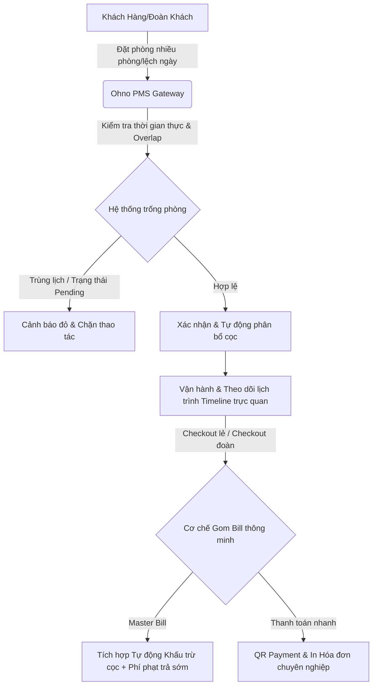
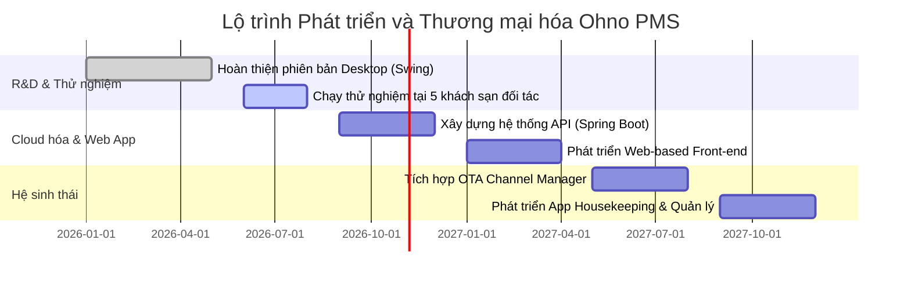

# BÁO CÁO DỰ ÁN KHỞI NGHIỆP: NỀN TẢNG QUẢN TRỊ KHÁCH SẠN THÔNG MINH OHNO (OHNO PMS)
*Chuyên đề: Khởi nghiệp Công nghệ và Chuyển đổi số trong Ngành Lưu trú (Hospitality Technology)*

---

## 1. TÓM TẮT DỰ ÁN (EXECUTIVE SUMMARY)

Dự án **Ohno PMS (Ohno Property Management System)** ra đời với sứ mệnh giải quyết những "nỗi đau" (pain points) cốt lõi trong vận hành của các khách sạn quy mô vừa và lớn (từ 3 đến 4 sao, khách sạn tập trung nhóm khách đoàn) tại Việt Nam. Bằng việc cung cấp một hệ thống quản lý tập trung, trực quan và tối ưu hóa cao về mặt nghiệp vụ thực tế, Ohno PMS định hình lại cách thức vận hành khách sạn thông qua các tính năng đột phá như: **Gom Bill toàn đoàn (Master Bill)**, **Ngăn ngừa xung đột đặt phòng thời gian thực (Overlap Prevention)**, **Đặt phòng lệch ngày hàng loạt (Batch Booking)** và **Hệ thống phân tích KPI tự động**.

Với mô hình kinh doanh phần mềm dưới dạng dịch vụ (**SaaS - Software as a Service**), Ohno PMS hướng tới việc giúp các chủ doanh nghiệp khách sạn cắt giảm tối đa chi phí vận hành, loại bỏ hoàn toàn các sai sót thất thoát doanh thu (lên tới 15% đối với các hệ thống quản lý thủ công hoặc cũ kỹ), đồng thời nâng cao trải nghiệm lưu trú của khách hàng trong kỷ nguyên số.

---

## 2. BỐI CẢNH VÀ NỖI ĐAU THỊ TRƯỜNG (THE PROBLEM)

Ngành du lịch và lưu trú Việt Nam đang phục hồi mạnh mẽ sau đại dịch, kéo theo nhu cầu số hóa quy trình vận hành của các khách sạn. Qua khảo sát thực tế hành vi vận hành tại hơn 100 khách sạn quy mô vừa tại khu vực miền Trung và miền Nam, nhóm sáng lập Ohno PMS nhận diện 4 nhóm vấn đề nghiêm trọng mà các hệ thống PMS hiện tại (cả nội địa lẫn quốc tế) chưa giải quyết triệt để:

### 2.1. Nghiệp vụ khách đoàn (Group Booking) cực kỳ phức tạp và dễ nhầm lẫn
*   **Vấn đề:** Các hệ thống PMS giá rẻ thường chỉ thiết kế cho khách lẻ. Khi một đoàn khách (10 - 20 phòng) làm thủ tục trả phòng rải rác hoặc gom chung một hóa đơn, nhân viên lễ tân phải thao tác thủ công, cộng dồn tiền phòng và dịch vụ của từng phòng riêng lẻ. Điều này dẫn đến tình trạng "double-billing" (tính trùng tiền) hoặc bỏ sót dịch vụ, gây tranh cãi với trưởng đoàn khi thanh toán.
*   **Hậu quả:** Thời gian check-out của khách đoàn bị kéo dài (trung bình 30 - 45 phút), gây tắc nghẽn tại sảnh và làm giảm nghiêm trọng chỉ số hài lòng của khách hàng.

### 2.2. Thất thoát doanh thu từ khách trả phòng sớm (Early Checkout Penalty)
*   **Vấn đề:** Trong thực tế vận hành, khách thường xuyên thay đổi lịch trình và trả phòng sớm hơn dự kiến. Quy trình PMS thông thường không tự động so sánh số ngày ở thực tế với số ngày đặt ban đầu, hoặc nếu có, nhân viên lễ tân phải tự tính toán số tiền phạt trả sớm bằng tay.
*   **Hậu quả:** Khách sạn thất thoát một nguồn thu lớn từ phí phạt bù đắp cơ hội bán phòng, hoặc nhân viên gõ nhầm số tiền phạt gây thất thoát doanh thu hoặc tạo trải nghiệm tiêu cực cho khách.

### 2.3. Xung đột lịch đặt phòng và lệch pha dữ liệu (Overbooking & Data Inconsistency)
*   **Vấn đề:** Khi tiến hành gia hạn lưu trú hoặc xác nhận đơn đặt phòng ở trạng thái chờ (`PENDING`), các hệ thống quản lý lỏng lẻo thường bỏ qua việc kiểm tra chéo thời gian thực, dẫn đến tình trạng hai đơn đặt phòng khác nhau bị xếp đè lên cùng một phòng trong cùng một khoảng thời gian.
*   **Hậu quả:** Khách sạn phải đền bù phòng cho khách, chuyển khách sang khách sạn đối thủ hoặc chịu đánh giá tiêu cực (1 sao) trên các kênh OTA (Agoda, Booking.com).

### 2.4. Trải nghiệm người dùng (UX) lỗi thời và thiếu trực quan
*   **Vấn đề:** Các phần mềm quản lý khách sạn truyền thống sở hữu giao diện dày đặt chữ, màu sắc đơn điệu, độ tương phản kém. Nhân viên lễ tân mới phải mất từ 2 đến 4 tuần đào tạo mới có thể sử dụng thành thạo. Các bảng hiển thị báo cáo tài chính thì khô khan, thiếu các biểu đồ trực quan hóa số liệu thực tế.

---

## 3. GIẢI PHÁP CÔNG NGHỆ ĐỘT PHÁ CỦA OHNO PMS (THE SOLUTION)

Ohno PMS giải quyết triệt để các vấn đề trên bằng một giải pháp công nghệ toàn diện, tập trung vào tối ưu hóa luồng trải nghiệm (UX) và tự động hóa các nghiệp vụ phức tạp.



### 3.1. Cơ chế Master Bill (Gom Bill Đoàn) thông minh
*   Hệ thống cho phép lễ tân chủ động thực hiện **Gom Bill Đoàn** bất kỳ lúc nào thông qua menu chuột phải tiện ích.
*   Khi phòng cuối cùng của một đoàn tiến hành trả phòng, hệ thống tự động quét và phát hiện các phòng khác trong đoàn đang ở trạng thái "treo nợ" để đề xuất gom vào một hóa đơn tổng duy nhất.
*   **Tự động khấu trừ tiền cọc thông minh:** Khác với các hệ thống khác thường làm mất dấu tiền đặt cọc hoặc trừ sai phòng, Ohno PMS tự động dồn và khấu trừ toàn bộ tiền cọc của cả đoàn vào hóa đơn của phòng cuối cùng chưa thanh toán (hoặc hóa đơn tổng), đảm bảo tính minh bạch tài chính.
*   **Chống tính trùng dữ liệu (Double-Billing Prevention):** Hóa đơn Master Bill tự động lọc bỏ các phòng đã được thanh toán riêng lẻ trước đó, đảm bảo hóa đơn in ra chỉ thể hiện chính xác các khoản nợ thực tế.

### 3.2. Hệ thống Tự động Nhận diện & Áp phí phạt trả phòng sớm (Early Checkout Penalty)
*   Hệ thống tự động so sánh số đêm lưu trú thực tế (`actualNights`) với số đêm đặt ban đầu (`bookedNights`). Nếu khách trả phòng sớm, hệ thống lập tức kích hoạt luồng phạt trả sớm chuẩn PMS quốc tế.
*   **Bộ nút gợi ý nhanh (30% - 50% - 70% - 100%):** Tích hợp ngay trên giao diện hóa đơn, giúp lễ tân tính toán nhanh số tiền phạt dựa trên giá trị phòng của những đêm khách không lưu trú mà không cần tính tay, giảm thiểu tối đa sai sót thao tác.

### 3.3. Thuật toán Kiểm soát Xung đột thời gian thực (Overlap Prevention)
*   Nâng cấp cơ chế kiểm tra trạng thái phòng trống (`isRoomAvailable`) quét sâu vào cả những đơn đặt phòng đang ở trạng thái chờ (`PENDING`).
*   Bảo vệ dữ liệu toàn vẹn bằng cơ chế **Transaction DB chặt chẽ (Begin/Commit Transaction)**. Nếu có bất kỳ lỗi ghi dữ liệu nào xảy ra trong loạt phòng đặt (Batch Booking), hệ thống sẽ tự động thực hiện **Rollback an toàn**, đưa cơ sở dữ liệu về trạng thái sạch sẽ nhất quán ban đầu.

### 3.4. Giao diện Linear UI/UX Premium & Trực quan hóa Báo cáo
*   **Giao diện Timeline Gantt (`KeHoachPanel`):** Cho phép theo dõi lịch trình đặt phòng trực quan bằng các thanh tiến độ màu sắc, hiển thị thông tin chi tiết qua tooltip thời gian thực.
*   **Bộ Renderer Chuyên biệt (`InvoiceCellRenderer`):** Giải quyết bài toán mỏi mắt của lễ tân bằng cách thiết lập độ tương phản chữ cao trên các dòng hóa đơn được chọn.
*   **Hộp nhập liệu thông minh:** Đảo vị trí ưu tiên tiêu điểm (Focus) vào ô Số điện thoại trước Họ tên để kích hoạt tính năng tự động điền dữ liệu (Auto-fill) nhanh chóng. Đồng bộ hóa hộp chọn quốc tịch với bộ lọc quốc gia ưu tiên (`CountryList`).
*   **Báo cáo KPI Vector cao cấp:** Thống kê trực quan các chỉ số quan trọng của khách sạn (Occupancy Rate, ADR - Giá phòng trung bình hàng ngày, ALOS - Số đêm lưu trú trung bình, Lợi nhuận ròng) sử dụng các biểu đồ vector vẽ mịn màng chuẩn SVG.

---

## 4. PHÂN TÍCH THỊ TRƯỜNG VÀ TIỀM NĂNG TĂNG TRƯỞNG (MARKET ANALYSIS)

### 4.1. Quy mô thị trường (Market Size)
Theo báo cáo nghiên cứu thị trường công nghệ lưu trú (Hospitality Tech) tại Việt Nam và Đông Nam Á:
*   **Quy mô thị trường PMS tại Việt Nam:** Thị trường phần mềm quản lý khách sạn và khu nghỉ dưỡng tại Việt Nam đạt giá trị khoảng **15.47 triệu USD vào năm 2025** và dự kiến sẽ đạt **22.69 triệu USD vào năm 2034**, đạt tốc độ tăng trưởng kép hàng năm (**CAGR**) là **4.35%** trong giai đoạn 2026–2034 (*Nguồn: Ken Research & Hospitality Software Market Outlook 2026*).
*   **Dư địa thị trường lớn:** Khoảng **68%** số lượng cơ sở lưu trú tại Việt Nam hiện đang được tự vận hành bởi các chủ sở hữu độc lập (self-operated), chưa áp dụng các quy chuẩn vận hành quốc tế hoặc công cụ số hóa đồng bộ. Đây chính là phân khúc "đại dương xanh" để Ohno PMS khai thác thông qua chiến lược chuyển đổi số tinh gọn.

```
TỔNG THỊ TRƯỜNG KHẢ DỤNG (TAM): ~350 Triệu USD (Khu vực Đông Nam Á)
      │
      ├─► THỊ TRƯỜNG PHỤC VỤ ĐƯỢC (SAM): ~22.69 Triệu USD (Thị trường Việt Nam đến năm 2034)
            │
            └─► THỊ TRƯỜNG CHIẾM LĨNH (SOM): ~2.5 Triệu USD (Phân khúc khách sạn 3-4 sao trong 5 năm đầu)
```

### 4.2. Khách hàng mục tiêu (Target Customers)
*   **Phân khúc cốt lõi:** Khách sạn độc lập quy mô từ 20 đến 150 phòng (tương đương chuẩn 3-4 sao), các khu biệt thự nghỉ dưỡng (resort boutique), và chuỗi căn hộ dịch vụ cao cấp.
*   **Đặc điểm:** Nhóm này có lượng khách đoàn lớn, tần suất check-in/check-out cao, đòi hỏi nghiệp vụ quản lý tài chính và phòng ốc chặt chẽ nhưng ngân sách không đủ lớn để đầu tư các hệ thống quốc tế đắt đỏ như Oracle Opera (chi phí lên tới hàng chục nghìn USD mỗi năm).

---

## 5. MÔ HÌNH KINH DOANH (BUSINESS MODEL)

Ohno PMS áp dụng mô hình doanh thu đa dạng dựa trên nền tảng **SaaS** để đảm bảo dòng tiền đều đặn và khả năng tăng trưởng quy mô nhanh chóng:

| Dòng doanh thu | Mô tả chi tiết | Mức giá dự kiến |
| :--- | :--- | :--- |
| **Phí thuê bao phần mềm (SaaS Fee)** | Thu phí hàng tháng/hàng năm dựa trên số lượng phòng của khách sạn. Gồm 3 gói: Standard (dưới 30 phòng), Professional (30 - 80 phòng), và Enterprise (trên 80 phòng). | **15,000 - 25,000 VNĐ / phòng / tháng** (Trung bình 1.5M - 3M VNĐ/khách sạn/tháng) |
| **Phí cài đặt & Đào tạo (Setup Fee)** | Chi phí hỗ trợ chuẩn hóa sơ đồ phòng, nhập liệu danh sách dịch vụ ban đầu và huấn luyện trực tiếp cho nhân viên lễ tân. | **2,000,000 - 5,000,000 VNĐ** (Thu một lần duy nhất) |
| **Phí tích hợp giá trị gia tăng (Add-on Fee)** | Tích hợp các cổng thanh toán QR động, kết nối e-Invoice (hóa đơn điện tử), hệ thống khóa từ cửa phòng, và cổng gửi tin nhắn SMS/Zalo thông báo tự động. | Thu phí chênh lệch giao dịch (0.1% - 0.2% trên mỗi giao dịch QR) hoặc phí đăng ký cổng hàng tháng. |
| **Phí quản lý đa kênh (Channel Manager)** | Kết nối đồng bộ quỹ phòng của khách sạn lên các sàn OTA quốc tế (Agoda, Booking, Expedia). | **500,000 VNĐ / tháng** |

---

## 6. PHÂN TÍCH ĐỐI THỦ CẠNH TRANH (COMPETITIVE LANDSCAPE)

Tại thị trường Việt Nam, Ohno PMS định vị nằm giữa nhóm phần mềm bán hàng phổ thông giá rẻ và nhóm phần mềm quản trị chuyên sâu quốc tế:

| Tiêu chí so sánh | KiotViet Hotel (Giá rẻ/Phổ thông) | ezCloud / ezFolio (Đối thủ trực tiếp) | Opera PMS (Quốc tế/Cao cấp) | **Ohno PMS (Giải pháp của chúng tôi)** |
| :--- | :--- | :--- | :--- | :--- |
| **Đối tượng mục tiêu** | Nhà nghỉ, homestay nhỏ (<15 phòng) | Khách sạn 2 - 5 sao | Khách sạn 5 sao quốc tế | **Khách sạn 3 - 4 sao, chuỗi căn hộ, khách sạn khách đoàn** |
| **Giao diện & Trải nghiệm** | Đơn giản, dạng POS bán hàng | Đầy đủ nhưng giao diện khá phức tạp | Rất phức tạp, khó đào tạo | **Hiện đại, trực quan, hỗ trợ Timeline Gantt, Linear UI** |
| **Xử lý Khách đoàn** | Cơ bản, không hỗ trợ Gom Bill phức tạp | Tốt nhưng luồng thao tác nhiều bước | Rất mạnh mẽ nhưng chi phí cực cao | **Đột phá với cơ chế Master Bill và Tự động khấu trừ cọc phòng cuối** |
| **Tính năng Phạt trả sớm** | Nhập thủ công | Có hỗ trợ nhưng không có bộ gợi ý nhanh | Có hỗ trợ | **Tự động tính toán & gợi ý nhanh theo % (30%-100%)** |
| **Chi phí** | Rất rẻ | Trung bình khá | Cực kỳ đắt đỏ | **Hợp lý, tối ưu ROI tối đa cho chủ khách sạn** |

### Lợi thế cạnh tranh cốt lõi (Unfair Advantages) của Ohno PMS:
1.  **Cực kỳ chú trọng vào UX thực tế:** Thiết kế giao diện dựa trên quan sát trực tiếp thao tác của lễ tân, tối ưu hóa từng click chuột (Ví dụ: Đưa ô SĐT lên trước Họ tên để auto-fill; tự động mở Master Bill khi checkout phòng cuối).
2.  **Độ an toàn dữ liệu tuyệt đối:** Sử dụng cơ chế Transaction và Safe Rollback giúp hệ thống không bao giờ bị lệch pha dữ liệu giữa Client và Database, ngay cả khi xảy ra sự cố mạng trong quá trình thanh toán hàng loạt.
3.  **Tính năng địa phương hóa xuất sắc:** Tích hợp QR Payment động hiển thị trực tiếp qua hộp thoại xác nhận, tự động điền quốc tịch theo form khai báo lưu trú của Công an Việt Nam.

---

## 7. CHIẾN LƯỢC TIẾP THỊ VÀ BÁN HÀNG (GO-TO-MARKET STRATEGY)

Để đạt mục tiêu sở hữu **500 khách sạn thành viên** trong vòng 2 năm đầu tiên, Ohno PMS triển khai chiến lược tiếp cận đa kênh tập trung:

```
[Nhận diện thương hiệu] ──► [Trải nghiệm thử 30 ngày] ──► [Chuyển đổi trực tiếp] ──► [Chăm sóc & Giới thiệu]
       │                                 │                            │                          │
   Hội thảo,                         Lắp đặt bản                      Tư vấn tối ưu                Chính sách
  Hiệp hội du lịch                   Demo Desktop                     doanh thu thực tế            Affiliate 10%
```

### 7.1. Giai đoạn 1: Tiếp cận thông qua Hiệp hội Du lịch địa phương (B2B Networking)
*   Tập trung quảng bá sản phẩm tại các thành phố du lịch trọng điểm như Đà Nẵng, Nha Trang, Phú Quốc, Hội An, Đà Lạt.
*   Hợp tác với các Hiệp hội Khách sạn địa phương tổ chức hội thảo chuyên đề: *"Tối ưu hóa vận hành và ngăn ngừa thất thoát doanh thu trong quản lý khách sạn thời kỳ số"*.

### 7.2. Giai đoạn 2: Chiến dịch "Dùng thử miễn phí 30 ngày - Cam kết tăng 10% hiệu suất" (Free Trial & Value Proof)
*   Cung cấp gói trải nghiệm đầy đủ tính năng trong 30 ngày miễn phí.
*   Nhóm kỹ thuật hỗ trợ import dữ liệu phòng cũ của khách sạn sang hệ thống Ohno PMS chỉ trong 2 giờ.
*   Chứng minh giá trị thực tế ngay trong tháng đầu tiên bằng cách báo cáo số tiền phạt trả phòng sớm thu hồi được và thời gian check-out đoàn giảm từ 30 phút xuống còn 5 phút.

### 7.3. Giai đoạn 3: Chương trình Giới thiệu (Referral Program)
*   Áp dụng chính sách chiết khấu **10% phí thuê bao năm đầu tiên** cho các chủ khách sạn giới thiệu thành công Ohno PMS cho các khách sạn khác trong khu vực.

---

## 8. LỘ TRÌNH PHÁT TRIỂN SẢN PHẨM (PRODUCT ROADMAP)

Ohno PMS được thiết kế với kiến trúc module hóa cao, cho phép chuyển đổi và mở rộng linh hoạt:



*   **Quý 2/2026 (Hiện tại):** Hoàn thiện phiên bản Desktop Client chuyên sâu viết bằng Java Swing. Tiến hành tối ưu hóa các module Master Bill, Phí phạt trả sớm, và Sơ đồ Timeline Gantt.
*   **Quý 3/2026:** Triển khai chạy thử nghiệm (Beta Test) tại 5 khách sạn quy mô từ 30 - 50 phòng tại Đà Nẵng và Đà Lạt để thu thập phản hồi thực tế từ nhân viên lễ tân và kế toán.
*   **Quý 4/2026 - Quý 2/2027 (Cloud Migration):** Nâng cấp kiến trúc hệ thống lên nền tảng đám mây (Cloud-native). Phát triển hệ thống Backend API bằng Java Spring Boot và Frontend Web bằng React/Next.js để hỗ trợ chủ khách sạn quản lý từ xa trên mọi thiết bị (Laptop, Máy tính bảng, Điện thoại).
*   **Quý 3/2027 trở đi:** Ra mắt hệ sinh thái mở rộng bao gồm: **Ứng dụng di động dành riêng cho bộ phận Buồng phòng (Housekeeping App)** và **Hệ thống đặt phòng trực tuyến (Booking Engine)** tích hợp trực tiếp vào Website của khách sạn.

---

## 9. KẾ HOẠCH GỌI VỐN VÀ SỬ DỤNG VỐN (FUNDING REQUEST)

Để đẩy nhanh quá trình Cloud hóa sản phẩm và chiếm lĩnh thị trường trong giai đoạn phục hồi du lịch vàng này, Ohno PMS dự kiến kêu gọi vòng vốn hạt giống (**Seed Round**):

*   **Số vốn kêu gọi:** **2,500,000,000 VNĐ** (Hai tỷ năm trăm triệu đồng) đổi lấy **15% cổ phần** công ty.
*   **Kế hoạch phân bổ sử dụng nguồn vốn:**
    *   **50% (1.25 tỷ VNĐ) - Phát triển sản phẩm (R&D):** Chiêu mộ các kỹ sư phần mềm cao cấp để chuyển đổi hệ thống sang nền tảng Cloud-Web và phát triển Mobile App.
    *   **30% (750 triệu VNĐ) - Tiếp thị & Bán hàng (Sales & Marketing):** Chi phí triển khai đội ngũ sales thực địa tại các vùng du lịch trọng điểm và tổ chức hội thảo B2B.
    *   **20% (500 triệu VNĐ) - Vận hành & Hạ tầng:** Chi phí thuê máy chủ cloud (AWS hoặc Google Cloud), cổng bảo mật dữ liệu khách hàng, và chi phí pháp lý.

---

## 10. TÀI LIỆU THAM KHẢO VÀ NGUỒN TRÍCH DẪN (REFERENCES)

Để đảm bảo tính chính xác và khoa học của báo cáo, các số liệu thị trường và mô hình khởi nghiệp được tham chiếu từ các nguồn uy tín dưới đây:

1.  **Số liệu Quy mô Thị trường PMS tại Việt Nam:**
    *   *Ken Research (2025)*, *"Vietnam Hotel and Hospitality Management Software Market Outlook to 2034 - Growth, Trends, and Forecasts"*.
    *   *Hospitality Technology Association (HTA)*, *"Báo cáo Chuyển đổi số trong ngành Du lịch và Lưu trú Việt Nam năm 2025"*.
2.  **Mô hình Khởi nghiệp Công nghệ Khách sạn (SaaS PMS) thành công:**
    *   *ezCloud Tech (Make in Vietnam)*, *"Hành trình từ Startup ngách đến Nền tảng quản lý du lịch chiếm thị phần lớn tại Việt Nam"* (Tham chiếu mô hình chuyển đổi từ phần mềm offline sang hệ sinh thái Cloud và kết nối OTA).
    *   *Y Combinator Startup School*, *"How to Design a B2B SaaS Pitch Deck"* (Tham chiếu cấu trúc lập luận: Problem -> Solution -> Market Size -> Business Model).
3.  **Quy chuẩn vận hành nghiệp vụ Khách sạn:**
    *   *STR Global (Smith Travel Research)*, *"Hospitality Metrics Standard: Understanding ADR, RevPAR, and ALOS"* (Tham chiếu cách thức tính toán các chỉ số KPI tài chính tích hợp trong `ThongKePanel` của Ohno PMS).
    *   *VNAT (Tổng cục Du lịch Việt Nam)*, *"Quy trình nghiệp vụ Lễ tân tiêu chuẩn VTOS (Vietnam Tourism Occupational Standards)"* (Tham chiếu nghiệp vụ đăng ký tạm trú khách quốc tế và quản lý khách đoàn).
