<style>
  bảng dữ liệu {
    width: 100%;
    border-collapse: collapse;
    margin: 20px 0;
    font-family: 'Segoe UI', Tahoma, Geneva, Verdana, sans-serif;
    font-size: 13px;
    box-shadow: 0 4px 6px rgba(0,0,0,0.05);
    border-radius: 6px;
    overflow: hidden;
    border: 1px solid #c0c0c0;
  }
  th, td {
    padding: 10px 12px;
    border: 1px solid #c0c0c0;
    text-align: left;
    vertical-align: top;
  }
  th {
    background-color: #f2f2f2;
    color: #333333;
    font-weight: bold;
    text-transform: none;
    font-size: 13px;
  }
  td[colspan="2"] {
    background-color: #f2f2f2;
    color: #000000;
    font-weight: bold;
    text-align: center;
    font-size: 13px;
    padding: 8px;
  }
  td.header-split {
    background-color: #ffffff;
    color: #000000;
    font-weight: bold;
    text-align: left;
    border-bottom: 2px solid #000000;
  }
</style>

# TÀI LIỆU ĐẶC TẢ USE CASE VÀ SƠ ĐỒ UML HỆ THỐNG

## DỰ ÁN: HỆ THỐNG QUẢN LÝ KHÁCH SẠN HOTEL OHNO

Tài liệu này đặc tả chi tiết toàn bộ các Use Case của hệ thống quản lý khách sạn **Hotel Ohno** dựa trên cấu trúc lập trình thực tế và logic xử lý của mã nguồn Java.

---

## 1. KIẾN TRÚC ÁNH XẠ 3 LỚP (BOUNDARY - CONTROL - ENTITY)

Hệ thống được phát triển theo mô hình 3 lớp chuẩn nghiệp vụ hướng đối tượng:

1. **Lớp Boundary (Giao diện người dùng - UI)**:
   - Các màn hình chính và phụ: `Giao diện đăng nhập`, `Giao diện chính`.
   - Các Panel nghiệp vụ: `TongQuanPanel`, `KeHoachPanel`, `giao diện đặt phòng`, `giao diện thuê phòng`, `giao diện hóa đơn`, `giao diện khách hàng`, `giao diện nhân viên`, `giao diện quản trị danh mục` (chứa các sub-panel `PhongPanel`, `LoaiPhongPanel`, `DichVuPanel`, `giao diện nhật ký`, `ShiftHistoryPanel`, `BangGiaPanel`), `giao diện thống kê`.
   - Các Hộp thoại nhập liệu hoặc hiển thị chi tiết (JDialog): `hộp thoại nhân viên`, `hộp thoại khách hàng`, `hộp thoại phòng`, `Loaihộp thoại phòng`, `hộp thoại dịch vụ`, `hộp thoại đặt phòng`, `Huyhộp thoại đặt phòng`, `hộp thoại nhận phòng`, `hộp thoại thanh toán`, `Xemhộp thoại thanh toán`, `hộp thoại nhật ký`, `hộp thoại đổi người đại diện`, `hộp thoại gia hạn phòng`, `hộp thoại đổi phòng`, `hộp thoại gọi dịch vụ`, `hộp thoại thanh toán khách đoàn`, `hộp thoại bàn giao ca`, `hộp thoại mệnh giá bàn giao`, `hộp thoại chi phí phát sinh`, `hộp thoại chi tiết ca làm việc`.

2. **Lớp Control (Xử lý logic & Truy xuất dữ liệu)**:
   - Các Service trung gian xử lý nghiệp vụ: `AuthService`, `NhanVienService`, `KhachHangService`, `PhongService`, `DichVuService`, `DatPhongService`, `ThuePhongService`, `ThongKeService`, `LogService`.
   - Các DAO (Data Access Object) tương tác trực tiếp với cơ sở dữ liệu SQL Server: `TaiKhoanDAO`, `NhanVienDAO`, `KhachHangDAO`, `PhongDAO`, `LoaiPhongDAO`, `DichVuDAO`, `DatPhongDAO`, `ChiTietDatPhongDAO`, `HoaDonDAO`, `ChiTietHoaDonDAO`, `LogDAO`, `GiaoCaDAO`, `BangGiaDAO`, `SuDungDichVuDAO`.

3. **Lớp Entity (Thực thể dữ liệu)**:
   - Ánh xạ trực tiếp từ các bảng trong cơ sở dữ liệu: `TaiKhoan`, `NhanVien`, `KhachHang`, `Phong`, `LoaiPhong`, `DichVu`, `DatPhong`, `ChiTietDatPhong`, `HoaDon`, `ChiTietHoaDon`, `NhatKyHeThong`, `GiaoCa`, `SuDungDichVu`.

### 1.1 SƠ ĐỒ LỚP CHI TIẾT (UML CLASS DIAGRAM)

Dưới đây là sơ đồ lớp chi tiết (UML Class Diagram) của các thực thể dữ liệu (Entity) trong hệ thống khách sạn Hotel Ohno, mô tả đầy đủ các thuộc tính, kiểu dữ liệu, các phương thức nghiệp vụ và các mối quan hệ (association, composition, aggregation, inheritance) cùng chỉ số multiplicity tương thích 100% với mã nguồn thực tế.

Sơ đồ được thiết kế đặc biệt với **khoảng cách siêu tối giản (nodesep 10, ranksep 15) và kích thước chữ lớn (DefaultFontSize 14, Attribute/MethodFontSize 12)**. Các lớp được phân bổ tối ưu hóa theo bố cục khối vuông 1:1 tự nhiên (**1578x1578 px**) bám sát các luồng liên kết nghiệp vụ. Bố cục siêu nén này triệt tiêu hoàn toàn các khoảng trắng vô ích và các đường nối kéo dài. Khi dán vào Microsoft Word, **toàn bộ sơ đồ lớp sẽ tự động mở rộng và chiếm trọn vẹn toàn bộ trang giấy dọc A4** với phông chữ **Segoe UI to lớn, sắc nét, rõ ràng** giúp người xem có thể đọc trực tiếp các thuộc tính nghiệp vụ mà không gặp bất kỳ khó khăn nào.

<details>
<summary><b>Xem mã nguồn PlantUML (nhấp để mở rộng)</b></summary>

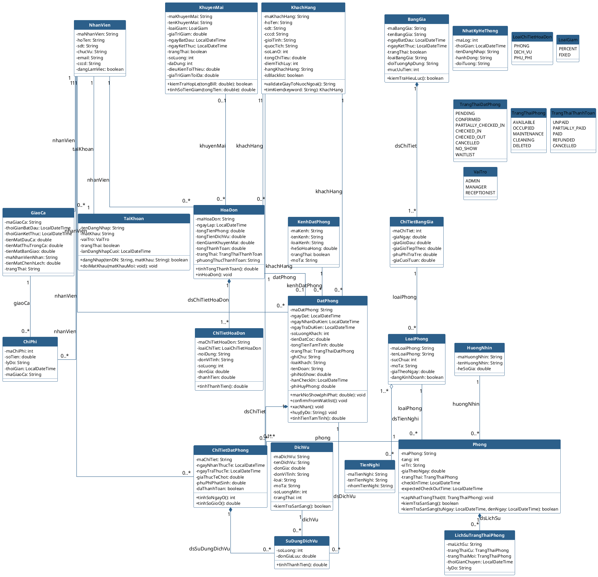
</details>

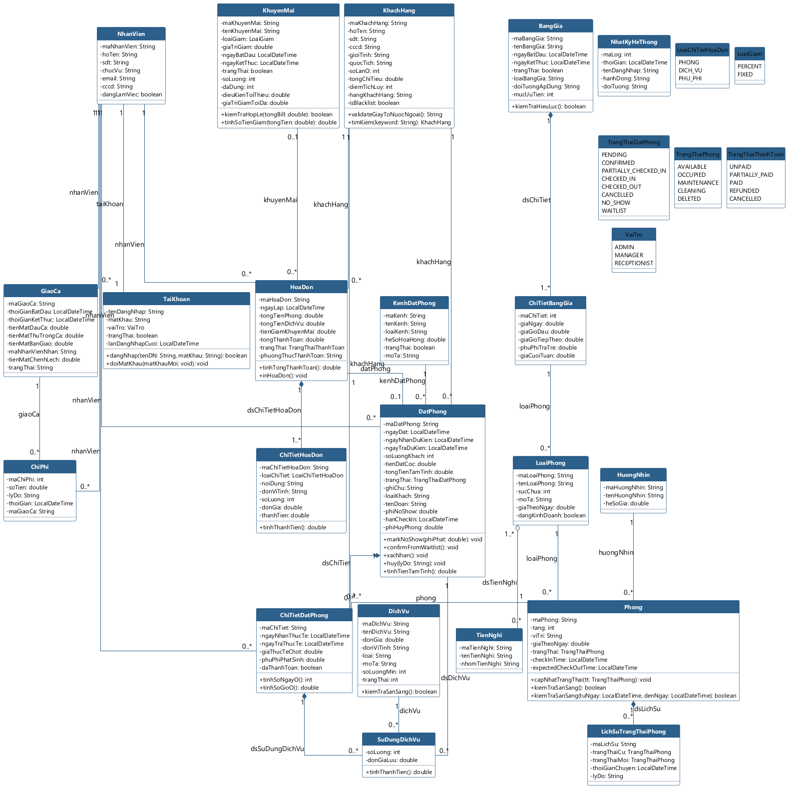

## 2. TỔNG QUAN HỆ THỐNG USE CASE

Hệ thống bao gồm các nhóm nghiệp vụ chính: Đăng nhập/Phân quyền, Quản lý Đặt phòng, Quản lý Lưu trú & Thuê phòng, Quản lý Khách hàng, Thanh toán & Trả phòng, Quản trị Danh mục (Phòng, Giá, Nhân viên, Dịch vụ, Khuyến mãi), Báo cáo thống kê và Nhật ký hệ thống.

### 2.1 SƠ ĐỒ USE CASE TỔNG QUAN

Sơ đồ Use Case tổng quan của hệ thống Quản lý Khách sạn Hotel Ohno biểu diễn toàn bộ các chức năng và các tác nhân tương tác trực tiếp với hệ thống. Sơ đồ được sắp xếp khoa học, ngăn nắp theo cấu trúc 2 cột dải bên cạnh Use Case Đăng nhập trung tâm để người đọc dễ dàng theo dõi kiến trúc phân quyền nghiệp vụ:

<details>
<summary><b>Xem mã nguồn PlantUML (nhấp để mở rộng)</b></summary>

```plantuml
@startuml
skinparam DefaultFontName "Segoe UI"
skinparam DefaultFontSize 10
skinparam linetype polyline
skinparam nodesep 25
skinparam ranksep 35

skinparam usecase {
  BackgroundColor #EAF3FB
  BorderColor #5B9BD5
  BorderThickness 1
  FontColor #000000
  FontSize 10
}

skinparam actor {
  BackgroundColor White
  BorderColor #2C5F8A
  FontColor #000000
  FontSize 10
}

skinparam rectangle {
  BackgroundColor #F8FBFF
  BorderColor #2C5F8A
  BorderThickness 1.5
  FontColor #2C5F8A
  FontStyle bold
}

skinparam ArrowColor #2C5F8A
skinparam ArrowThickness 1
skinparam ArrowFontSize 9
skinparam ArrowFontColor #2C5F8A

left to right direction

' === ACTORS (Left) ===
actor "Lễ tân" as LeTan

' === SYSTEM BOUNDARY ===
rectangle "Hệ thống Quản lý Khách sạn Hotel Ohno" as SYS {

  ' --- CENTRAL USE CASE ---
  usecase "Đăng nhập" as UC_DN

  ' --- LEFT COLUMN USE CASES (Lễ Tân related) ---
  usecase "Đặt phòng trước" as UC_Dat
  usecase "Hủy đặt phòng" as UC_Huy
  usecase "Nhận phòng" as UC_NP
  usecase "Nhận phòng theo đặt trước" as UC_NP1
  usecase "Nhận phòng trực tiếp" as UC_NP2
  usecase "Tra cứu khách hàng" as UC_TCKH
  usecase "Trả phòng &
Thanh toán lẻ" as UC_TP
  usecase "Xuất hóa đơn PDF" as UC_PDF
  usecase "Gom bill đoàn" as UC_Gom
  usecase "Gọi dịch vụ phòng" as UC_DV
  usecase "Chuyển phòng" as UC_CP
  usecase "Gia hạn lưu trú" as UC_GH
  usecase "Thay đổi
người đại diện" as UC_DD
  usecase "Cập nhật trạng thái
dọn phòng" as UC_Don
  usecase "Thêm/Sửa/Vô hiệu
hóa khách hàng" as UC_KH
  usecase "Tra cứu hóa đơn" as UC_TCHD
  usecase "In lại hóa đơn" as UC_In
  usecase "Bàn giao ca" as UC_BGC
  usecase "Kiểm đếm tiền mặt" as UC_KD

  ' --- RIGHT COLUMN USE CASES (Quản lý & Admin related) ---
  usecase "Đăng xuất" as UC_DX
  usecase "Đổi mật khẩu" as UC_DMK
  usecase "Thêm/Sửa/Xóa phòng" as UC_Phong
  usecase "Quản lý loại phòng" as UC_LP
  usecase "Cập nhật bảng giá" as UC_BG
  usecase "Thêm/Sửa/Xóa
dịch vụ" as UC_DVQL
  usecase "Thêm/Sửa/Xóa
khuyến mãi" as UC_KM
  usecase "Xem thống kê
& báo cáo" as UC_TK
  usecase "Tra cứu nhật ký" as UC_NK
  usecase "Thêm/Sửa
nhân viên" as UC_NV
  usecase "Khóa/Mở
tài khoản" as UC_TK2

  ' --- VERTICAL ALIGNMENT ALONG 2 COLUMNS (In left to right direction, 'right' aligns vertically) ---
  ' Left Column Stack
  UC_Dat -[hidden]right-> UC_Huy
  UC_Huy -[hidden]right-> UC_NP
  UC_NP -[hidden]right-> UC_NP1
  UC_NP1 -[hidden]right-> UC_NP2
  UC_NP2 -[hidden]right-> UC_TCKH
  UC_TCKH -[hidden]right-> UC_TP
  UC_TP -[hidden]right-> UC_PDF
  UC_PDF -[hidden]right-> UC_Gom
  UC_Gom -[hidden]right-> UC_DV
  UC_DV -[hidden]right-> UC_CP
  UC_CP -[hidden]right-> UC_GH
  UC_GH -[hidden]right-> UC_DD
  UC_DD -[hidden]right-> UC_Don
  UC_Don -[hidden]right-> UC_KH
  UC_KH -[hidden]right-> UC_TCHD
  UC_TCHD -[hidden]right-> UC_In
  UC_In -[hidden]right-> UC_BGC
  UC_BGC -[hidden]right-> UC_KD

  ' Right Column Stack
  UC_DX -[hidden]right-> UC_DMK
  UC_DMK -[hidden]right-> UC_Phong
  UC_Phong -[hidden]right-> UC_LP
  UC_LP -[hidden]right-> UC_BG
  UC_BG -[hidden]right-> UC_DVQL
  UC_DVQL -[hidden]right-> UC_KM
  UC_KM -[hidden]right-> UC_TK
  UC_TK -[hidden]right-> UC_NK
  UC_NK -[hidden]right-> UC_NV
  UC_NV -[hidden]right-> UC_TK2

  ' Position the columns relative to Đăng nhập (Center) (In left to right direction, 'down' aligns horizontally)
  UC_NP -[hidden]down-> UC_DN
  UC_DN -[hidden]down-> UC_Phong
}

' === ACTORS (Right) ===
actor "Quản lý" as QuanLy
actor "Admin" as Admin

' === ACTOR INHERITANCE ===
LeTan <|-- QuanLy
QuanLy <|-- Admin

' === CONNECTIONS: ACTORS TO USE CASES ===
' Left Actor (Lễ tân)
LeTan --> UC_DN
LeTan --> UC_Dat
LeTan --> UC_Huy
LeTan --> UC_NP
LeTan --> UC_TP
LeTan --> UC_Gom
LeTan --> UC_DV
LeTan --> UC_CP
LeTan --> UC_GH
LeTan --> UC_DD
LeTan --> UC_Don
LeTan --> UC_KH
LeTan --> UC_TCHD
LeTan --> UC_BGC

' Right Actor (Quản lý)
QuanLy --> UC_DN
QuanLy --> UC_Phong
QuanLy --> UC_LP
QuanLy --> UC_BG
QuanLy --> UC_DVQL
QuanLy --> UC_KM
QuanLy --> UC_TK
QuanLy --> UC_NK

' Right Actor (Admin)
Admin --> UC_DN
Admin --> UC_NV
Admin --> UC_TK2

' === USE CASE RELATIONSHIPS ===
UC_DX ..> UC_DN : <i><size:9><<extend>></size></i>
UC_DMK ..> UC_DN : <i><size:9><<extend>></size></i>
UC_NP1 ..> UC_NP : <i><size:9><<extend>></size></i>
UC_NP2 ..> UC_NP : <i><size:9><<extend>></size></i>
UC_NP ..> UC_TCKH : <i><size:9><<include>></size></i>
UC_TP ..> UC_PDF : <i><size:9><<include>></size></i>
UC_Gom ..> UC_TP : <i><size:9><<include>></size></i>
UC_In ..> UC_TCHD : <i><size:9><<extend>></size></i>
UC_BGC ..> UC_KD : <i><size:9><<include>></size></i>

@enduml
```
</details>

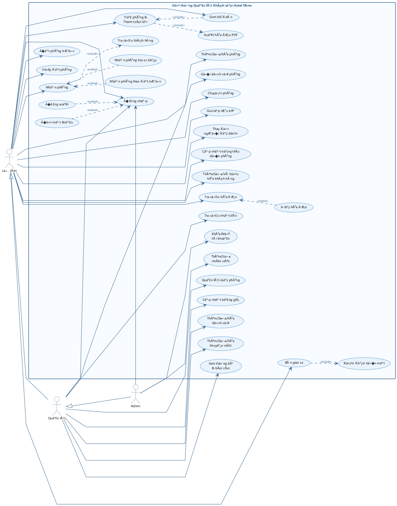

---

## 3. CHI TIẾT ĐẶC TẢ USE CASE VÀ BIỂU ĐỒ UML

### 3.1 Đăng nhập & Đăng xuất (UC_001.1 & UC_001.2):

#### 3.1.A Use Case: Đăng nhập (UC_001.1)

##### 3.1.A.1 Mô tả UC_001.1

<table border="1">
  <tr>
    <td width="30%"><b>Mục</b></td>
    <td width="70%"><b>Nội dung</b></td>
  </tr>
  <tr>
    <td><b>Tên Use case:</b></td>
    <td>Đăng nhập</td>
  </tr>
  <tr>
    <td><b>Mã Use case:</b></td>
    <td>UC_001.1</td>
  </tr>
  <tr>
    <td><b>Mô tả:</b></td>
    <td>Cho phép người dùng đăng nhập để sử dụng các tính năng của hệ thống theo đúng phân quyền vai trò.</td>
  </tr>
  <tr>
    <td><b>Tác nhân:</b></td>
    <td>Mọi nhân viên (Lễ tân, Quản lý, Admin)</td>
  </tr>
  <tr>
    <td><b>Điều kiện trước:</b></td>
    <td>Hệ thống đang chạy, người dùng chưa đăng nhập vào ứng dụng.</td>
  </tr>
  <tr>
    <td><b>Điều kiện sau:</b></td>
    <td>Người dùng đăng nhập thành công vào hệ thống và được chuyển tới màn hình chính (Giao diện chính).</td>
  </tr>
  <tr>
    <td colspan="2" align="center"><b>Luồng sự kiện chính (Basic flows)</b></td>
  </tr>
  <tr>
    <td class="header-split"><b>Người dùng</b></td>
    <td class="header-split"><b>Hệ thống</b></td>
  </tr>
  <tr>
    <td>1. Chọn ứng dụng và khởi động.</td>
    <td></td>
  </tr>
  <tr>
    <td></td>
    <td>2. Hệ thống hiển thị Giao diện đăng nhập.</td>
  </tr>
  <tr>
    <td>3. Nhập Tên đăng nhập và Mật khẩu, nhấn "Đăng nhập".</td>
    <td></td>
  </tr>
  <tr>
    <td></td>
    <td>4. Hệ thống kiểm tra ràng buộc ký tự trống và định dạng hợp lệ.</td>
  </tr>
  <tr>
    <td></td>
    <td>5. Hệ thống xác thực thông tin tài khoản trong cơ sở dữ liệu.</td>
  </tr>
  <tr>
    <td></td>
    <td>6. Hệ thống ghi nhật ký đăng nhập thành công vào cơ sở dữ liệu.</td>
  </tr>
  <tr>
    <td></td>
    <td>7. Hệ thống đóng Giao diện đăng nhập và hiển thị Giao diện chính theo phân quyền vai trò.</td>
  </tr>
  <tr>
    <td colspan="2" align="center"><b>Luồng sự kiện phụ (Alternative Flows)</b></td>
  </tr>
  <tr>
    <td></td>
    <td>4.1. Hệ thống báo đỏ viền ô nhập liệu trống hoặc chứa ký tự đặc biệt không được phép.</td>
  </tr>
  <tr>
    <td>4.2. Nhân viên sửa lại thông tin hợp lệ và thực hiện lại thao tác.</td>
    <td></td>
  </tr>
  <tr>
    <td></td>
    <td>5.1. Hệ thống xác thực thất bại, thông báo sai tên tài khoản hoặc mật khẩu.</td>
  </tr>
  <tr>
    <td></td>
    <td>5.2. Nếu nhập sai quá 5 lần liên tiếp, hệ thống khóa nút Đăng nhập trong 30 giây (ghi log vào file login_lockout.dat) và hiển thị đếm ngược thời gian.</td>
  </tr>
  <tr>
    <td></td>
    <td>5.3. Nếu tài khoản bị vô hiệu hóa bởi Admin, hiển thị thông báo tài khoản bị vô hiệu hóa.</td>
  </tr>
</table>

##### 3.1.A.2 Biểu đồ

###### Sơ đồ Activity - Đăng nhập

<details>
<summary><b>Xem mã nguồn PlantUML (nhấp để mở rộng)</b></summary>

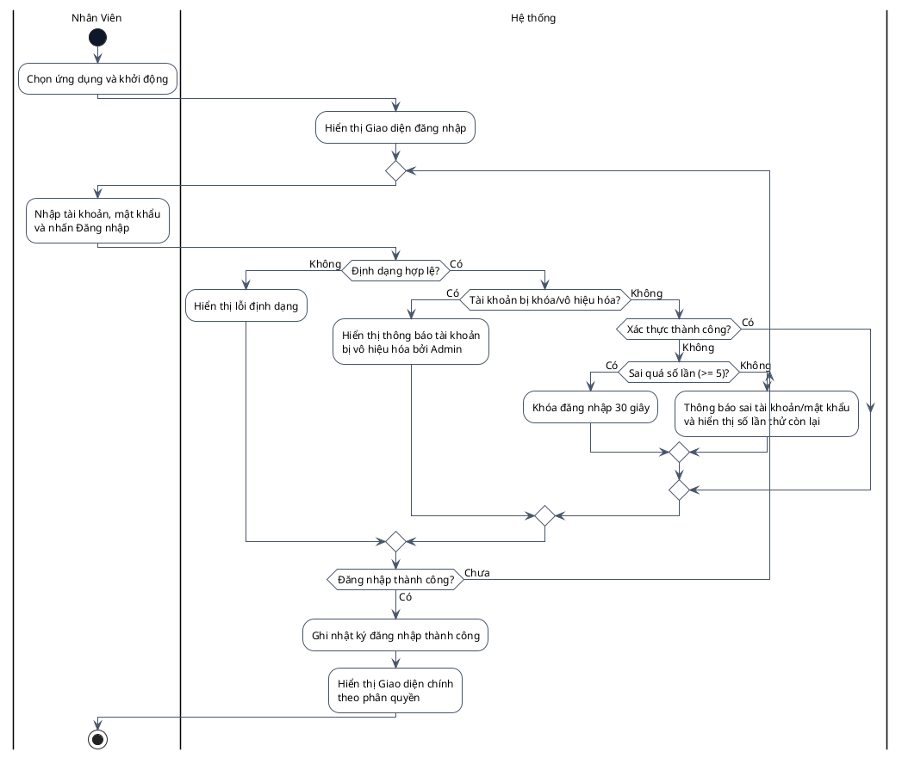

</details>

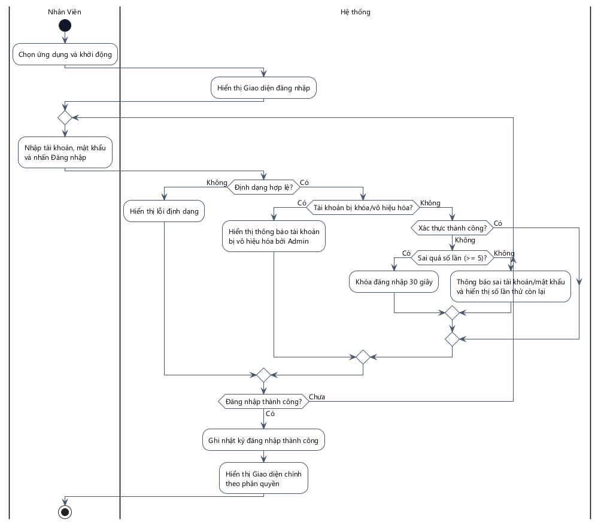

###### Sơ đồ Sequence - Đăng nhập

<details>
<summary><b>Xem mã nguồn Mermaid (nhấp để mở rộng)</b></summary>

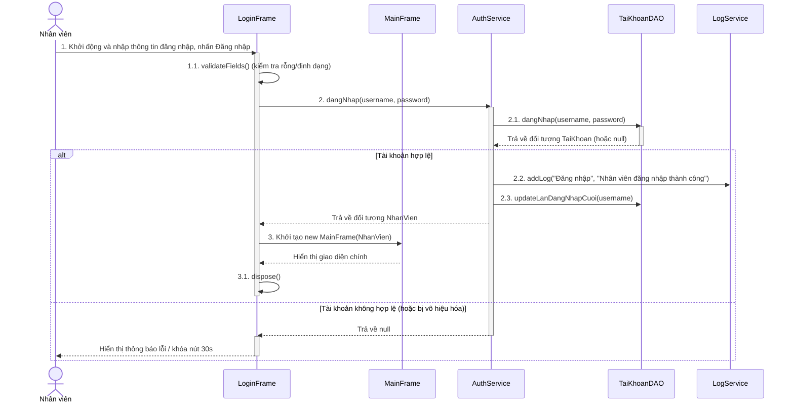

</details>

#### 3.1.B Use Case: Đăng xuất (UC_001.2)

##### 3.1.B.1 Mô tả UC_001.2

<table border="1">
  <tr>
    <td width="30%"><b>Mục</b></td>
    <td width="70%"><b>Nội dung</b></td>
  </tr>
  <tr>
    <td><b>Tên Use case:</b></td>
    <td>Đăng xuất</td>
  </tr>
  <tr>
    <td><b>Mã Use case:</b></td>
    <td>UC_001.2</td>
  </tr>
  <tr>
    <td><b>Mô tả:</b></td>
    <td>Cho phép người dùng thoát khỏi phiên làm việc hiện tại, xóa thông tin đăng nhập và quay về màn hình đăng nhập an toàn.</td>
  </tr>
  <tr>
    <td><b>Tác nhân:</b></td>
    <td>Mọi nhân viên (Lễ tân, Quản lý, Admin)</td>
  </tr>
  <tr>
    <td><b>Điều kiện trước:</b></td>
    <td>Người dùng đang đăng nhập và sử dụng Giao diện chính của hệ thống.</td>
  </tr>
  <tr>
    <td><b>Điều kiện sau:</b></td>
    <td>Hệ thống xóa thông tin phiên làm việc hiện tại, đóng Giao diện chính và hiển thị lại Giao diện đăng nhập.</td>
  </tr>
  <tr>
    <td colspan="2" align="center"><b>Luồng sự kiện chính (Basic flows)</b></td>
  </tr>
  <tr>
    <td class="header-split"><b>Người dùng</b></td>
    <td class="header-split"><b>Hệ thống</b></td>
  </tr>
  <tr>
    <td>1. Nhấn chọn nút "Đăng xuất" từ Menu trên giao diện chính.</td>
    <td></td>
  </tr>
  <tr>
    <td></td>
    <td>2. Hệ thống thực hiện đăng xuất và xóa phiên làm việc hiện tại của nhân viên.</td>
  </tr>
  <tr>
    <td></td>
    <td>3. Hệ thống ghi nhật ký đăng xuất vào cơ sở dữ liệu.</td>
  </tr>
  <tr>
    <td></td>
    <td>4. Hệ thống giải phóng Giao diện chính và hiển thị lại Giao diện đăng nhập.</td>
  </tr>
</table>

##### 3.1.B.2 Biểu đồ

###### Sơ đồ Activity - Đăng xuất

<details>
<summary><b>Xem mã nguồn PlantUML (nhấp để mở rộng)</b></summary>

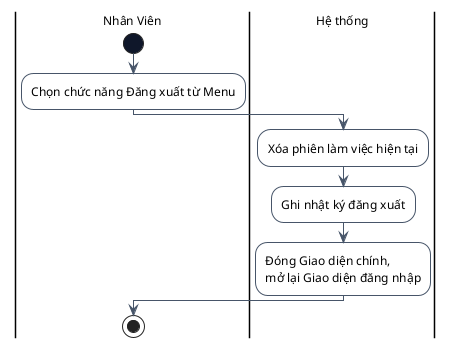

</details>

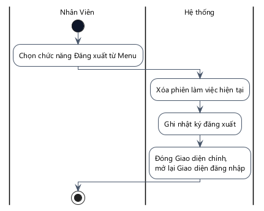

###### Sơ đồ Sequence - Đăng xuất

<details>
<summary><b>Xem mã nguồn Mermaid (nhấp để mở rộng)</b></summary>

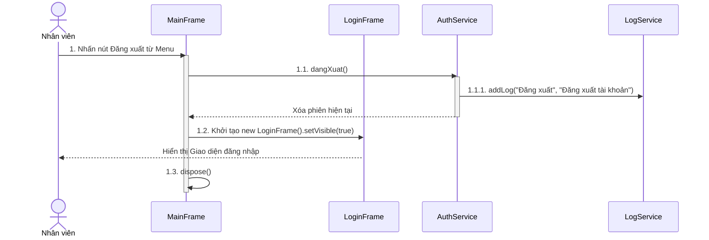

</details>

### 3.2 Tìm phòng trống và Đặt phòng:

#### 3.2.1 Mô tả UC_013.1

<table border="1">
  <tr>
    <td width="30%"><b>Mục</b></td>
    <td width="70%"><b>Nội dung</b></td>
  </tr>
  <tr>
    <td><b>Tên Use case:</b></td>
    <td>Tìm phòng trống & Đặt phòng</td>
  </tr>
  <tr>
    <td><b>Mã Use case:</b></td>
    <td>UC_013.1</td>
  </tr>
  <tr>
    <td><b>Mô tả:</b></td>
    <td>Hỗ trợ nhân viên lễ tân tìm kiếm phòng trống theo thời gian Nhận phòng/Trả phòng dự kiến, số khách và loại phòng yêu cầu để tiến hành tạo phiếu đặt phòng mới.</td>
  </tr>
  <tr>
    <td><b>Tác nhân:</b></td>
    <td>Nhân viên lễ tân, Quản lý</td>
  </tr>
  <tr>
    <td><b>Điều kiện trước:</b></td>
    <td>Người dùng đã đăng nhập hệ thống và đang ở giao diện giao diện đặt phòng.</td>
  </tr>
  <tr>
    <td><b>Điều kiện sau:</b></td>
    <td>Phiếu đặt phòng mới được tạo thành công và lưu vào cơ sở dữ liệu.</td>
  </tr>
  <tr>
    <td colspan="2" align="center"><b>Luồng sự kiện chính (Basic flows)</b></td>
  </tr>
  <tr>
    <td class="header-split"><b>Người dùng</b></td>
    <td class="header-split"><b>Hệ thống</b></td>
  </tr>
  <tr>
    <td>1. Nhấn nút "+ Tạo phiếu đặt phòng".</td>
    <td></td>
  </tr>
  <tr>
    <td></td>
    <td>2. Hệ thống hiển thị giao diện hộp thoại đặt phòng trống.</td>
  </tr>
  <tr>
    <td>3. Chọn ngày đến, ngày đi dự kiến, loại phòng và nhấn "Tìm phòng trống".</td>
    <td></td>
  </tr>
  <tr>
    <td></td>
    <td>4. Hệ thống lọc danh sách các phòng trống không bị trùng lịch.</td>
  </tr>
  <tr>
    <td></td>
    <td>5. Hệ thống hiển thị danh sách các phòng trống khả dụng lên bảng bảng dữ liệu.</td>
  </tr>
  <tr>
    <td>6. Chọn phòng từ danh sách, nhập số điện thoại hoặc CCCD khách hàng đại diện.</td>
    <td></td>
  </tr>
  <tr>
    <td></td>
    <td>7. Hệ thống tự động kiểm tra hồ sơ khách hàng. Nếu khách hàng đã tồn tại, tự động điền thông tin họ tên, email.</td>
  </tr>
  <tr>
    <td>8. Nhập tiền đặt cọc (nếu có) và nhấn nút "Hoàn tất đặt phòng".</td>
    <td></td>
  </tr>
  <tr>
    <td></td>
    <td>9. Hệ thống kiểm tra ràng buộc ngày đi phải lớn hơn ngày đến.</td>
  </tr>
  <tr>
    <td></td>
    <td>10. Hệ thống lưu phiếu đặt vào bảng DatPhong và ChiTietDatPhong dưới hình thức giao dịch đồng bộ.</td>
  </tr>
  <tr>
    <td></td>
    <td>11. Hệ thống ghi nhận trạng thái phiếu đặt phòng là Đã cọc (hoặc Chờ nhận phòng).</td>
  </tr>
  <tr>
    <td></td>
    <td>12. Hệ thống tải lại bảng trên giao diện đặt phòng và hiển thị thông báo đặt phòng thành công.</td>
  </tr>
  <tr>
    <td>13. Nhân viên hoàn tất thao tác và đóng hộp thoại.</td>
    <td></td>
  </tr>
  <tr>
    <td colspan="2" align="center"><b>Luồng sự kiện phụ (Alternative Flows)</b></td>
  </tr>
  <tr>
    <td></td>
    <td>4.1. Không có phòng trống thỏa mãn bộ lọc, hệ thống thông báo "Không tìm thấy phòng trống phù hợp trong khoảng thời gian đã chọn".</td>
  </tr>
  <tr>
    <td>7.1. Khách hàng chưa có hồ sơ trong cơ sở dữ liệu. Nhân viên nhập nhanh Họ tên, SĐT, CCCD khách hàng trực tiếp trên dialog để hệ thống tự động insert khách hàng mới.</td>
    <td></td>
  </tr>
  <tr>
    <td></td>
    <td>9.1. Ngày đi nhỏ hơn hoặc bằng ngày đến, hệ thống báo lỗi nhập liệu ngày tháng và giữ nguyên giao diện đặt phòng.</td>
  </tr>
</table>

#### 3.2.2 Biểu đồ

##### Sơ đồ Activity

<details>
<summary><b>Xem mã nguồn PlantUML (nhấp để mở rộng)</b></summary>

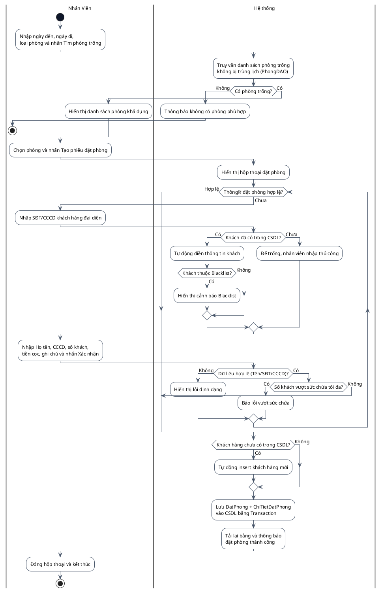

</details>

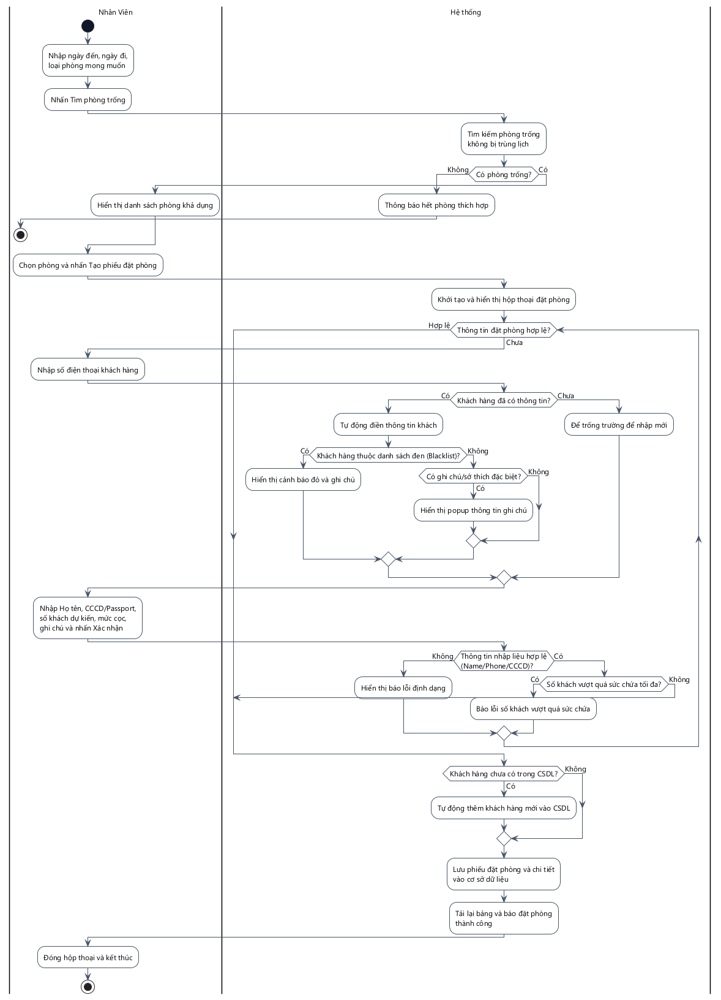

##### Sơ đồ Sequence

<details>
<summary><b>Xem mã nguồn Mermaid (nhấp để mở rộng)</b></summary>

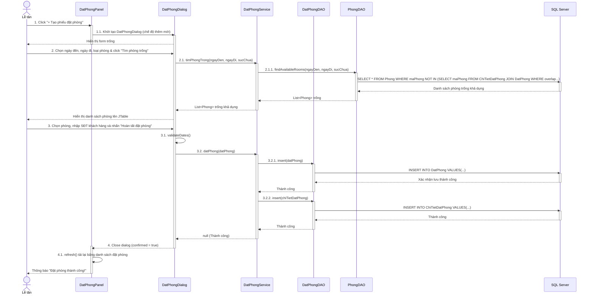

</details>

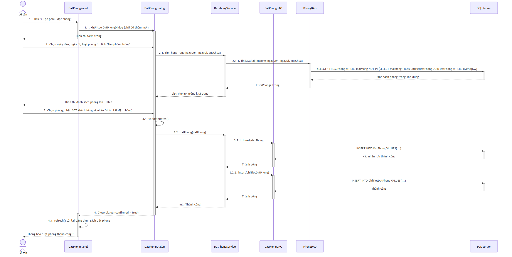

---

### 3.3 Nhận phòng / Nhận phòng:

#### 3.3.1 Mô tả UC_014.1

<table border="1">
  <tr>
    <td width="30%"><b>Mục</b></td>
    <td width="70%"><b>Nội dung</b></td>
  </tr>
  <tr>
    <td><b>Tên Use case:</b></td>
    <td>Nhận phòng / Nhận phòng</td>
  </tr>
  <tr>
    <td><b>Mã Use case:</b></td>
    <td>UC_014.1</td>
  </tr>
  <tr>
    <td><b>Mô tả:</b></td>
    <td>Cho phép nhân viên lễ tân thực hiện thủ tục nhận phòng cho khách hàng có đặt phòng trước (Nhận phòng theo lịch đặt) hoặc Nhận phòng trực tiếp cho khách vãng lai.</td>
  </tr>
  <tr>
    <td><b>Tác nhân:</b></td>
    <td>Nhân viên lễ tân, Quản lý</td>
  </tr>
  <tr>
    <td><b>Điều kiện trước:</b></td>
    <td>Người dùng đã đăng nhập hệ thống, đang ở màn hình giao diện thuê phòng.</td>
  </tr>
  <tr>
    <td><b>Điều kiện sau:</b></td>
    <td>Trạng thái phòng chuyển sang Đang ở (Đang có khách ở) và thông tin lưu trú được ghi nhận vào hệ thống.</td>
  </tr>
  <tr>
    <td colspan="2" align="center"><b>Luồng sự kiện chính (Basic flows)</b></td>
  </tr>
  <tr>
    <td class="header-split"><b>Người dùng</b></td>
    <td class="header-split"><b>Hệ thống</b></td>
  </tr>
  <tr>
    <td>1. Lựa chọn phòng trống trên sơ đồ phòng, click chuột phải chọn "Nhận phòng / Nhận phòng".</td>
    <td></td>
  </tr>
  <tr>
    <td></td>
    <td>2. Hệ thống hiển thị hộp thoại hộp thoại nhận phòng.</td>
  </tr>
  <tr>
    <td>3. Chọn hình thức Nhận phòng: "Theo phiếu đặt phòng" hoặc "Nhận phòng trực tiếp".</td>
    <td></td>
  </tr>
  <tr>
    <td></td>
    <td>4. Nếu Nhận phòng theo phiếu đặt, hiển thị danh sách các phiếu đặt tương ứng với phòng hoặc tên khách hàng. Lễ tân chọn phiếu đặt.</td>
  </tr>
  <tr>
    <td>5. Nhập thông tin của những khách hàng ở cùng phòng (Họ tên, SĐT, CCCD).</td>
    <td></td>
  </tr>
  <tr>
    <td>6. Nhập tiền đặt cọc nhận từ khách (nếu có) và nhấn nút "Hoàn tất nhận phòng".</td>
    <td></td>
  </tr>
  <tr>
    <td></td>
    <td>7. Hệ thống xử lý nhận phòng cập nhật trạng thái đặt phòng thành Đã nhận phòng.</td>
  </tr>
  <tr>
    <td></td>
    <td>8. Hệ thống cập nhật trạng thái phòng thực tế trong cơ sở dữ liệu từ Trống thành Đang ở.</td>
  </tr>
  <tr>
    <td></td>
    <td>9. Hệ thống ghi nhật ký hệ thống: "Nhân viên thực hiện Nhận phòng phòng X thành công".</td>
  </tr>
  <tr>
    <td></td>
    <td>10. Hệ thống làm mới sơ đồ phòng trên giao diện và hiển thị thông báo thành công.</td>
  </tr>
  <tr>
    <td>11. Nhân viên hoàn tất thao tác và đóng hộp thoại.</td>
    <td></td>
  </tr>
  <tr>
    <td colspan="2" align="center"><b>Luồng sự kiện phụ (Alternative Flows)</b></td>
  </tr>
  <tr>
    <td>3.1a. Chọn "Nhận phòng trực tiếp" (Khách vãng lai). Lễ tân chọn ngày đi dự kiến, nhập thông tin khách hàng và số tiền đặt cọc.</td>
    <td></td>
  </tr>
  <tr>
    <td></td>
    <td>7.1. Hệ thống báo lỗi nếu phòng được chọn đang ở trạng thái không trống (Đang ở, Bảo trì, CLEANING) và dừng thao tác.</td>
  </tr>
</table>

#### 3.3.2 Biểu đồ

##### Sơ đồ Activity

<details>
<summary><b>Xem mã nguồn PlantUML (nhấp để mở rộng)</b></summary>

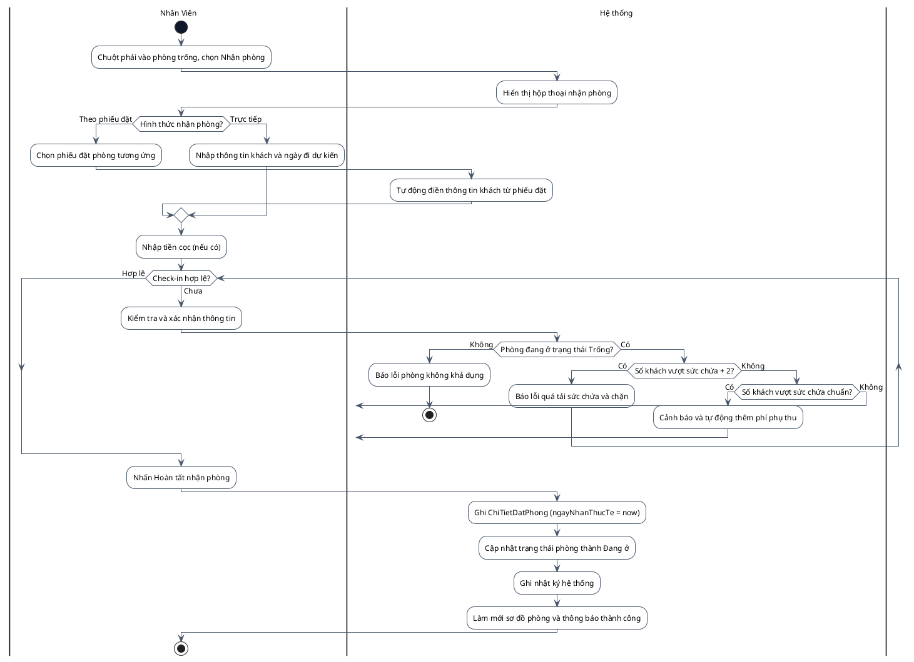

</details>

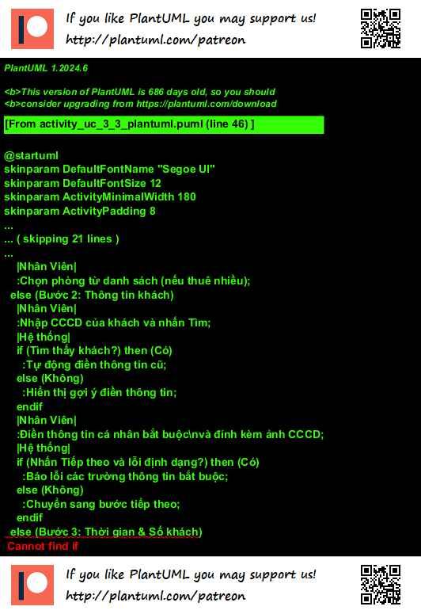

##### Sơ đồ Sequence

<details>
<summary><b>Xem mã nguồn Mermaid (nhấp để mở rộng)</b></summary>

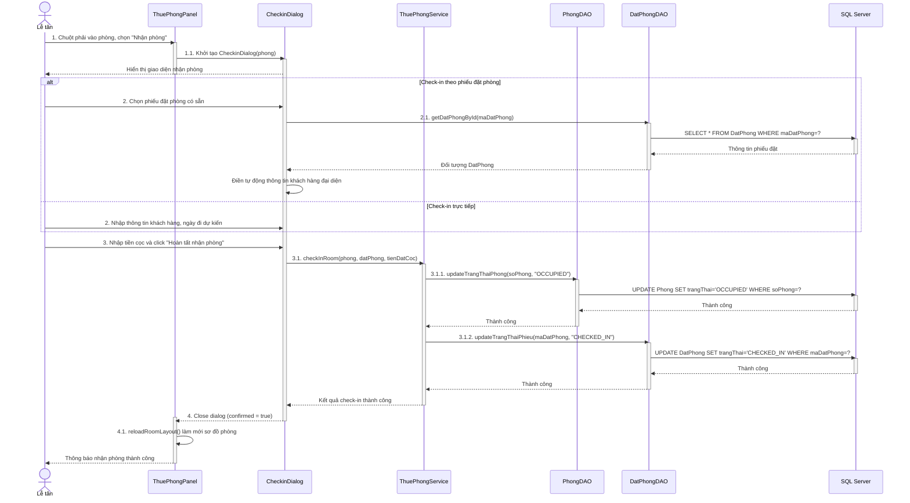

</details>


---

### 3.4 Thêm thông tin khách hàng:

#### 3.4.1 Mô tả UC_12.1

<table border="1">
  <tr>
    <td width="30%"><b>Mục</b></td>
    <td width="70%"><b>Nội dung</b></td>
  </tr>
  <tr>
    <td><b>Tên Use case:</b></td>
    <td>Thêm khách hàng</td>
  </tr>
  <tr>
    <td><b>Mã Use case:</b></td>
    <td>UC_12.1</td>
  </tr>
  <tr>
    <td><b>Mô tả:</b></td>
    <td>Cho phép nhân viên lễ tân thêm khách hàng mới vào hệ thống.</td>
  </tr>
  <tr>
    <td><b>Tác nhân:</b></td>
    <td>Nhân viên lễ tân</td>
  </tr>
  <tr>
    <td><b>Điều kiện trước:</b></td>
    <td>Người dùng phải đăng nhập vào hệ thống.</td>
  </tr>
  <tr>
    <td><b>Điều kiện sau:</b></td>
    <td>Thông tin khách hàng được thêm vào hệ thống.</td>
  </tr>
  <tr>
    <td colspan="2" align="center"><b>Luồng sự kiện chính (Basic flows)</b></td>
  </tr>
  <tr>
    <td class="header-split"><b>Người dùng</b></td>
    <td class="header-split"><b>Hệ thống</b></td>
  </tr>
  <tr>
    <td>1. Nhân viên lễ tân chọn chức năng quản lý khách hàng.</td>
    <td></td>
  </tr>
  <tr>
    <td></td>
    <td>2. Hệ thống hiển thị giao diện quản lý khách hàng.</td>
  </tr>
  <tr>
    <td>3. Nhân viên lễ tân chọn chức năng thêm thông tin khách hàng.</td>
    <td></td>
  </tr>
  <tr>
    <td></td>
    <td>4. Hệ thống hiển thị form thêm thông tin khách hàng.</td>
  </tr>
  <tr>
    <td>5. Nhân viên lễ tân nhập thông tin khách hàng.</td>
    <td></td>
  </tr>
  <tr>
    <td>6. Nhân viên nhấn lưu.</td>
    <td></td>
  </tr>
  <tr>
    <td></td>
    <td>7. Hệ thống kiểm tra ràng buộc dữ liệu.</td>
  </tr>
  <tr>
    <td></td>
    <td>8. Hệ thống kiểm tra các quy tắc nghiệp vụ của khách hàng.</td>
  </tr>
  <tr>
    <td></td>
    <td>9. Hệ thống lưu thông tin khách hàng vào cơ sở dữ liệu.</td>
  </tr>
  <tr>
    <td></td>
    <td>10. Hệ thống hiển thị lại danh sách khách hàng.</td>
  </tr>
  <tr>
    <td></td>
    <td>11. Hệ thống thông báo thêm khách hàng thành công.</td>
  </tr>
  <tr>
    <td>12. Nhân viên xác nhận và kết thúc.</td>
    <td></td>
  </tr>
  <tr>
    <td colspan="2" align="center"><b>Luồng sự kiện phụ (Alternative Flows)</b></td>
  </tr>
  <tr>
    <td></td>
    <td>7.1. Hệ thống hiển thị lỗi.</td>
  </tr>
  <tr>
    <td>7.2. Nhân viên lễ tân chỉnh sửa thông tin nhập vào và thực hiện lại thao tác.</td>
    <td></td>
  </tr>
  <tr>
    <td></td>
    <td>8.1. Hệ thống thông báo lỗi.</td>
  </tr>
  <tr>
    <td>8.2. Nhân viên lễ tân chỉnh sửa thông tin nhập vào và thực hiện lại thao tác.</td>
    <td></td>
  </tr>
</table>

#### 3.4.2 Biểu đồ

##### Sơ đồ Activity

<details>
<summary><b>Xem mã nguồn PlantUML (nhấp để mở rộng)</b></summary>

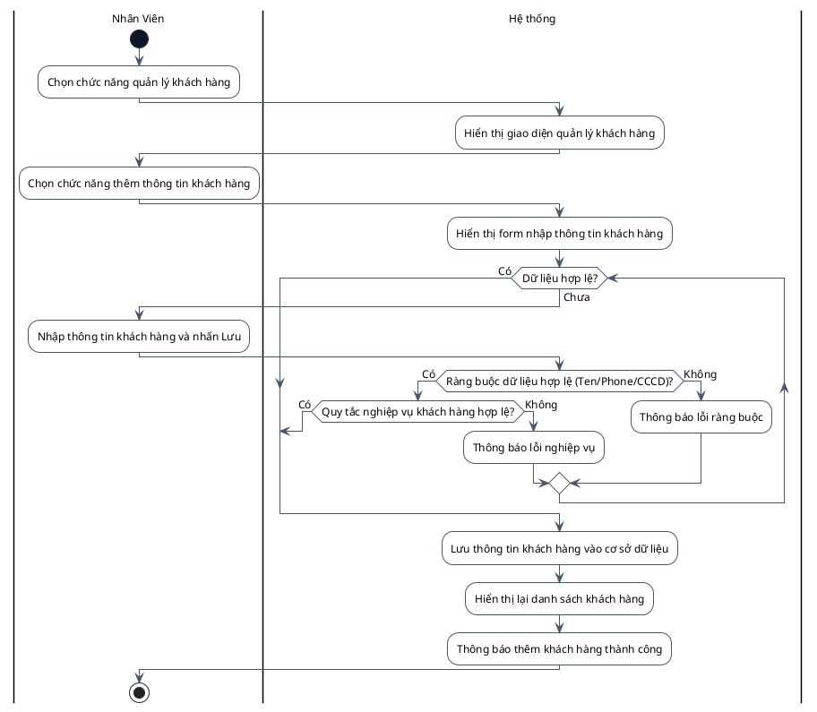

</details>

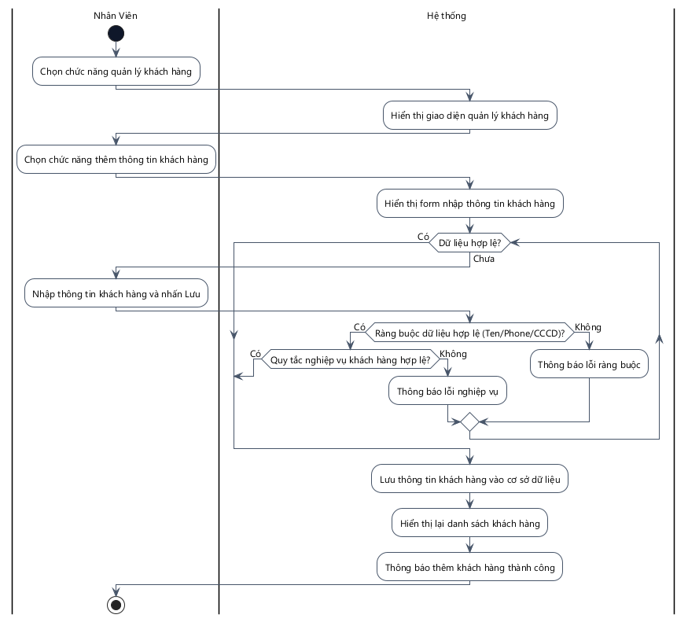

##### Sơ đồ Sequence

<details>
<summary><b>Xem mã nguồn Mermaid (nhấp để mở rộng)</b></summary>

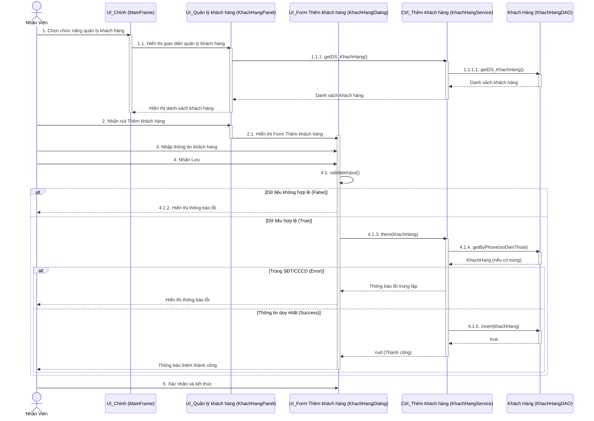

</details>

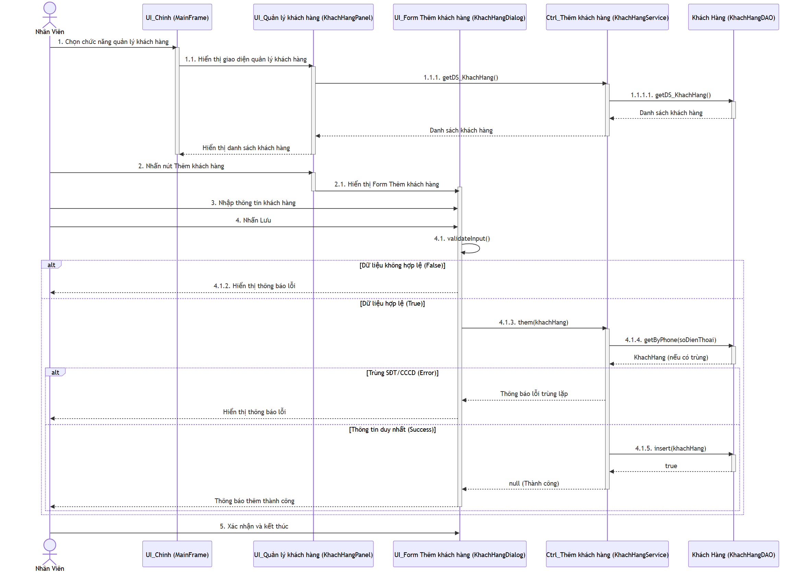

---

### 3.5 Thực hiện Thực hiện gọi dịch vụ phòng:

#### 3.5.1 Mô tả UC_014.2

<table border="1">
  <tr>
    <td width="30%"><b>Mục</b></td>
    <td width="70%"><b>Nội dung</b></td>
  </tr>
  <tr>
    <td><b>Tên Use case:</b></td>
    <td>Sử dụng dịch vụ phòng (Order Service)</td>
  </tr>
  <tr>
    <td><b>Mã Use case:</b></td>
    <td>UC_014.2</td>
  </tr>
  <tr>
    <td><b>Mô tả:</b></td>
    <td>Cho phép nhân viên lễ tân ghi nhận các dịch vụ (đồ ăn, thức uống, giặt ủi, massage...) mà khách lưu trú gọi thêm vào chi tiết hóa đơn của phòng.</td>
  </tr>
  <tr>
    <td><b>Tác nhân:</b></td>
    <td>Nhân viên lễ tân, Quản lý</td>
  </tr>
  <tr>
    <td><b>Điều kiện trước:</b></td>
    <td>Phòng đang ở trạng thái Đang ở (Đang có khách lưu trú).</td>
  </tr>
  <tr>
    <td><b>Điều kiện sau:</b></td>
    <td>Thông tin sử dụng dịch vụ được lưu vào cơ sở dữ liệu bảng SuDungDichVu và cộng tiền vào tổng bill phòng.</td>
  </tr>
  <tr>
    <td colspan="2" align="center"><b>Luồng sự kiện chính (Basic flows)</b></td>
  </tr>
  <tr>
    <td class="header-split"><b>Người dùng</b></td>
    <td class="header-split"><b>Hệ thống</b></td>
  </tr>
  <tr>
    <td>1. Chuột phải vào phòng đang có khách ở sơ đồ phòng, chọn "Thực hiện Thực hiện gọi dịch vụ / Sử dụng dịch vụ".</td>
    <td></td>
  </tr>
  <tr>
    <td></td>
    <td>2. Hệ thống hiển thị giao diện gọi dịch vụ chứa thông tin phòng và danh mục dịch vụ.</td>
  </tr>
  <tr>
    <td>3. Chọn dịch vụ từ danh mục bên trái, nhập số lượng sử dụng và nhấn nút "Thêm vào giỏ".</td>
    <td></td>
  </tr>
  <tr>
    <td></td>
    <td>4. Hệ thống tính toán thành tiền dịch vụ và hiển thị vào bảng danh sách dịch vụ đã chọn bên phải.</td>
  </tr>
  <tr>
    <td>5. Nhấn nút "Lưu thay đổi".</td>
    <td></td>
  </tr>
  <tr>
    <td></td>
    <td>6. Hệ thống thực hiện gọi SuDungDichVuDAO để lưu toàn bộ danh sách dịch vụ vừa order vào cơ sở dữ liệu.</td>
  </tr>
  <tr>
    <td></td>
    <td>7. Hệ thống thông báo cập nhật dịch vụ phòng thành công.</td>
  </tr>
  <tr>
    <td>8. Nhân viên đóng hộp thoại và hoàn tất thao tác.</td>
    <td></td>
  </tr>
  <tr>
    <td colspan="2" align="center"><b>Luồng sự kiện phụ (Alternative Flows)</b></td>
  </tr>
  <tr>
    <td>3.1. Nhân viên muốn chỉnh sửa số lượng hoặc xóa bỏ một dịch vụ đã chọn trước đó bên bảng giỏ hàng. Nhấn nút "Xóa" hoặc sửa trực tiếp số lượng trong ô JSpinner.</td>
    <td></td>
  </tr>
  <tr>
    <td></td>
    <td>6.1. Nếu kết nối cơ sở dữ liệu lỗi, hệ thống hiển thị thông báo "Không thể lưu dữ liệu dịch vụ" và giữ nguyên giao diện để lễ tân lưu lại.</td>
  </tr>
</table>

#### 3.5.2 Biểu đồ

##### Sơ đồ Activity

<details>
<summary><b>Xem mã nguồn PlantUML (nhấp để mở rộng)</b></summary>

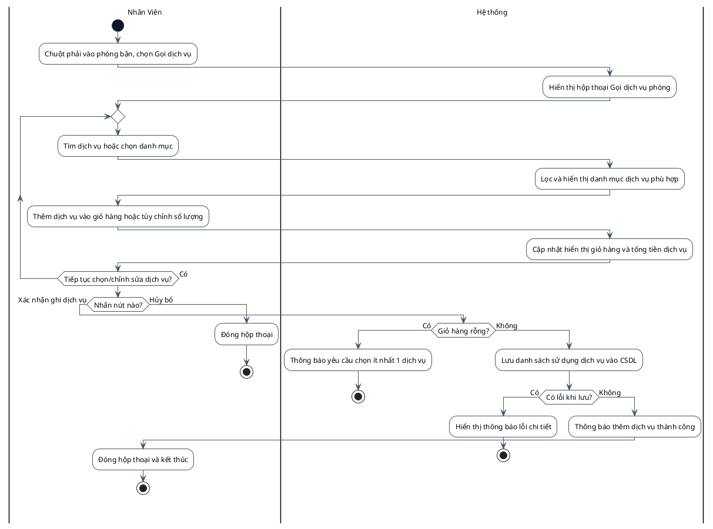

</details>

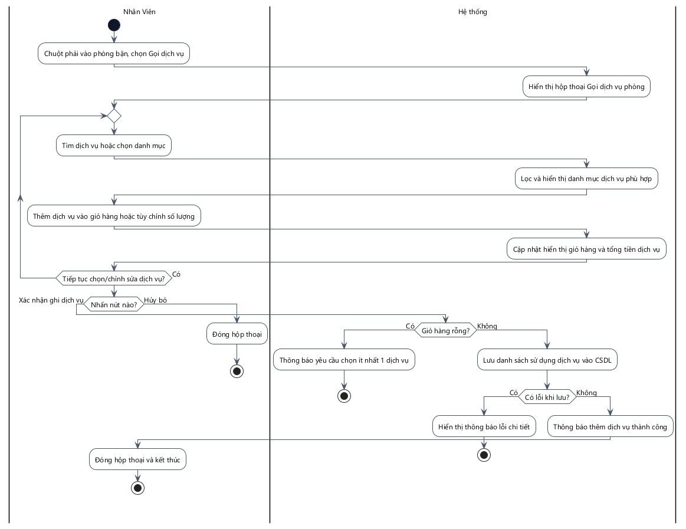

##### Sơ đồ Sequence

<details>
<summary><b>Xem mã nguồn Mermaid (nhấp để mở rộng)</b></summary>

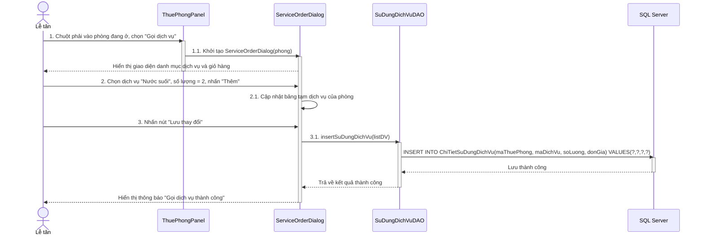

</details>

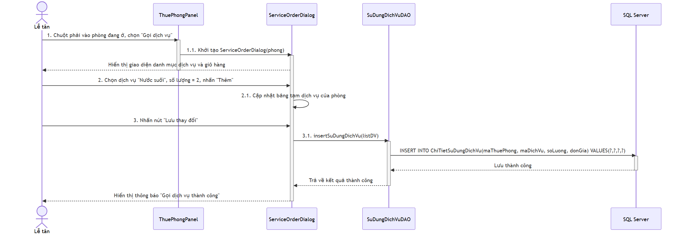

---

### 3.6 Đổi phòng:

#### 3.6.1 Mô tả UC_014.3

<table border="1">
  <tr>
    <td width="30%"><b>Mục</b></td>
    <td width="70%"><b>Nội dung</b></td>
  </tr>
  <tr>
    <td><b>Tên Use case:</b></td>
    <td>Đổi phòng (Switch Room)</td>
  </tr>
  <tr>
    <td><b>Mã Use case:</b></td>
    <td>UC_014.3</td>
  </tr>
  <tr>
    <td><b>Mô tả:</b></td>
    <td>Cho phép lễ tân chuyển khách lưu trú từ phòng hiện tại sang một phòng trống khác có cùng hoặc khác loại phòng theo yêu cầu.</td>
  </tr>
  <tr>
    <td><b>Tác nhân:</b></td>
    <td>Nhân viên lễ tân, Quản lý</td>
  </tr>
  <tr>
    <td><b>Điều kiện trước:</b></td>
    <td>Khách đang ở phòng hiện tại (Đang ở) và hệ thống còn ít nhất 1 phòng trống (Trống).</td>
  </tr>
  <tr>
    <td><b>Điều kiện sau:</b></td>
    <td>Thông tin khách, dịch vụ đã sử dụng được chuyển sang phòng mới. Phòng cũ đổi thành CLEANING (hoặc Trống), phòng mới đổi thành Đang ở.</td>
  </tr>
  <tr>
    <td colspan="2" align="center"><b>Luồng sự kiện chính (Basic flows)</b></td>
  </tr>
  <tr>
    <td class="header-split"><b>Người dùng</b></td>
    <td class="header-split"><b>Hệ thống</b></td>
  </tr>
  <tr>
    <td>1. Chuột phải vào phòng đang có khách ở sơ đồ phòng, chọn "Đổi phòng / Chuyển phòng".</td>
    <td></td>
  </tr>
  <tr>
    <td></td>
    <td>2. Hệ thống hiển thị hộp thoại đổi phòng chứa thông tin phòng cũ.</td>
  </tr>
  <tr>
    <td>3. Chọn loại phòng đích và lọc danh sách các phòng trống đang sẵn sàng.</td>
    <td></td>
  </tr>
  <tr>
    <td>4. Lựa chọn phòng mới và chọn hình thức tính phụ phí chênh lệch giá phòng (nếu có).</td>
    <td></td>
  </tr>
  <tr>
    <td>5. Nhấn nút "Xác nhận chuyển phòng".</td>
    <td></td>
  </tr>
  <tr>
    <td></td>
    <td>6. Hệ thống thực hiện giao dịch trong cơ sở dữ liệu: chuyển đổi liên kết của khách hàng và các dịch vụ đã sử dụng từ phòng cũ sang phòng mới.</td>
  </tr>
  <tr>
    <td></td>
    <td>7. Hệ thống cập nhật trạng thái phòng cũ thành CLEANING (Cần dọn dẹp) và phòng mới thành Đang ở.</td>
  </tr>
  <tr>
    <td></td>
    <td>8. Hệ thống ghi nhật ký chuyển phòng: "Đổi phòng từ phòng A sang phòng B thành công".</td>
  </tr>
  <tr>
    <td></td>
    <td>9. Hệ thống tải lại sơ đồ phòng và thông báo chuyển phòng thành công.</td>
  </tr>
  <tr>
    <td>10. Nhân viên đóng dialog kết thúc.</td>
    <td></td>
  </tr>
  <tr>
    <td colspan="2" align="center"><b>Luồng sự kiện phụ (Alternative Flows)</b></td>
  </tr>
  <tr>
    <td></td>
    <td>6.1. Giao dịch đổi phòng thất bại trong cơ sở dữ liệu, hệ thống rollback toàn bộ dữ liệu trạng thái phòng cũ và mới, thông báo lỗi.</td>
  </tr>
</table>

#### 3.6.2 Biểu đồ

##### Sơ đồ Activity

<details>
<summary><b>Xem mã nguồn PlantUML (nhấp để mở rộng)</b></summary>

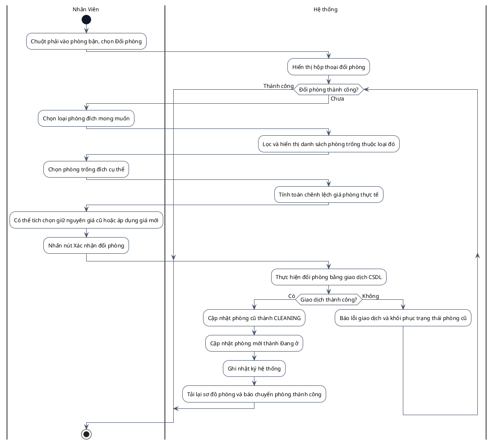

</details>


##### Sơ đồ Sequence

<details>
<summary><b>Xem mã nguồn Mermaid (nhấp để mở rộng)</b></summary>

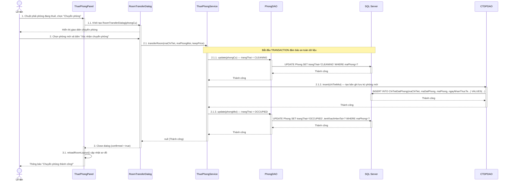

</details>


---

### 3.7 Gia hạn lưu trú:

#### 3.7.1 Mô tả UC_014.4

<table border="1">
  <tr>
    <td width="30%"><b>Mục</b></td>
    <td width="70%"><b>Nội dung</b></td>
  </tr>
  <tr>
    <td><b>Tên Use case:</b></td>
    <td>Gia hạn lưu trú (Extend Stay)</td>
  </tr>
  <tr>
    <td><b>Mã Use case:</b></td>
    <td>UC_014.4</td>
  </tr>
  <tr>
    <td><b>Mô tả:</b></td>
    <td>Cho phép lễ tân thay đổi ngày đi dự kiến của khách thuê phòng sang một ngày muộn hơn nếu phòng đó chưa có lịch đặt của khách khác.</td>
  </tr>
  <tr>
    <td><b>Tác nhân:</b></td>
    <td>Nhân viên lễ tân, Quản lý</td>
  </tr>
  <tr>
    <td><b>Điều kiện trước:</b></td>
    <td>Khách đang ở phòng cần gia hạn và phòng đó trống lịch trong khoảng thời gian gia hạn.</td>
  </tr>
  <tr>
    <td><b>Điều kiện sau:</b></td>
    <td>Thông tin ngày đi dự kiến của khách thuê phòng được thay đổi thành ngày mới trên cơ sở dữ liệu.</td>
  </tr>
  <tr>
    <td colspan="2" align="center"><b>Luồng sự kiện chính (Basic flows)</b></td>
  </tr>
  <tr>
    <td class="header-split"><b>Người dùng</b></td>
    <td class="header-split"><b>Hệ thống</b></td>
  </tr>
  <tr>
    <td>1. Chuột phải vào phòng đang bận, chọn "Gia hạn phòng".</td>
    <td></td>
  </tr>
  <tr>
    <td></td>
    <td>2. Hệ thống hiển thị hộp thoại gia hạn lưu trú điền sẵn thông tin thời gian lưu trú cũ.</td>
  </tr>
  <tr>
    <td>3. Chọn ngày và giờ đi dự kiến mới.</td>
    <td></td>
  </tr>
  <tr>
    <td>4. Nhấn nút "Kiểm tra lịch & Xác nhận gia hạn".</td>
    <td></td>
  </tr>
  <tr>
    <td></td>
    <td>5. Hệ thống kiểm tra xem khoảng gia hạn mới có bị trùng lịch đặt phòng tương lai của phòng này không.</td>
  </tr>
  <tr>
    <td></td>
    <td>6. Hệ thống thực hiện cập nhật ngày đi mới của phiếu thuê phòng (ChiTietDatPhong) trong cơ sở dữ liệu.</td>
  </tr>
  <tr>
    <td></td>
    <td>7. Hệ thống thông báo gia hạn lưu trú thành công.</td>
  </tr>
  <tr>
    <td>8. Nhân viên đóng dialog và kết thúc.</td>
    <td></td>
  </tr>
  <tr>
    <td colspan="2" align="center"><b>Luồng sự kiện phụ (Alternative Flows)</b></td>
  </tr>
  <tr>
    <td></td>
    <td>5.1. Phòng đã bị đặt trước bởi khách khác ngay trong khoảng gia hạn, hệ thống đưa ra cảnh báo "Không thể gia hạn do phòng đã có khách đặt từ ngày X. Hãy đề xuất đổi phòng cho khách".</td>
  </tr>
</table>

#### 3.7.2 Biểu đồ

##### Sơ đồ Activity

<details>
<summary><b>Xem mã nguồn PlantUML (nhấp để mở rộng)</b></summary>

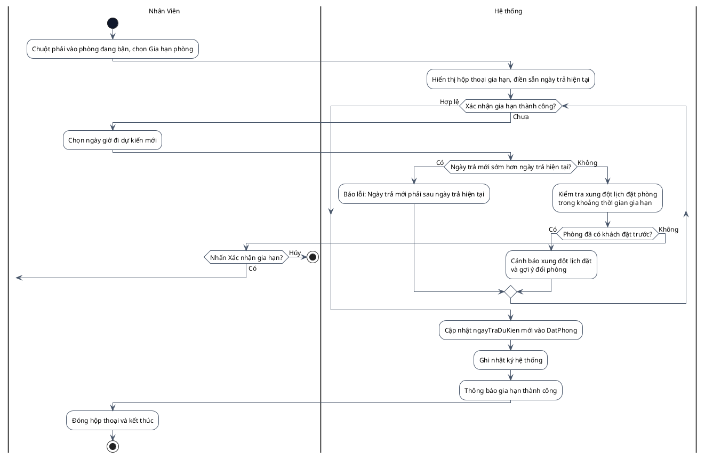

</details>

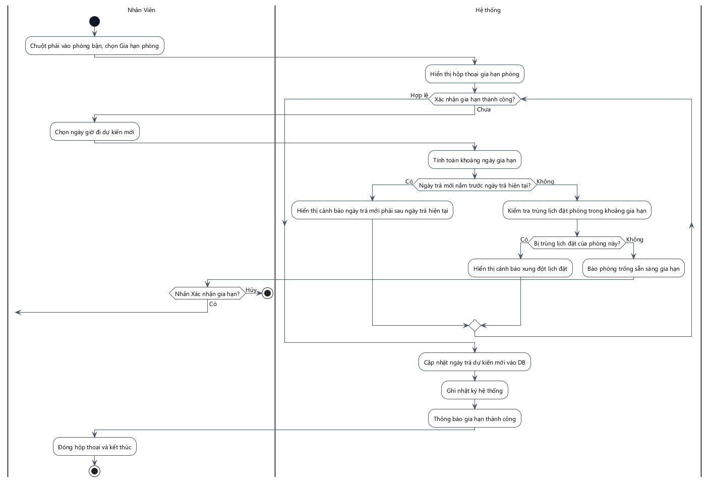

##### Sơ đồ Sequence

<details>
<summary><b>Xem mã nguồn Mermaid (nhấp để mở rộng)</b></summary>

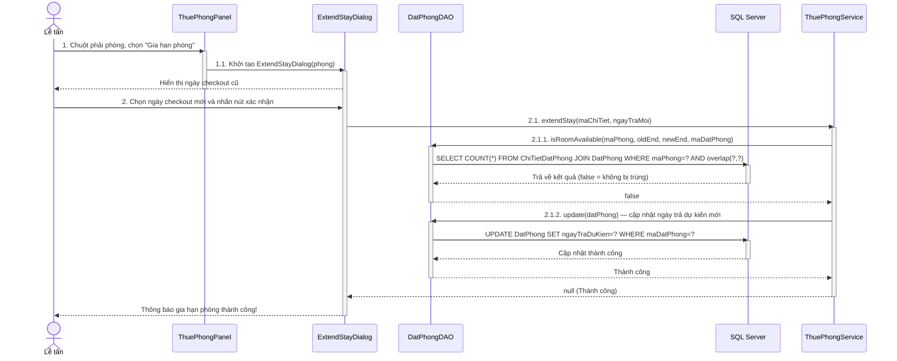

</details>

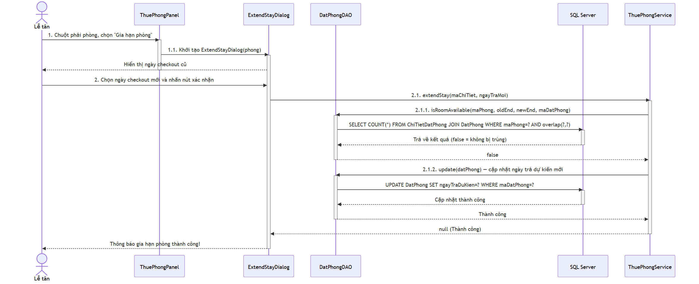

---

### 3.8 Thanh toán & Trả phòng lẻ:

#### 3.8.1 Mô tả UC_015.1

<table border="1">
  <tr>
    <td width="30%"><b>Mục</b></td>
    <td width="70%"><b>Nội dung</b></td>
  </tr>
  <tr>
    <td><b>Tên Use case:</b></td>
    <td>Thanh toán & Trả phòng lẻ</td>
  </tr>
  <tr>
    <td><b>Mã Use case:</b></td>
    <td>UC_015.1</td>
  </tr>
  <tr>
    <td><b>Mô tả:</b></td>
    <td>Hỗ trợ nhân viên lễ tân thanh toán hóa đơn lưu trú, chi phí dịch vụ và phụ thu cho khách thuê phòng lẻ, sau đó in hóa đơn và hoàn tất trả phòng.</td>
  </tr>
  <tr>
    <td><b>Tác nhân:</b></td>
    <td>Nhân viên lễ tân, Quản lý</td>
  </tr>
  <tr>
    <td><b>Điều kiện trước:</b></td>
    <td>Phòng đang có khách lưu trú (Đang ở).</td>
  </tr>
  <tr>
    <td><b>Điều kiện sau:</b></td>
    <td>Hóa đơn được lưu vào cơ sở dữ liệu (bảng HoaDon và ChiTietHoaDon), phòng chuyển sang trạng thái CLEANING (Cần dọn dẹp).</td>
  </tr>
  <tr>
    <td colspan="2" align="center"><b>Luồng sự kiện chính (Basic flows)</b></td>
  </tr>
  <tr>
    <td class="header-split"><b>Người dùng</b></td>
    <td class="header-split"><b>Hệ thống</b></td>
  </tr>
  <tr>
    <td>1. Chuột phải phòng cần trả phòng, chọn "Thanh toán & Trả phòng".</td>
    <td></td>
  </tr>
  <tr>
    <td></td>
    <td>2. Hệ thống hiển thị giao diện hóa đơn tính toán chi tiết (Số ngày ở, tiền phòng, phụ thu Nhận phòng sớm / Trả phòng muộn, tiền dịch vụ, khuyến mãi áp dụng và tổng tiền thanh toán).</td>
  </tr>
  <tr>
    <td>3. Lựa chọn phương thức thanh toán: "Tiền mặt" hoặc "Chuyển khoản QR".</td>
    <td></td>
  </tr>
  <tr>
    <td>4. Nhập số tiền khách đưa (nếu là tiền mặt) hoặc hiển thị mã QR thanh toán động.</td>
    <td></td>
  </tr>
  <tr>
    <td>5. Nhấn nút "Xác nhận & In hóa đơn".</td>
    <td></td>
  </tr>
  <tr>
    <td></td>
    <td>6. Hệ thống tạo hóa đơn và lưu chi tiết vào bảng HoaDon, ChiTietHoaDon. Cập nhật trạng thái thuê phòng thành CHECKED_OUT.</td>
  </tr>
  <tr>
    <td></td>
    <td>7. Hệ thống chuyển đổi trạng thái phòng đích thành CLEANING.</td>
  </tr>
  <tr>
    <td></td>
    <td>8. Hệ thống xuất phiếu in hóa đơn dưới dạng PDF bằng PDFExporter.</td>
  </tr>
  <tr>
    <td></td>
    <td>9. Hệ thống tải lại sơ đồ phòng và hiển thị thông báo thanh toán thành công.</td>
  </tr>
  <tr>
    <td>10. Nhân viên nhận hóa đơn từ máy in giao cho khách, hoàn tất giao dịch.</td>
    <td></td>
  </tr>
  <tr>
    <td colspan="2" align="center"><b>Luồng sự kiện phụ (Alternative Flows)</b></td>
  </tr>
  <tr>
    <td>3.1. Chọn "Chuyển khoản QR". Hệ thống mở QRPaymentDialog kết xuất mã QR động VietQR chứa số tiền hóa đơn và mã chuyển khoản tự động. Sau khi khách quét mã, lễ tân kiểm tra tài khoản và nhấn xác nhận thanh toán.</td>
    <td></td>
  </tr>
</table>

#### 3.8.2 Biểu đồ

##### Sơ đồ Activity

<details>
<summary><b>Xem mã nguồn PlantUML (nhấp để mở rộng)</b></summary>

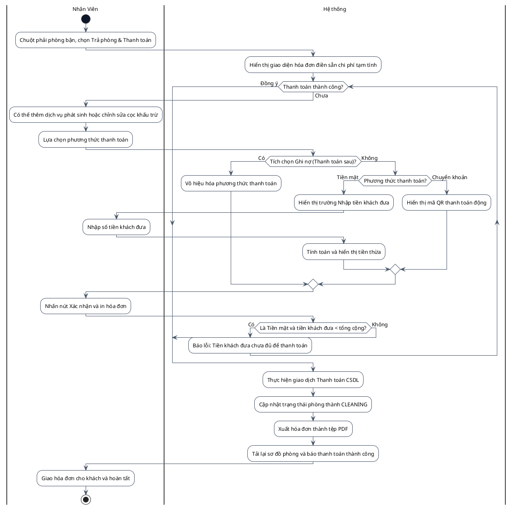

</details>

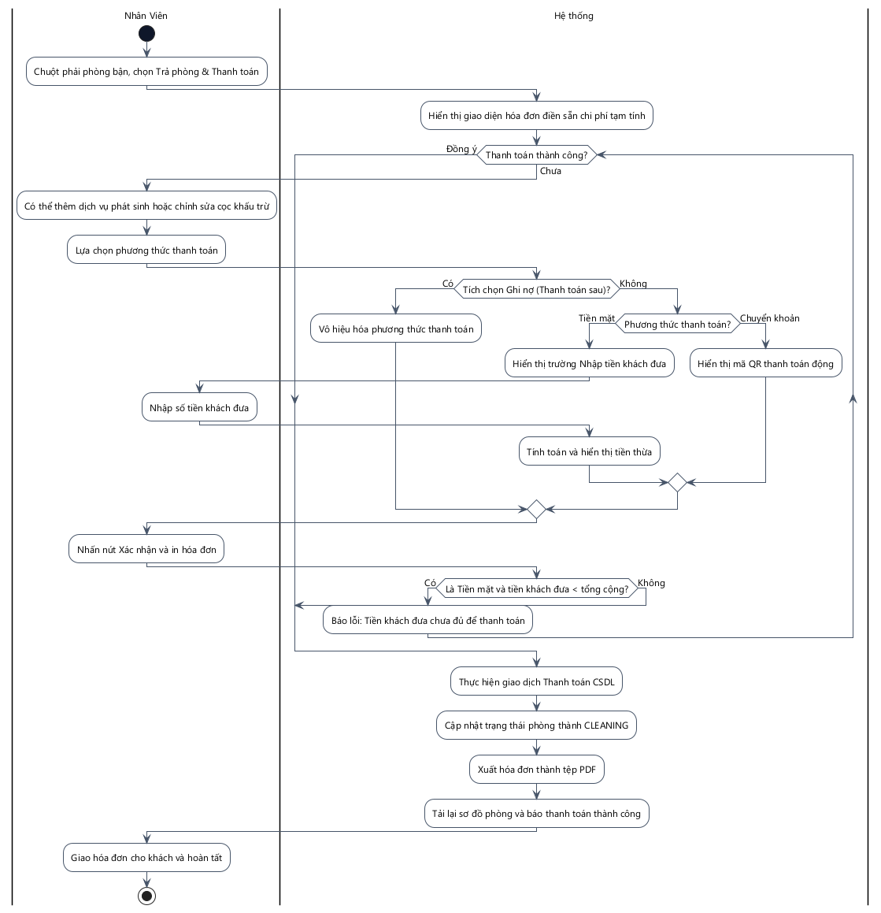

##### Sơ đồ Sequence

<details>
<summary><b>Xem mã nguồn Mermaid (nhấp để mở rộng)</b></summary>

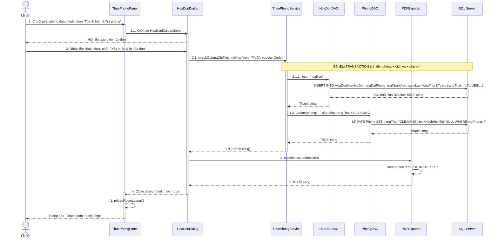

</details>

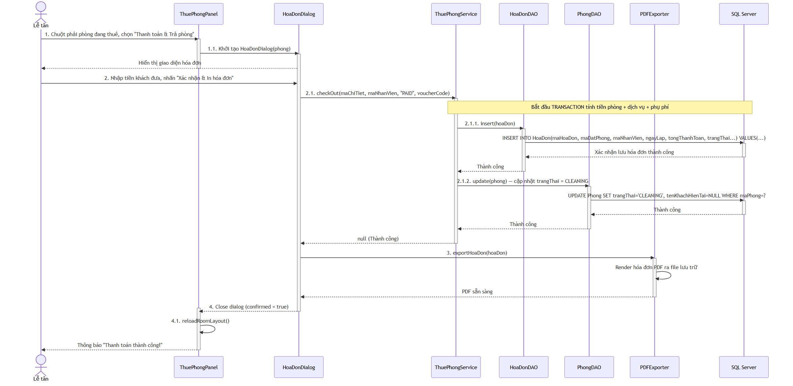

---

### 3.9 Gom Bill thanh toán khách đoàn:

#### 3.9.1 Mô tả UC_015.2

<table border="1">
  <tr>
    <td width="30%"><b>Mục</b></td>
    <td width="70%"><b>Nội dung</b></td>
  </tr>
  <tr>
    <td><b>Tên Use case:</b></td>
    <td>Gom Bill thanh toán khách đoàn</td>
  </tr>
  <tr>
    <td><b>Mã Use case:</b></td>
    <td>UC_015.2</td>
  </tr>
  <tr>
    <td><b>Mô tả:</b></td>
    <td>Hỗ trợ nhân viên lễ tân thanh toán dồn cho toàn bộ các phòng trong cùng một đoàn (cùng một mã đặt phòng) vào một hóa đơn tổng duy nhất khi trả phòng, giải quyết nợ treo đoàn.</td>
  </tr>
  <tr>
    <td><b>Tác nhân:</b></td>
    <td>Nhân viên lễ tân, Quản lý</td>
  </tr>
  <tr>
    <td><b>Điều kiện trước:</b></td>
    <td>Các phòng trong đoàn đều đang bận (Đang ở) hoặc đã trả phòng trước đó nhưng chọn hình thức "Treo nợ đoàn".</td>
  </tr>
  <tr>
    <td><b>Điều kiện sau:</b></td>
    <td>Hóa đơn tổng được lưu vào cơ sở dữ liệu. Trạng thái các phòng đổi thành CLEANING. Xóa tình trạng nợ của đoàn.</td>
  </tr>
  <tr>
    <td colspan="2" align="center"><b>Luồng sự kiện chính (Basic flows)</b></td>
  </tr>
  <tr>
    <td class="header-split"><b>Người dùng</b></td>
    <td class="header-split"><b>Hệ thống</b></td>
  </tr>
  <tr>
    <td>1. Chuột phải vào phòng cuối cùng của đoàn làm thủ tục trả phòng, chọn "Thanh toán & Trả phòng".</td>
    <td></td>
  </tr>
  <tr>
    <td></td>
    <td>2. Hệ thống phát hiện đây là phòng thuộc đoàn, hiển thị thông báo hỏi lễ tân có muốn gom tất cả các phòng bận và phòng nợ treo của đoàn để thanh toán chung hay không.</td>
  </tr>
  <tr>
    <td>3. Nhấn nút "Đồng ý Gom Bill".</td>
    <td></td>
  </tr>
  <tr>
    <td></td>
    <td>4. Hệ thống hiển thị hộp thoại hộp thoại thanh toán khách đoàn điền sẵn bảng tổng hợp các chi phí của tất cả các phòng thuộc đoàn.</td>
  </tr>
  <tr>
    <td>5. Chọn hình thức thanh toán và nhấn "Xác nhận thanh toán đoàn".</td>
    <td></td>
  </tr>
  <tr>
    <td></td>
    <td>6. Hệ thống xử lý thanh toán khách đoàn chạy Transaction đồng thời lưu hóa đơn tổng và chuyển đổi toàn bộ trạng thái các phòng trong đoàn thành CLEANING.</td>
  </tr>
  <tr>
    <td></td>
    <td>7. Hệ thống xuất hóa đơn tổng dạng PDF và gửi lệnh in.</td>
  </tr>
  <tr>
    <td></td>
    <td>8. Hệ thống làm mới sơ đồ phòng và hiển thị thông báo thanh toán gom bill đoàn thành công.</td>
  </tr>
  <tr>
    <td>9. Lễ tân giao hóa đơn tổng cho trưởng đoàn, kết thúc giao dịch.</td>
    <td></td>
  </tr>
  <tr style="background-color: #f2f2f2;">
    <td colspan="2" align="center"><b>Luồng sự kiện phụ (Alternative Flows)</b></td>
  </tr>
  <tr>
    <td>3.1. Chọn "Trả lẻ từng phòng". Hệ thống bỏ qua gom bill và mở hộp thoại thanh toán của riêng phòng được chọn để thanh toán đơn lẻ bình thường.</td>
    <td></td>
  </tr>
</table>

#### 3.9.2 Biểu đồ

##### Sơ đồ Activity

<details>
<summary><b>Xem mã nguồn PlantUML (nhấp để mở rộng)</b></summary>

```plantuml
@startuml
skinparam DefaultFontName "Segoe UI"
skinparam DefaultFontSize 12
skinparam ActivityMinimalWidth 180
skinparam ActivityPadding 8
skinparam ActivityMargin 8
skinparam backgroundcolor white
skinparam ActivityBackgroundColor white
skinparam ActivityBorderColor #475569
skinparam ActivityStartColor #0F172A
skinparam ActivityEndColor #0F172A
skinparam ActivityDiamondBackgroundColor white
skinparam ActivityDiamondBorderColor #475569
skinparam ArrowColor #475569
skinparam ActivityBorderThickness 1
skinparam ArrowThickness 1
skinparam linetype ortho

|Nhân Viên|
start
:Chuột phải phòng bận cuối của đoàn, chọn Trả phòng;
|Hệ thống|
:Hiển thị câu hỏi gom bill;
|Nhân Viên|
:Chọn Gom Bill đoàn;
|Hệ thống|
:Hiển thị giao diện thanh toán tổng hợp chi phí toàn đoàn;
while (Thanh toán đoàn thành công?) is (Chưa)
  |Nhân Viên|
  :Chọn phương thức thanh toán;
  |Hệ thống|
  if (Phương thức thanh toán?) then (Tiền mặt)
    :Hiển thị ô nhập tiền khách đưa;
    |Nhân Viên|
    :Nhập số tiền khách đưa;
    |Hệ thống|
    :Tính toán và hiển thị tiền thừa;
  else (Chuyển khoản)
    :Hiển thị mã QR thanh toán động cho toàn đoàn;
  endif
  |Nhân Viên|
  :Nhấn Xác nhận thanh toán đoàn;
  |Hệ thống|
  if (Là Tiền mặt và tiền khách đưa < tổng cộng?) then (Có)
    :Báo lỗi: Tiền khách đưa chưa đủ!;
  else (Không)
    break
  endif
endwhile (Đồng ý)
:Xử lý thanh toán hóa đơn đoàn trong giao dịch cơ sở dữ liệu;
:Đồng bộ chuyển tất cả phòng đoàn thành CLEANING;
:Xuất hóa đơn tổng dạng PDF;
:Tải lại sơ đồ phòng và thông báo thành công;
|Nhân Viên|
:Giao hóa đơn cho đoàn và kết thúc;
stop
@enduml
```

</details>

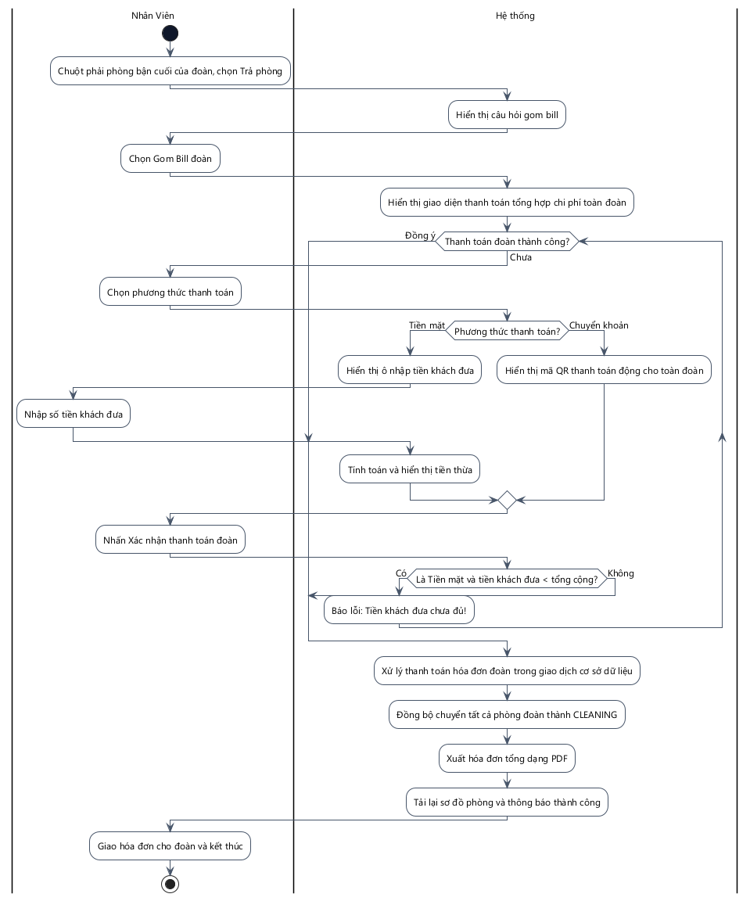

##### Sơ đồ Sequence

<details>
<summary><b>Xem mã nguồn Mermaid (nhấp để mở rộng)</b></summary>

```mermaid
sequenceDiagram
    actor Receptionist as Lễ tân
    participant UI as ThuePhongPanel
    participant Dlg as MasterBillDialog
    participant Service as ThuePhongService
    participant HDDAO as HoaDonDAO
    participant PhongDAO as PhongDAO
    participant DB as SQL Server

    Receptionist->>UI: 1. Chuột phải phòng đoàn, chọn "Trả phòng"
    activate UI
    UI-->>Receptionist: Hiển thị popup hỏi "Bạn có muốn gom bill đoàn?"
    Receptionist->>UI: 2. Nhấn "Gom Bill"
    UI->>Dlg: 2.1. Khởi tạo MasterBillDialog(datPhong, listRoomSelected)
    activate Dlg
    Dlg-->>Receptionist: Hiển thị chi tiết tiền phòng và dịch vụ của toàn đoàn
    deactivate UI

    Receptionist->>Dlg: 3. Nhấn nút "Xác nhận thanh toán đoàn"
    Dlg->>Service: 3.1. checkOutMasterBill(maDatPhong, maNhanVien, voucherCode)
    activate Service

    Note over Service, DB: Bắt đầu TRANSACTION — tính tiền toàn đoàn
    Service->>HDDAO: 3.1.1. insert(hoaDonTong)
    activate HDDAO
    HDDAO->>DB: INSERT INTO HoaDon(maHoaDon, maDatPhong, maNhanVien, tongThanhToan...) VALUES(...)
    activate DB
    DB-->>HDDAO: Lưu thành công
    deactivate DB
    HDDAO-->>Service: Thành công
    deactivate HDDAO

    loop Duyệt qua từng phòng trong đoàn (chưa thanh toán)
        Service->>PhongDAO: 3.1.2. update(phong) — trangThai = CLEANING
        activate PhongDAO
        PhongDAO->>DB: UPDATE Phong SET trangThai='CLEANING', tenKhachHienTai=NULL WHERE maPhong=?
        activate DB
        DB-->>PhongDAO: Thành công
        deactivate DB
        PhongDAO-->>Service: Thành công
        deactivate PhongDAO
    end

    Service-->>Dlg: null (Thành công)
    deactivate Service

    Dlg-->>UI: 4. Close dialog (confirmed = true)
    activate UI
    deactivate Dlg
    UI->>UI: 4.1. reloadRoomLayout()
    UI-->>Receptionist: Thông báo thanh toán hóa đơn đoàn thành công!
    deactivate UI
```

</details>

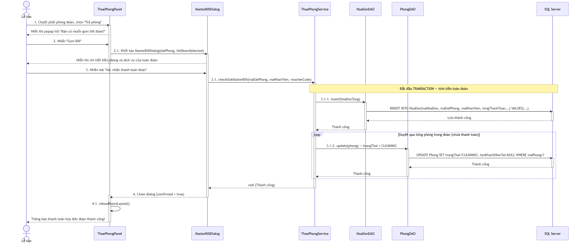

---

### 3.10 Quản lý Nhân sự - Thêm nhân viên:

#### 3.10.1 Mô tả UC_007.1

<table border="1">
  <tr>
    <td width="30%"><b>Mục</b></td>
    <td width="70%"><b>Nội dung</b></td>
  </tr>
  <tr>
    <td><b>Tên Use case:</b></td>
    <td>Thêm nhân viên mới</td>
  </tr>
  <tr>
    <td><b>Mã Use case:</b></td>
    <td>UC_007.1 / UC_002.1</td>
  </tr>
  <tr>
    <td><b>Mô tả:</b></td>
    <td>Cho phép Admin tạo mới một hồ sơ nhân viên đi kèm với tài khoản đăng nhập hệ thống trong cùng một giao dịch an toàn dữ liệu.</td>
  </tr>
  <tr>
    <td><b>Tác nhân:</b></td>
    <td>Quản trị viên (Admin)</td>
  </tr>
  <tr>
    <td><b>Điều kiện trước:</b></td>
    <td>Admin đăng nhập hệ thống, đang ở màn hình giao diện nhân viên.</td>
  </tr>
  <tr>
    <td><b>Điều kiện sau:</b></td>
    <td>Hồ sơ nhân viên mới và tài khoản hệ thống được lưu thành công vào cơ sở dữ liệu.</td>
  </tr>
  <tr>
    <td colspan="2" align="center"><b>Luồng sự kiện chính (Basic flows)</b></td>
  </tr>
  <tr>
    <td class="header-split"><b>Người dùng</b></td>
    <td class="header-split"><b>Hệ thống</b></td>
  </tr>
  <tr>
    <td>1. Nhấn nút "+ Thêm nhân viên".</td>
    <td></td>
  </tr>
  <tr>
    <td></td>
    <td>2. Hiển thị hộp thoại hộp thoại nhân viên ở chế độ trống.</td>
  </tr>
  <tr>
    <td>3. Nhập thông tin (Họ tên, SĐT, CCCD, Địa chỉ, Vai trò hệ thống) và mật khẩu tài khoản (mặc định là "123456" nếu để trống).</td>
    <td></td>
  </tr>
  <tr>
    <td>4. Nhấn nút "Thêm nhân viên".</td>
    <td></td>
  </tr>
  <tr>
    <td></td>
    <td>5. Hệ thống kiểm tra ràng buộc regex (Họ tên không số, SĐT và CCCD chỉ được nhập số và có độ dài chính xác).</td>
  </tr>
  <tr>
    <td></td>
    <td>6. Hệ thống tự động sinh mã nhân viên kế tiếp trong cơ sở dữ liệu.</td>
  </tr>
  <tr>
    <td></td>
    <td>7. Hệ thống gọi thêm nhân viên mới để lưu thực thể NhanVien và TaiKhoan tương ứng.</td>
  </tr>
  <tr>
    <td></td>
    <td>8. Hệ thống làm mới danh sách bảng trên giao diện nhân viên và hiển thị thông báo thành công.</td>
  </tr>
  <tr>
    <td>9. Nhấn nút Đóng để kết thúc.</td>
    <td></td>
  </tr>
  <tr style="background-color: #f2f2f2;">
    <td colspan="2" align="center"><b>Luồng sự kiện phụ (Alternative Flows)</b></td>
  </tr>
  <tr>
    <td></td>
    <td>5.1. Dữ liệu sai định dạng, hệ thống báo đỏ lỗi trực tiếp trên dialog và dừng thao tác lưu.</td>
  </tr>
  <tr>
    <td></td>
    <td>7.1. Trùng lặp số CCCD hoặc SĐT của nhân sự đã tồn tại trong cơ sở dữ liệu, hiển thị thông báo cảnh báo trùng dữ liệu.</td>
  </tr>
</table>

#### 3.10.2 Biểu đồ

##### Sơ đồ Activity

<details>
<summary><b>Xem mã nguồn PlantUML (nhấp để mở rộng)</b></summary>

```plantuml
@startuml
skinparam DefaultFontName "Segoe UI"
skinparam DefaultFontSize 12
skinparam ActivityMinimalWidth 180
skinparam ActivityPadding 8
skinparam ActivityMargin 8
skinparam backgroundcolor white
skinparam ActivityBackgroundColor white
skinparam ActivityBorderColor #475569
skinparam ActivityStartColor #0F172A
skinparam ActivityEndColor #0F172A
skinparam ActivityDiamondBackgroundColor white
skinparam ActivityDiamondBorderColor #475569
skinparam ArrowColor #475569
skinparam ActivityBorderThickness 1
skinparam ArrowThickness 1
skinparam linetype ortho

|Quản Trị Viên|
start
:Nhấn nút Thêm nhân viên;
|Hệ thống|
:Hiển thị hộp thoại thông tin nhân viên trống;
while (Thông tin nhân viên hợp lệ?) is (Chưa)
  |Quản Trị Viên|
  :Nhập các thông tin cá nhân bắt buộc\n(Họ tên, SĐT, CCCD, Ngày sinh, Chức vụ, Mật khẩu);
  |Hệ thống|
  :Đồng bộ Chức vụ với Vai trò hệ thống;
  |Quản Trị Viên|
  :Nhấn nút Thêm nhân viên trên form;
  |Hệ thống|
  if (Thông tin nhập liệu hợp lệ\n(Name/Phone/Email/CCCD)?) then (Không)
    :Hiển thị báo lỗi định dạng tương ứng;
  else (Có)
    if (Nhân viên chưa đủ 18 tuổi?) then (Có)
      :Báo lỗi: Ngày sinh không hợp lệ (Phải từ 18 tuổi);
    else (Không)
      if (SĐT hoặc CCCD bị trùng trong CSDL?) then (Có)
        :Thông báo trùng dữ liệu nhân sự;
      else (Không)
        break
      endif
    endif
  endif
endwhile (Hợp lệ)
:Lưu NhanVien và TaiKhoan\nbằng Transaction;
:Làm mới danh sách bảng và báo thành công;
|Quản Trị Viên|
:Đóng hộp thoại và hoàn tất;
stop
@enduml
```

</details>

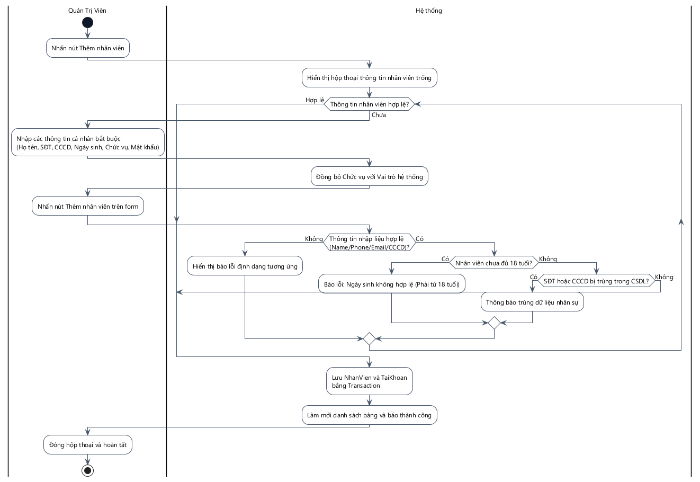

##### Sơ đồ Sequence

<details>
<summary><b>Xem mã nguồn Mermaid (nhấp để mở rộng)</b></summary>

```mermaid
sequenceDiagram
    actor Admin
    participant UI as NhanVienPanel
    participant Dlg as NhanVienDialog
    participant Service as NhanVienService
    participant NVDAO as NhanVienDAO
    participant DB as SQL Server

    Admin->>UI: 1. Click "+ Thêm nhân viên"
    activate UI
    UI->>Dlg: 1.1. Khởi tạo NhanVienDialog (mode add)
    activate Dlg
    Dlg-->>Admin: Hiển thị form trống
    deactivate UI

    Admin->>Dlg: 2. Nhập thông tin nhân sự và nhấn nút "Thêm nhân viên"
    Dlg->>Dlg: 2.1. validateFields()
    Dlg->>Service: 2.2. them(nv)
    activate Service

    Service->>NVDAO: 2.2.1. insert(nv)
    activate NVDAO
    NVDAO->>DB: INSERT INTO NhanVien(hoTen, sdt, cccd...) VALUES(?,?,?...)
    activate DB
    DB-->>NVDAO: Thành công
    NVDAO->>DB: INSERT INTO TaiKhoan(tenDangNhap, matKhau, vaiTro...) VALUES(?,?,?...)
    DB-->>NVDAO: Thành công
    deactivate DB
    NVDAO-->>Service: Trả về kết quả
    deactivate NVDAO

    Service-->>Dlg: Kết quả thêm thành công
    deactivate Service

    Dlg-->>UI: 3. Close dialog (confirmed = true)
    activate UI
    deactivate Dlg
    UI->>UI: 3.1. refresh() cập nhật danh sách
    UI-->>Admin: Thông báo "Thêm nhân viên thành công"
    deactivate UI
```

</details>

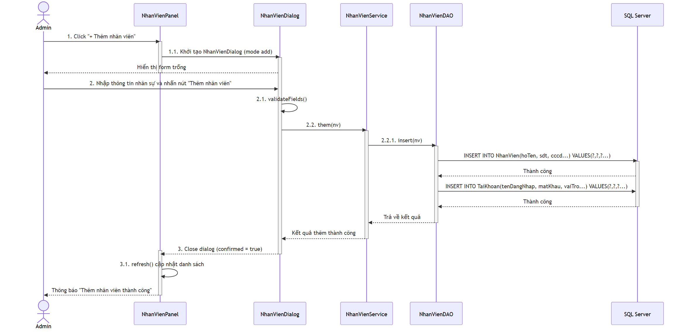

---

### 3.11 Quản lý Nhân sự - Sửa nhân viên:

#### 3.11.1 Mô tả UC_007.2

<table border="1">
  <tr>
    <td width="30%"><b>Mục</b></td>
    <td width="70%"><b>Nội dung</b></td>
  </tr>
  <tr>
    <td><b>Tên Use case:</b></td>
    <td>Sửa thông tin nhân viên</td>
  </tr>
  <tr>
    <td><b>Mã Use case:</b></td>
    <td>UC_007.2</td>
  </tr>
  <tr>
    <td><b>Mô tả:</b></td>
    <td>Cho phép Admin cập nhật hồ sơ thông tin cá nhân của nhân sự (Địa chỉ, số điện thoại, email) hoặc thay đổi quyền truy cập hệ thống.</td>
  </tr>
  <tr>
    <td><b>Tác nhân:</b></td>
    <td>Quản trị viên (Admin)</td>
  </tr>
  <tr>
    <td><b>Điều kiện trước:</b></td>
    <td>Admin đã đăng nhập và đang mở bảng danh sách nhân sự trên giao diện nhân viên.</td>
  </tr>
  <tr>
    <td><b>Điều kiện sau:</b></td>
    <td>Dữ liệu cập nhật nhân viên được đồng bộ thành công vào cơ sở dữ liệu.</td>
  </tr>
  <tr>
    <td colspan="2" align="center"><b>Luồng sự kiện chính (Basic flows)</b></td>
  </tr>
  <tr>
    <td class="header-split"><b>Người dùng</b></td>
    <td class="header-split"><b>Hệ thống</b></td>
  </tr>
  <tr>
    <td>1. Lựa chọn một nhân viên từ bảng, đúp-click chuột (hoặc chuột phải chọn "Xem / Sửa").</td>
    <td></td>
  </tr>
  <tr>
    <td></td>
    <td>2. Hệ thống tải thông tin cũ của nhân sự từ cơ sở dữ liệu và điền sẵn lên hộp thoại nhân viên.</td>
  </tr>
  <tr>
    <td>3. Chỉnh sửa thông tin cá nhân cần thiết (Số điện thoại, Địa chỉ, Chức vụ, Email...).</td>
    <td></td>
  </tr>
  <tr>
    <td>4. Nhấn nút "Lưu thay đổi".</td>
    <td></td>
  </tr>
  <tr>
    <td></td>
    <td>5. Hệ thống thực hiện kiểm tra định dạng dữ liệu nhập mới.</td>
  </tr>
  <tr>
    <td></td>
    <td>6. Hệ thống cập nhật dữ liệu hồ sơ vào bảng nhân viên.</td>
  </tr>
  <tr>
    <td></td>
    <td>7. Hệ thống làm mới danh sách bảng nhân sự trên panel và thông báo cập nhật thành công.</td>
  </tr>
  <tr>
    <td>8. Admin đóng dialog kết thúc.</td>
    <td></td>
  </tr>
  <tr style="background-color: #f2f2f2;">
    <td colspan="2" align="center"><b>Luồng sự kiện phụ (Alternative Flows)</b></td>
  </tr>
  <tr>
    <td></td>
    <td>5.1. Báo lỗi định dạng ô nhập liệu (ví dụ: Số điện thoại không hợp lệ) và dừng lưu thông tin.</td>
  </tr>
</table>

#### 3.11.2 Biểu đồ

##### Sơ đồ Activity

<details>
<summary><b>Xem mã nguồn PlantUML (nhấp để mở rộng)</b></summary>

```plantuml
@startuml
skinparam DefaultFontName "Segoe UI"
skinparam DefaultFontSize 12
skinparam ActivityMinimalWidth 180
skinparam ActivityPadding 8
skinparam ActivityMargin 8
skinparam backgroundcolor white
skinparam ActivityBackgroundColor white
skinparam ActivityBorderColor #475569
skinparam ActivityStartColor #0F172A
skinparam ActivityEndColor #0F172A
skinparam ActivityDiamondBackgroundColor white
skinparam ActivityDiamondBorderColor #475569
skinparam ArrowColor #475569
skinparam ActivityBorderThickness 1
skinparam ArrowThickness 1
skinparam linetype ortho

|Quản Trị Viên|
start
:Chọn nhân viên từ bảng, chuột phải chọn Sửa;
|Hệ thống|
:Hiển thị hộp thoại thông tin nhân viên\nđiền sẵn dữ liệu cũ;
while (Thông tin cập nhật hợp lệ?) is (Chưa)
  |Quản Trị Viên|
  :Thay đổi thông tin cá nhân,\nchức vụ hoặc trạng thái;
  :Nhập mật khẩu mới (nếu muốn thay đổi);
  :Nhấn nút Lưu thay đổi;
  |Hệ thống|
  if (Thông tin nhập liệu hợp lệ?) then (Có)
    if (Tuổi dưới 18?) then (Có)
      :Báo lỗi tuổi dưới 18;
    else (Không)
      break
    endif
  else (Không)
    :Hiển thị báo lỗi định dạng chi tiết trên Form;
  endif
endwhile (Hợp lệ)
:Cập nhật thông tin nhân viên vào CSDL;
:Tải lại danh sách bảng và báo thành công;
|Quản Trị Viên|
:Đóng hộp thoại và hoàn tất;
stop
@enduml
```

</details>

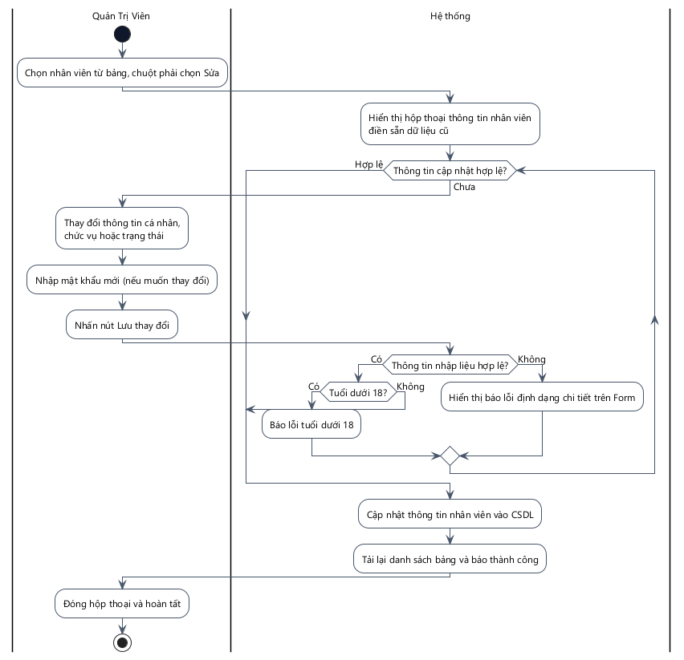

##### Sơ đồ Sequence

<details>
<summary><b>Xem mã nguồn Mermaid (nhấp để mở rộng)</b></summary>

```mermaid
sequenceDiagram
    actor Admin
    participant UI as NhanVienPanel
    participant Dlg as NhanVienDialog
    participant Service as NhanVienService
    participant NVDAO as NhanVienDAO
    participant DB as SQL Server

    Admin->>UI: 1. Đúp-click vào dòng nhân viên trên bảng
    activate UI
    UI->>Dlg: 1.1. Khởi tạo NhanVienDialog(nvSelected)
    activate Dlg
    Dlg-->>Admin: Điền sẵn thông tin cũ của nhân viên lên Form
    deactivate UI

    Admin->>Dlg: 2. Nhập thông tin sửa đổi & click "Lưu thay đổi"
    Dlg->>Dlg: 2.1. validateFields()
    Dlg->>Service: 2.2. sua(nv)
    activate Service

    Service->>NVDAO: 2.2.1. update(nv)
    activate NVDAO
    NVDAO->>DB: UPDATE NhanVien SET hoTen=?, sdt=?, diaChi=?, vaiTro=? WHERE maNhanVien=?
    activate DB
    DB-->>NVDAO: Thành công
    deactivate DB
    NVDAO-->>Service: Trả về kết quả
    deactivate NVDAO

    Service-->>Dlg: Cập nhật thành công
    deactivate Service

    Dlg-->>UI: 3. Close dialog (confirmed = true)
    activate UI
    deactivate Dlg
    UI->>UI: 3.1. refresh()
    UI-->>Admin: Thông báo "Cập nhật nhân viên thành công!"
    deactivate UI
```

</details>

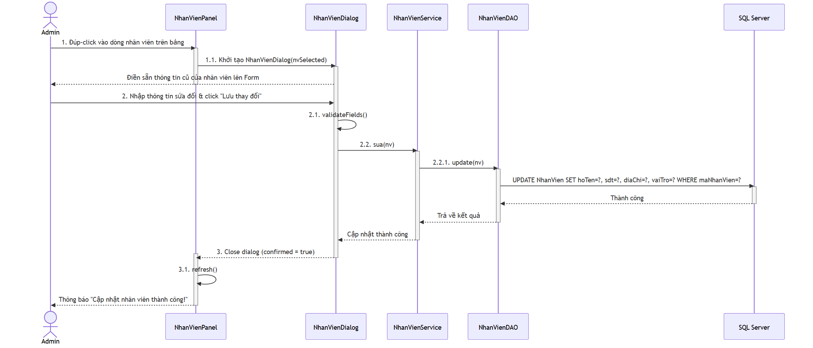

---

### 3.12 Quản lý Nhân sự - Khóa/Mở tài khoản:

#### 3.12.1 Mô tả UC_007.3

<table border="1">
  <tr>
    <td width="30%"><b>Mục</b></td>
    <td width="70%"><b>Nội dung</b></td>
  </tr>
  <tr>
    <td><b>Tên Use case:</b></td>
    <td>Khóa / Mở tài khoản</td>
  </tr>
  <tr>
    <td><b>Mã Use case:</b></td>
    <td>UC_007.3 / UC_002.3</td>
  </tr>
  <tr>
    <td><b>Mô tả:</b></td>
    <td>Cho phép Admin chuyển đổi trạng thái hoạt động của tài khoản nhân viên (Khóa hoạt động khi nhân viên nghỉ việc hoặc mở khóa khi làm việc lại).</td>
  </tr>
  <tr>
    <td><b>Tác nhân:</b></td>
    <td>Quản trị viên (Admin)</td>
  </tr>
  <tr>
    <td><b>Điều kiện trước:</b></td>
    <td>Admin đã đăng nhập, đang xem danh sách tài khoản tại giao diện nhân viên.</td>
  </tr>
  <tr>
    <td><b>Điều kiện sau:</b></td>
    <td>Trạng thái tài khoản được cập nhật (trangThai = 0 hoặc 1) thành công trong cơ sở dữ liệu.</td>
  </tr>
  <tr>
    <td colspan="2" align="center"><b>Luồng sự kiện chính (Basic flows)</b></td>
  </tr>
  <tr>
    <td class="header-split"><b>Người dùng</b></td>
    <td class="header-split"><b>Hệ thống</b></td>
  </tr>
  <tr>
    <td>1. Lựa chọn nhân sự cần thay đổi trạng thái hoạt động.</td>
    <td></td>
  </tr>
  <tr>
    <td>2. Click chuột phải, chọn "Xóa nhân viên này" (hoặc mở hộp thoại nhân viên sửa và đổi trạng thái).</td>
    <td></td>
  </tr>
  <tr>
    <td></td>
    <td>3. Hệ thống kiểm tra tài khoản bị chọn có trùng với tài khoản đang đăng nhập hay không.</td>
  </tr>
  <tr>
    <td></td>
    <td>4. Hệ thống hiển thị hộp thoại xác nhận đổi trạng thái hoạt động của nhân viên (YES/NO).</td>
  </tr>
  <tr>
    <td>5. Chọn nút "YES" đồng ý xác nhận khóa.</td>
    <td></td>
  </tr>
  <tr>
    <td></td>
    <td>6. Hệ thống đổi trạng thái hoạt động của tài khoản trong cơ sở dữ liệu.</td>
  </tr>
  <tr>
    <td></td>
    <td>7. Hệ thống làm mới danh sách bảng nhân sự và thông báo thực hiện thành công.</td>
  </tr>
  <tr style="background-color: #f2f2f2;">
    <td colspan="2" align="center"><b>Luồng sự kiện phụ (Alternative Flows)</b></td>
  </tr>
  <tr>
    <td></td>
    <td>3.1. Tài khoản bị chọn trùng với tài khoản Admin hiện đang đăng nhập, hệ thống từ chối thao tác và đưa ra thông báo: "Không thể tự xóa tài khoản của bản thân".</td>
  </tr>
</table>

#### 3.12.2 Biểu đồ

##### Sơ đồ Activity

<details>
<summary><b>Xem mã nguồn PlantUML (nhấp để mở rộng)</b></summary>

```plantuml
@startuml
skinparam DefaultFontName "Segoe UI"
skinparam DefaultFontSize 12
skinparam ActivityMinimalWidth 180
skinparam ActivityPadding 8
skinparam ActivityMargin 8
skinparam backgroundcolor white
skinparam ActivityBackgroundColor white
skinparam ActivityBorderColor #475569
skinparam ActivityStartColor #0F172A
skinparam ActivityEndColor #0F172A
skinparam ActivityDiamondBackgroundColor white
skinparam ActivityDiamondBorderColor #475569
skinparam ArrowColor #475569
skinparam ActivityBorderThickness 1
skinparam ArrowThickness 1
skinparam linetype ortho

|Quản Trị Viên|
start
:Chọn nhân viên từ bảng;
:Chuột phải chọn Khóa nhân viên này;
|Hệ thống|
if (Tự khóa tài khoản của chính mình?) then (Có)
  :Báo lỗi: Không thể tự khóa tài khoản của mình!;
  |Quản Trị Viên|
  stop
else (Không)
  :Hiển thị hộp thoại cảnh báo xác nhận YES/NO;
endif
|Quản Trị Viên|
:Chọn YES xác nhận đổi trạng thái hoạt động;
|Hệ thống|
:Khóa/Mở khóa tài khoản nhân viên trong DB;
:Tải lại bảng nhân viên và thông báo thành công;
|Quản Trị Viên|
stop
@enduml
```

</details>

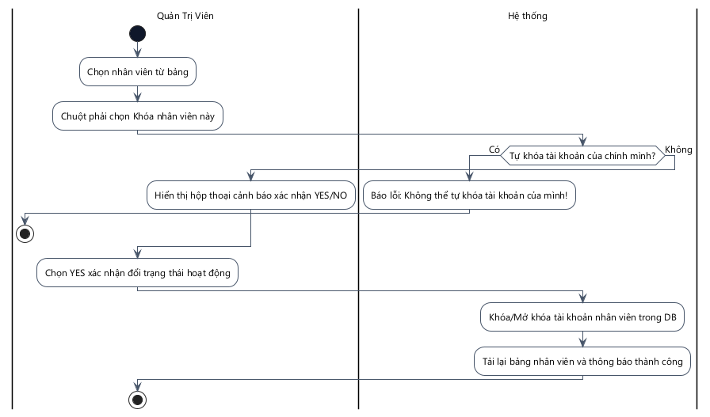

##### Sơ đồ Sequence

<details>
<summary><b>Xem mã nguồn Mermaid (nhấp để mở rộng)</b></summary>

```mermaid
sequenceDiagram
    actor Admin
    participant UI as NhanVienPanel
    participant Service as NhanVienService
    participant NVDAO as NhanVienDAO
    participant DB as SQL Server

    Admin->>UI: 1. Chọn nhân viên, chuột phải chọn "Xóa nhân viên này"
    activate UI
    UI->>UI: 1.1. Kiểm tra mã nhân viên có trùng với AuthService.getCurrentMaNV() ?

    alt Trùng với tài khoản đang đăng nhập
        UI-->>Admin: Báo lỗi "Không thể tự xóa/khóa tài khoản của bản thân đang đăng nhập!"
    else Hợp lệ
        UI-->>Admin: Hiển thị hộp thoại Xác nhận xóa (YES/NO)
        Admin->>UI: 2. Click YES
        UI->>Service: 2.1. xoa(maNhanVien)
        activate Service
        Service->>NVDAO: 2.1.1. delete(maNhanVien)
        activate NVDAO
        NVDAO->>DB: UPDATE NhanVien SET dangLamViec=0 WHERE maNhanVien=? / UPDATE TaiKhoan SET trangThai=0 WHERE maNhanVien=?
        activate DB
        DB-->>NVDAO: Thành công
        deactivate DB
        NVDAO-->>Service: true
        deactivate NVDAO
        Service-->>UI: null (Thành công)
        deactivate Service
        UI->>UI: 2.2. refresh() tải lại danh sách bảng
        UI-->>Admin: Hiển thị thông báo đã khóa tài khoản nhân viên thành công
    end
    deactivate UI
```

</details>

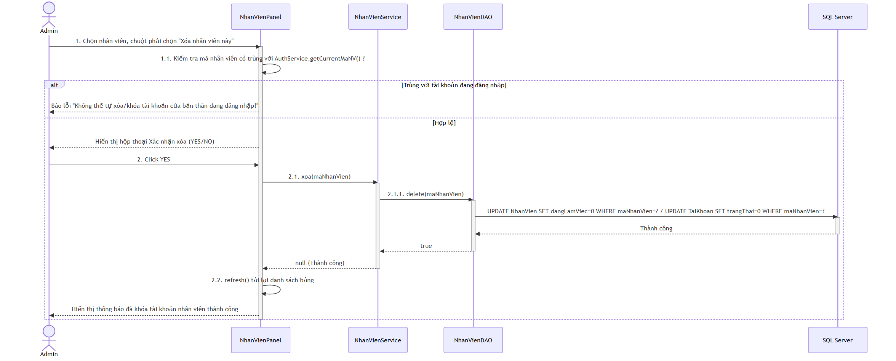

---

### 3.13 Quản lý Khách hàng - Thêm khách hàng:

#### 3.13.1 Mô tả UC_12.1

<table border="1">
  <tr>
    <td width="30%"><b>Mục</b></td>
    <td width="70%"><b>Nội dung</b></td>
  </tr>
  <tr>
    <td><b>Tên Use case:</b></td>
    <td>Thêm khách hàng mới</td>
  </tr>
  <tr>
    <td><b>Mã Use case:</b></td>
    <td>UC_12.1</td>
  </tr>
  <tr>
    <td><b>Mô tả:</b></td>
    <td>Cho phép nhân viên lễ tân thêm khách hàng mới vào hệ thống từ giao diện quản lý khách hàng (giao diện khách hàng).</td>
  </tr>
  <tr>
    <td><b>Tác nhân:</b></td>
    <td>Nhân viên lễ tân, Quản lý, Admin</td>
  </tr>
  <tr>
    <td><b>Điều kiện trước:</b></td>
    <td>Người dùng đã đăng nhập vào hệ thống và đang ở giao diện quản lý khách hàng (giao diện khách hàng).</td>
  </tr>
  <tr>
    <td><b>Điều kiện sau:</b></td>
    <td>Thông tin khách hàng mới được lưu thành công vào cơ sở dữ liệu và sẵn sàng phục vụ.</td>
  </tr>
  <tr style="background-color: #f2f2f2;">
    <td colspan="2" align="center"><b>Luồng sự kiện chính (Basic flows)</b></td>
  </tr>
  <tr>
    <td class="header-split"><b>Người dùng</b></td>
    <td class="header-split"><b>Hệ thống</b></td>
  </tr>
  <tr>
    <td>1. Lễ tân nhấn nút "Thêm khách hàng" trên thanh công cụ của giao diện khách hàng.</td>
    <td></td>
  </tr>
  <tr>
    <td></td>
    <td>2. Hệ thống hiển thị form nhập thông tin khách hàng (hộp thoại khách hàng) rỗng.</td>
  </tr>
  <tr>
    <td>3. Nhập đầy đủ thông tin cá nhân khách hàng bao gồm Họ tên, Số điện thoại, CCCD, Địa chỉ, Quốc tịch.</td>
    <td></td>
  </tr>
  <tr>
    <td>4. Nhấn nút "Lưu".</td>
    <td></td>
  </tr>
  <tr>
    <td></td>
    <td>5. Hệ thống kiểm tra tính hợp lệ và định dạng của dữ liệu khách hàng.</td>
  </tr>
  <tr>
    <td></td>
    <td>6. Hệ thống kiểm tra trùng lặp số điện thoại hoặc CCCD.</td>
  </tr>
  <tr>
    <td></td>
    <td>7. Hệ thống gọi lưu khách khách hàng để lưu bản ghi khách hàng mới vào cơ sở dữ liệu.</td>
  </tr>
  <tr>
    <td></td>
    <td>8. Hệ thống phản hồi thông báo thêm khách hàng mới thành công và tự động đóng hộp thoại khách hàng.</td>
  </tr>
  <tr>
    <td></td>
    <td>9. Hệ thống tải lại bảng danh sách khách hàng hiển thị trên giao diện khách hàng.</td>
  </tr>
  <tr style="background-color: #f2f2f2;">
    <td colspan="2" align="center"><b>Luồng sự kiện phụ (Alternative Flows)</b></td>
  </tr>
  <tr>
    <td>5a. Dữ liệu nhập vào sai định dạng (ví dụ CCCD không đúng 12 số hoặc bỏ trống thông tin bắt buộc). Hệ thống hiển thị cảnh báo lỗi tương ứng và giữ nguyên giao diện form nhập.</td>
    <td></td>
  </tr>
  <tr>
    <td>6a. Số điện thoại hoặc số CCCD nhập vào bị trùng với một khách hàng khác đã có sẵn trong cơ sở dữ liệu. Hệ thống báo lỗi trùng lặp và yêu cầu kiểm tra lại thông tin.</td>
    <td></td>
  </tr>
  <tr>
    <td>4b. Chọn nút "Đóng" hoặc nút "Hủy". Hệ thống tắt hộp thoại và không lưu thông tin khách hàng.</td>
    <td></td>
  </tr>
</table>

#### 3.13.2 Biểu đồ

##### Sơ đồ Activity

<details>
<summary><b>Xem mã nguồn PlantUML (nhấp để mở rộng)</b></summary>

```plantuml
@startuml
skinparam DefaultFontName "Segoe UI"
skinparam DefaultFontSize 12
skinparam ActivityMinimalWidth 180
skinparam ActivityPadding 8
skinparam ActivityMargin 8
skinparam backgroundcolor white
skinparam ActivityBackgroundColor white
skinparam ActivityBorderColor #475569
skinparam ActivityStartColor #0F172A
skinparam ActivityEndColor #0F172A
skinparam ActivityDiamondBackgroundColor white
skinparam ActivityDiamondBorderColor #475569
skinparam ArrowColor #475569
skinparam ActivityBorderThickness 1
skinparam ArrowThickness 1
skinparam linetype ortho

|Nhân Viên|
start
:Nhấn Thêm khách hàng;
|Hệ thống|
:Hiển thị hộp thoại thông tin khách hàng rỗng;
while (Thông tin khách hàng hợp lệ?) is (Chưa)
  |Nhân Viên|
  :Nhập quốc tịch khách hàng;
  |Hệ thống|
  if (Quốc tịch nước ngoài?) then (Có)
    :Hiển thị các trường Passport & Visa;
  else (Không)
    :Ẩn các trường Passport & Visa;
  endif
  |Nhân Viên|
  :Nhập Họ tên, SĐT, CCCD/Passport,\nNgày sinh, Giới tính và nhấn Lưu;
  |Hệ thống|
  if (Định dạng Họ tên/SĐT/CCCD/Passport hợp lệ?) then (Không)
    :Báo lỗi định dạng trường thông tin;
  else (Có)
    if (Khách hàng bị trùng lặp số SĐT/CCCD?) then (Có)
      :Báo lỗi thông tin đã tồn tại trong hệ thống;
    else (Không)
      break
    endif
  endif
endwhile (Hợp lệ)
:Lưu thông tin khách hàng vào cơ sở dữ liệu;
:Thông báo thêm khách hàng thành công;
:Tải lại bảng khách hàng và đóng hộp thoại;
|Nhân Viên|
stop
@enduml
```

</details>

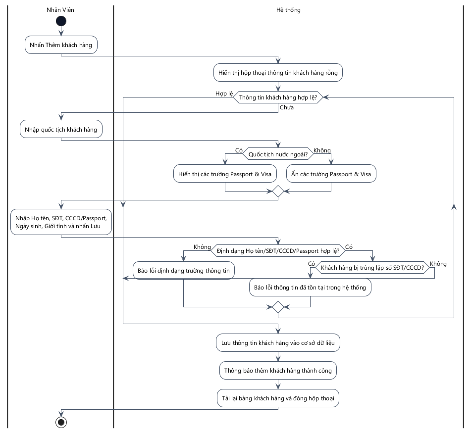

##### Sơ đồ Sequence

<details>
<summary><b>Xem mã nguồn Mermaid (nhấp để mở rộng)</b></summary>

```mermaid
sequenceDiagram
    actor User as Lễ tân / Quản lý
    participant Panel as KhachHangPanel
    participant Dialog as KhachHangDialog
    participant Service as KhachHangService
    participant DAO as KhachHangDAO
    participant DB as SQL Server

    User->>Panel: 1. Click "Thêm khách hàng"
    activate Panel
    Panel->>Dialog: 1.1. Khởi tạo KhachHangDialog()
    activate Dialog
    Dialog-->>User: Giao diện form nhập trống
    User->>Dialog: 2. Nhập thông tin khách hàng & nhấn "Lưu"
    Dialog->>Dialog: 2.1. validateInput()

    alt Dữ liệu không hợp lệ
        Dialog-->>User: Báo lỗi định dạng trường thông tin
    else Dữ liệu hợp lệ
        Dialog->>Service: 2.2. themKhachHang(kh)
        activate Service
        Service->>DAO: 2.2.1. getByPhone(kh.getSoDienThoai())
        activate DAO
        DAO-->>Service: trả về KhachHang tồn tại (nếu có)
        deactivate DAO

        alt Trùng lặp SĐT/CCCD
            Service-->>Dialog: trả về thông báo lỗi trùng lặp
            Dialog-->>User: Hiển thị lỗi trùng lặp thông tin
        else Thông tin duy nhất
            Service->>DAO: 2.2.2. insert(kh)
            activate DAO
            DAO->>DB: INSERT INTO KhachHang (hoTen, soDienThoai, cccd, diaChi, quocTich, isBlacklist) VALUES (?,?,?,?,?,?)
            activate DB
            DB-->>DAO: Thành công
            deactivate DB
            DAO-->>Service: true
            deactivate DAO
            Service-->>Dialog: null (Thành công)
            deactivate Service
            Dialog-->>User: Báo "Thêm khách hàng thành công"
            Dialog->>Panel: refreshView()
            deactivate Dialog
            Panel->>Panel: loadData() (Tải lại bảng khách hàng)
        end
    end
    deactivate Panel
```

</details>

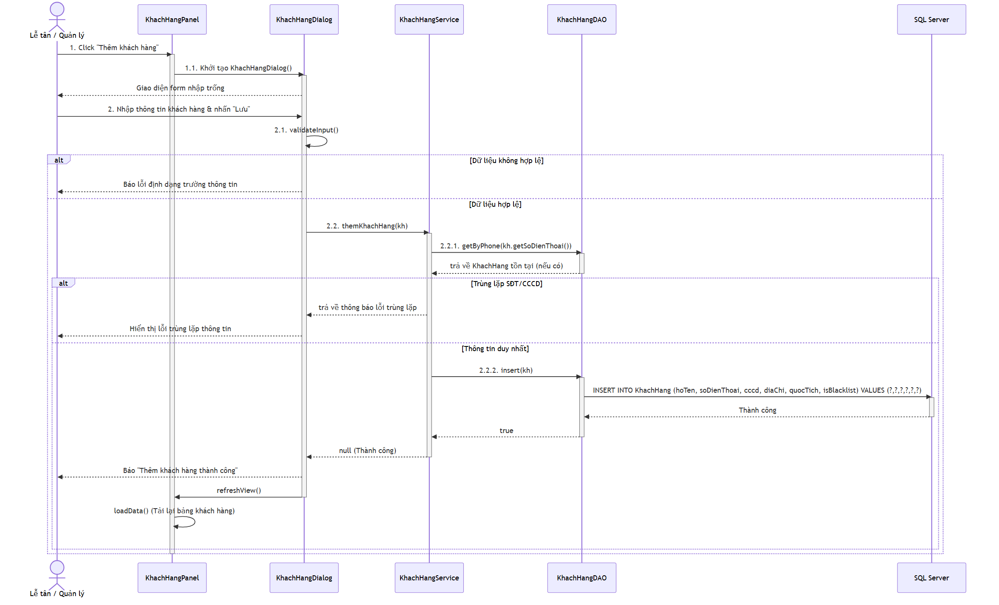

### 3.14 Quản lý Khách hàng - Sửa khách hàng:

#### 3.14.1 Mô tả UC_12.2

<table border="1">
  <tr>
    <td width="30%"><b>Mục</b></td>
    <td width="70%"><b>Nội dung</b></td>
  </tr>
  <tr>
    <td><b>Tên Use case:</b></td>
    <td>Sửa thông tin khách hàng</td>
  </tr>
  <tr>
    <td><b>Mã Use case:</b></td>
    <td>UC_12.2</td>
  </tr>
  <tr>
    <td><b>Mô tả:</b></td>
    <td>Cho phép nhân viên lễ tân cập nhật các thông tin cá nhân thay đổi của khách hàng (Địa chỉ, số điện thoại, quốc tịch, gắn blacklist).</td>
  </tr>
  <tr>
    <td><b>Tác nhân:</b></td>
    <td>Nhân viên lễ tân, Quản lý</td>
  </tr>
  <tr>
    <td><b>Điều kiện trước:</b></td>
    <td>Khách hàng đã có hồ sơ thông tin trong cơ sở dữ liệu và đang hiển thị trên bảng giao diện khách hàng.</td>
  </tr>
  <tr>
    <td><b>Điều kiện sau:</b></td>
    <td>Thông tin sửa đổi được cập nhật thành công vào bảng KhachHang trong cơ sở dữ liệu.</td>
  </tr>
  <tr>
    <td colspan="2" align="center"><b>Luồng sự kiện chính (Basic flows)</b></td>
  </tr>
  <tr>
    <td class="header-split"><b>Người dùng</b></td>
    <td class="header-split"><b>Hệ thống</b></td>
  </tr>
  <tr>
    <td>1. Đúp-click vào khách hàng cần thay đổi thông tin trên bảng bảng dữ liệu.</td>
    <td></td>
  </tr>
  <tr>
    <td></td>
    <td>2. Hệ thống tải dữ liệu hiện tại và hiển thị lên hộp thoại khách hàng.</td>
  </tr>
  <tr>
    <td>3. Thay đổi thông tin cá nhân cần sửa của khách hàng (SĐT, Quốc tịch, Đánh dấu Blacklist nếu khách quậy phá/nợ tiền).</td>
    <td></td>
  </tr>
  <tr>
    <td>4. Nhấn nút "Lưu thay đổi".</td>
    <td></td>
  </tr>
  <tr>
    <td></td>
    <td>5. Hệ thống kiểm tra hợp lệ định dạng CCCD/Số điện thoại.</td>
  </tr>
  <tr>
    <td></td>
    <td>6. Hệ thống lưu dữ liệu cập nhật khách hàng vào cơ sở dữ liệu.</td>
  </tr>
  <tr>
    <td></td>
    <td>7. Hệ thống làm mới danh sách bảng trên giao diện khách hàng và hiển thị thông báo thành công.</td>
  </tr>
  <tr>
    <td>8. Nhân viên đóng dialog và kết thúc.</td>
    <td></td>
  </tr>
  <tr style="background-color: #f2f2f2;">
    <td colspan="2" align="center"><b>Luồng sự kiện phụ (Alternative Flows)</b></td>
  </tr>
  <tr>
    <td></td>
    <td>5.1. Số điện thoại nhập sai định dạng, hệ thống thông báo lỗi định dạng trường dữ liệu và dừng lưu.</td>
  </tr>
</table>

#### 3.14.2 Biểu đồ

##### Sơ đồ Activity

<details>
<summary><b>Xem mã nguồn PlantUML (nhấp để mở rộng)</b></summary>

```plantuml
@startuml
skinparam DefaultFontName "Segoe UI"
skinparam DefaultFontSize 12
skinparam ActivityMinimalWidth 180
skinparam ActivityPadding 8
skinparam ActivityMargin 8
skinparam backgroundcolor white
skinparam ActivityBackgroundColor white
skinparam ActivityBorderColor #475569
skinparam ActivityStartColor #0F172A
skinparam ActivityEndColor #0F172A
skinparam ActivityDiamondBackgroundColor white
skinparam ActivityDiamondBorderColor #475569
skinparam ArrowColor #475569
skinparam ActivityBorderThickness 1
skinparam ArrowThickness 1
skinparam linetype ortho

|Nhân Viên|
start
:Chọn khách hàng trên bảng, đúp-click chuột;
|Hệ thống|
:Hiển thị hộp thoại thông tin khách hàng\nđiền sẵn dữ liệu cũ;
while (Thông tin sửa đổi hợp lệ?) is (Chưa)
  |Nhân Viên|
  :Sửa đổi thông tin và nhấn Lưu thay đổi;
  |Hệ thống|
  if (Định dạng Họ tên/SĐT/CCCD/Passport hợp lệ?) then (Có)
    break
  else (Không)
    :Báo lỗi định dạng tương ứng;
  endif
endwhile (Hợp lệ)
:Cập nhật dữ liệu khách hàng vào cơ sở dữ liệu;
:Tải lại danh sách bảng và báo thành công;
|Nhân Viên|
:Đóng hộp thoại và hoàn tất;
stop
@enduml
```

</details>

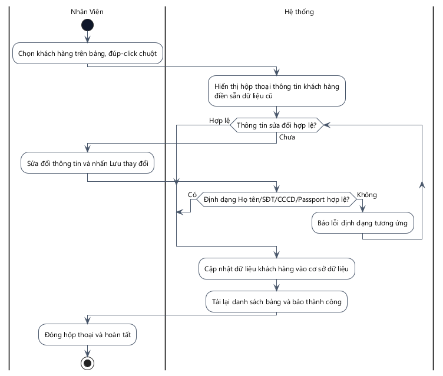

##### Sơ đồ Sequence

<details>
<summary><b>Xem mã nguồn Mermaid (nhấp để mở rộng)</b></summary>

```mermaid
sequenceDiagram
    actor Receptionist as Lễ tân
    participant UI as KhachHangPanel
    participant Dlg as KhachHangDialog
    participant Service as KhachHangService
    participant KHDAO as KhachHangDAO
    participant DB as SQL Server

    Receptionist->>UI: 1. Đúp-click vào dòng khách hàng trên bảng
    activate UI
    UI->>Dlg: 1.1. Khởi tạo KhachHangDialog(khSelected)
    activate Dlg
    Dlg-->>Receptionist: Điền sẵn thông tin cũ của khách hàng
    deactivate UI

    Receptionist->>Dlg: 2. Thay đổi thông tin & click "Lưu"
    Dlg->>Dlg: 2.1. validateInput()
    Dlg->>Service: 2.2. suaKhachHang(kh)
    activate Service

    Service->>KHDAO: 2.2.1. update(kh)
    activate KHDAO
    KHDAO->>DB: UPDATE KhachHang SET hoTen=?, soDienThoai=?, cccd=?, quocTich=?, isBlacklist=? WHERE maKhachHang=?
    activate DB
    DB-->>KHDAO: Thành công
    deactivate DB
    KHDAO-->>Service: Thành công
    deactivate KHDAO

    Service-->>Dlg: Kết quả sửa thành công
    deactivate Service

    Dlg-->>UI: 3. Close dialog (confirmed = true)
    activate UI
    deactivate Dlg
    UI->>UI: 3.1. refresh() tải lại bảng danh sách khách hàng
    UI-->>Receptionist: Thông báo cập nhật thông tin khách hàng thành công
    deactivate UI
```

</details>

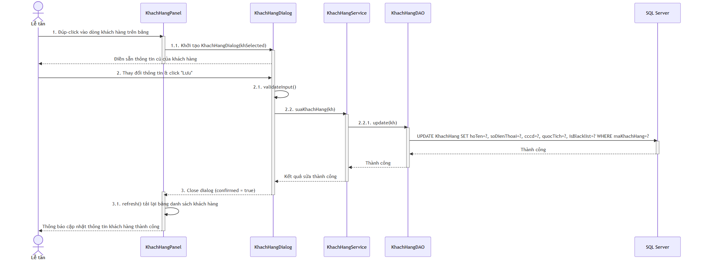

---

### 3.15 Quản lý Khách hàng - Vô hiệu hóa khách hàng:

#### 3.15.1 Mô tả UC_12.3

<table border="1">
  <tr>
    <td width="30%"><b>Mục</b></td>
    <td width="70%"><b>Nội dung</b></td>
  </tr>
  <tr>
    <td><b>Tên Use case:</b></td>
    <td>Vô hiệu hóa hồ sơ khách hàng</td>
  </tr>
  <tr>
    <td><b>Mã Use case:</b></td>
    <td>UC_12.3</td>
  </tr>
  <tr>
    <td><b>Mô tả:</b></td>
    <td>Cho phép Quản lý hoặc Admin vô hiệu hóa tài khoản/hồ sơ khách hàng cũ (ẩn logic), ngăn không cho đặt phòng nhưng bảo toàn lịch sử hóa đơn.</td>
  </tr>
  <tr>
    <td><b>Tác nhân:</b></td>
    <td>Quản lý, Admin</td>
  </tr>
  <tr>
    <td><b>Điều kiện trước:</b></td>
    <td>Đăng nhập bằng tài khoản có vai trò Quản lý/Admin và mở giao diện khách hàng.</td>
  </tr>
  <tr>
    <td><b>Điều kiện sau:</b></td>
    <td>Trạng thái hoạt động của khách hàng được đổi thành Vô hiệu hóa trong cơ sở dữ liệu.</td>
  </tr>
  <tr>
    <td colspan="2" align="center"><b>Luồng sự kiện chính (Basic flows)</b></td>
  </tr>
  <tr>
    <td class="header-split"><b>Người dùng</b></td>
    <td class="header-split"><b>Hệ thống</b></td>
  </tr>
  <tr>
    <td>1. Lựa chọn khách hàng cần xử lý từ bảng bảng dữ liệu.</td>
    <td></td>
  </tr>
  <tr>
    <td>2. Click chuột phải, chọn chức năng "Vô hiệu hóa hồ sơ".</td>
    <td></td>
  </tr>
  <tr>
    <td></td>
    <td>3. Hệ thống kiểm tra quyền hạn của tài khoản đang thao tác (kiểm tra vai trò tài khoản).</td>
  </tr>
  <tr>
    <td></td>
    <td>4. Hệ thống hiển thị hộp thoại cảnh báo xác nhận hành động vô hiệu hóa khách hàng (YES/NO).</td>
  </tr>
  <tr>
    <td>5. Nhấn chọn "YES".</td>
    <td></td>
  </tr>
  <tr>
    <td></td>
    <td>6. Hệ thống cập nhật trạng thái ẩn khách hàng trong cơ sở dữ liệu.</td>
  </tr>
  <tr>
    <td></td>
    <td>7. Hệ thống làm mới bảng danh sách và thông báo thực hiện thành công.</td>
  </tr>
  <tr style="background-color: #f2f2f2;">
    <td colspan="2" align="center"><b>Luồng sự kiện phụ (Alternative Flows)</b></td>
  </tr>
  <tr>
    <td></td>
    <td>3.1. Người dùng có vai trò là Lễ tân (RECEPTIONIST) thực hiện chuột phải vô hiệu hóa khách hàng, hệ thống chặn quyền thao tác và thông báo: "Bạn không có quyền vô hiệu hóa khách hàng! Chỉ Quản lý/Admin mới được phép".</td>
  </tr>
</table>

#### 3.15.2 Biểu đồ

##### Sơ đồ Activity

<details>
<summary><b>Xem mã nguồn PlantUML (nhấp để mở rộng)</b></summary>

```plantuml
@startuml
skinparam DefaultFontName "Segoe UI"
skinparam DefaultFontSize 12
skinparam ActivityMinimalWidth 180
skinparam ActivityPadding 8
skinparam ActivityMargin 8
skinparam backgroundcolor white
skinparam ActivityBackgroundColor white
skinparam ActivityBorderColor #475569
skinparam ActivityStartColor #0F172A
skinparam ActivityEndColor #0F172A
skinparam ActivityDiamondBackgroundColor white
skinparam ActivityDiamondBorderColor #475569
skinparam ArrowColor #475569
skinparam ActivityBorderThickness 1
skinparam ArrowThickness 1
skinparam linetype ortho

|Quản Lý / Admin|
start
:Chọn khách hàng từ bảng;
:Chuột phải chọn Vô hiệu hóa hồ sơ;
|Hệ thống|
if (Người dùng có quyền Quản lý?) then (Không)
  :Ẩn/Báo lỗi: Chỉ Quản lý mới được quyền!;
  |Quản Lý / Admin|
  stop
else (Có)
  :Hiển thị cảnh báo xác nhận YES/NO;
endif
|Quản Lý / Admin|
:Nhấn chọn YES xác nhận;
|Hệ thống|
:Cập nhật trạng thái vô hiệu hóa trong DB;
:Tải lại bảng khách hàng và thông báo thành công;
|Quản Lý / Admin|
stop
@enduml
```

</details>

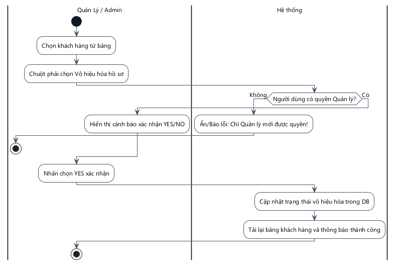

##### Sơ đồ Sequence

<details>
<summary><b>Xem mã nguồn Mermaid (nhấp để mở rộng)</b></summary>

```mermaid
sequenceDiagram
    actor Manager as Quản lý / Admin
    participant UI as KhachHangPanel
    participant Auth as AuthService
    participant Service as KhachHangService
    participant KHDAO as KhachHangDAO
    participant DB as SQL Server

    Manager->>UI: 1. Chọn khách hàng, chuột phải chọn "Vô hiệu hóa hồ sơ"
    activate UI
    UI->>Auth: 1.1. canEdit("khachhang")
    activate Auth
    Auth-->>UI: Trả về true (nhưng kiểm tra vai trò hiện tại)
    deactivate Auth

    alt Vai trò là Lễ tân (RECEPTIONIST)
        UI-->>Manager: Hiển thị lỗi "Chỉ Quản lý/Admin mới được phép vô hiệu hóa!"
    else Vai trò là Quản lý/Admin
        UI-->>Manager: Hiển thị hộp thoại Xác nhận (YES/NO)
        Manager->>UI: 2. Nhấp chọn YES
        UI->>Service: 2.1. xoa(maKhachHang)
        activate Service
        Service->>KHDAO: 2.1.1. delete(maKhachHang)
        activate KHDAO
        KHDAO->>DB: UPDATE KhachHang SET trangThai=0 WHERE maKhachHang=?
        activate DB
        DB-->>KHDAO: Thành công
        deactivate DB
        KHDAO-->>Service: true
        deactivate KHDAO
        Service-->>UI: null (Thành công)
        deactivate Service
        UI->>UI: 2.2. refresh() tải lại danh sách
        UI-->>Manager: Thông báo vô hiệu hóa thành công
    end
    deactivate UI
```

</details>

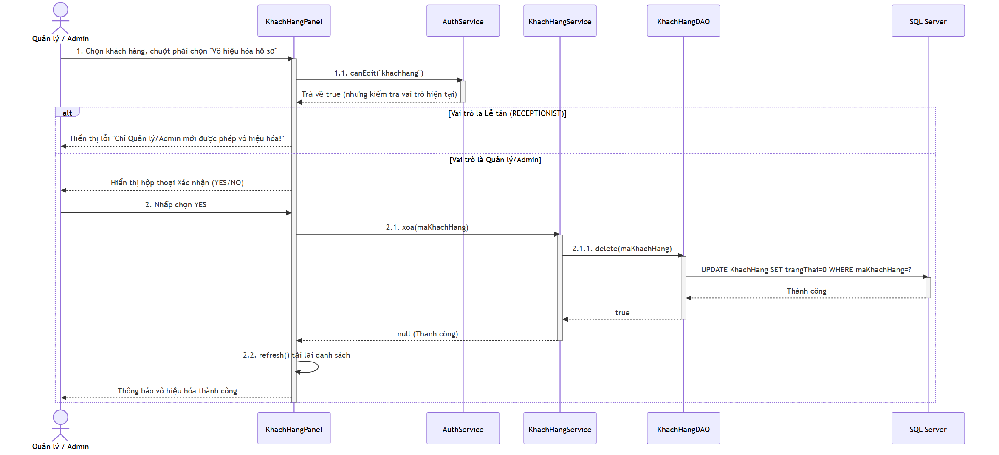

---

### 3.16 Quản lý Phòng - Thêm phòng:

#### 3.16.1 Mô tả UC_008.1

<table border="1">
  <tr>
    <td width="30%"><b>Mục</b></td>
    <td width="70%"><b>Nội dung</b></td>
  </tr>
  <tr>
    <td><b>Tên Use case:</b></td>
    <td>Thêm phòng mới</td>
  </tr>
  <tr>
    <td><b>Mã Use case:</b></td>
    <td>UC_008.1</td>
  </tr>
  <tr>
    <td><b>Mô tả:</b></td>
    <td>Cho phép Quản lý hoặc Admin thêm mới một phòng vật lý vào hệ thống sơ đồ khách sạn.</td>
  </tr>
  <tr>
    <td><b>Tác nhân:</b></td>
    <td>Quản lý, Admin</td>
  </tr>
  <tr>
    <td><b>Điều kiện trước:</b></td>
    <td>Đăng nhập tài khoản Quản lý/Admin và đang mở màn hình PhongPanel.</td>
  </tr>
  <tr>
    <td><b>Điều kiện sau:</b></td>
    <td>Thực thể phòng mới được lưu thành công vào cơ sở dữ liệu.</td>
  </tr>
  <tr>
    <td colspan="2" align="center"><b>Luồng sự kiện chính (Basic flows)</b></td>
  </tr>
  <tr>
    <td class="header-split"><b>Người dùng</b></td>
    <td class="header-split"><b>Hệ thống</b></td>
  </tr>
  <tr>
    <td>1. Nhấn nút "+ Thêm phòng mới".</td>
    <td></td>
  </tr>
  <tr>
    <td></td>
    <td>2. Hệ thống mở hộp thoại hộp thoại phòng trống.</td>
  </tr>
  <tr>
    <td>3. Nhập số phòng, vị trí tầng, hướng nhìn (view) và chọn loại phòng (từ danh sách ComboBox tải từ cơ sở dữ liệu).</td>
    <td></td>
  </tr>
  <tr>
    <td>4. Nhấn nút "Lưu".</td>
    <td></td>
  </tr>
  <tr>
    <td></td>
    <td>5. Hệ thống kiểm tra tính trùng lặp số phòng mới trong cơ sở dữ liệu.</td>
  </tr>
  <tr>
    <td></td>
    <td>6. Hệ thống gọi thêm phòng mới để INSERT bản ghi mới vào bảng Phong với trạng thái mặc định là Trống.</td>
  </tr>
  <tr>
    <td></td>
    <td>7. Hệ thống làm mới bảng trên PhongPanel và hiển thị thông báo thêm thành công.</td>
  </tr>
  <tr>
    <td>8. Người dùng đóng dialog hoàn tất.</td>
    <td></td>
  </tr>
  <tr style="background-color: #f2f2f2;">
    <td colspan="2" align="center"><b>Luồng sự kiện phụ (Alternative Flows)</b></td>
  </tr>
  <tr>
    <td></td>
    <td>5.1. Số phòng đã tồn tại, hệ thống báo lỗi "Số phòng đã tồn tại trong hệ thống. Vui lòng nhập số khác" và giữ nguyên giao diện hộp thoại phòng.</td>
  </tr>
</table>

#### 3.16.2 Biểu đồ

##### Sơ đồ Activity

<details>
<summary><b>Xem mã nguồn PlantUML (nhấp để mở rộng)</b></summary>

```plantuml
@startuml
skinparam DefaultFontName "Segoe UI"
skinparam DefaultFontSize 12
skinparam ActivityMinimalWidth 180
skinparam ActivityPadding 8
skinparam ActivityMargin 8
skinparam backgroundcolor white
skinparam ActivityBackgroundColor white
skinparam ActivityBorderColor #475569
skinparam ActivityStartColor #0F172A
skinparam ActivityEndColor #0F172A
skinparam ActivityDiamondBackgroundColor white
skinparam ActivityDiamondBorderColor #475569
skinparam ArrowColor #475569
skinparam ActivityBorderThickness 1
skinparam ArrowThickness 1
skinparam linetype ortho

|Quản Lý / Admin|
start
:Nhấn nút Thêm phòng mới;
|Hệ thống|
:Hiển thị hộp thoại thông tin phòng;
while (Số phòng hợp lệ?) is (Chưa)
  |Quản Lý / Admin|
  :Nhập số phòng, chọn loại phòng,\nhướng nhìn và tầng;
  |Hệ thống|
  :Tự động tải sức chứa và giá\ntheo loại phòng đã chọn;
  :Hiển thị thông tin giá hiện hành\ncủa bảng giá đang áp dụng;
  |Quản Lý / Admin|
  :Nhấn nút Lưu phòng;
  |Hệ thống|
  if (Số phòng đã tồn tại trong CSDL?) then (Có)
    :Báo lỗi số phòng bị trùng lặp;
  else (Không)
    break
  endif
endwhile (Hợp lệ)
:Lưu thông tin phòng vào cơ sở dữ liệu;
:Tải lại bảng danh sách phòng và báo thành công;
|Quản Lý / Admin|
:Đóng hộp thoại và kết thúc;
stop
@enduml
```

</details>

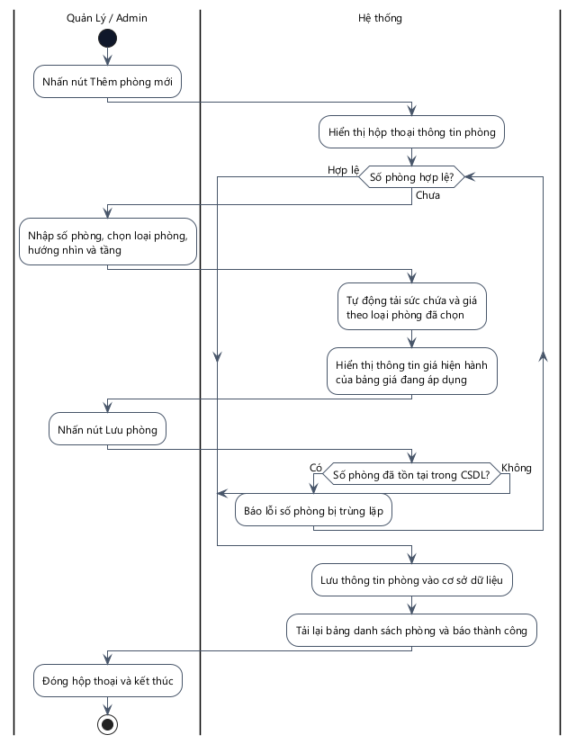

##### Sơ đồ Sequence

<details>
<summary><b>Xem mã nguồn Mermaid (nhấp để mở rộng)</b></summary>

```mermaid
sequenceDiagram
    actor Manager as Quản lý / Admin
    participant UI as PhongPanel
    participant Dlg as PhongDialog
    participant Service as PhongService
    participant DAO as PhongDAO
    participant DB as SQL Server

    Manager->>UI: 1. Click "+ Thêm phòng mới"
    activate UI
    UI->>Dlg: 1.1. Khởi tạo PhongDialog (mode add)
    activate Dlg
    Dlg-->>Manager: Hiển thị form trống
    deactivate UI

    Manager->>Dlg: 2. Nhập số phòng, tầng, chọn loại phòng và click "Lưu"
    Dlg->>Service: 2.1. themPhong(phong)
    activate Service

    Service->>DAO: 2.1.1. checkSoPhongTonTai(soPhong)
    activate DAO
    DAO->>DB: SELECT COUNT(*) FROM Phong WHERE soPhong=?
    activate DB
    DB-->>DAO: Trả về kết quả (0 = chưa tồn tại)
    deactivate DB
    DAO-->>Service: false
    deactivate DAO

    Service->>DAO: 2.1.2. insert(phong)
    activate DAO
    DAO->>DB: INSERT INTO Phong(soPhong, maLoaiPhong, viTriTang, trangThai) VALUES(?,?,?,?)
    activate DB
    DB-->>DAO: Thành công
    deactivate DB
    DAO-->>Service: Thành công
    deactivate DAO

    Service-->>Dlg: Kết quả thêm thành công
    deactivate Service

    Dlg-->>UI: 3. Close dialog (confirmed = true)
    activate UI
    deactivate Dlg
    UI->>UI: 3.1. refreshTable() làm mới danh sách phòng
    UI-->>Manager: Thông báo thêm thành công
    deactivate UI
```

</details>

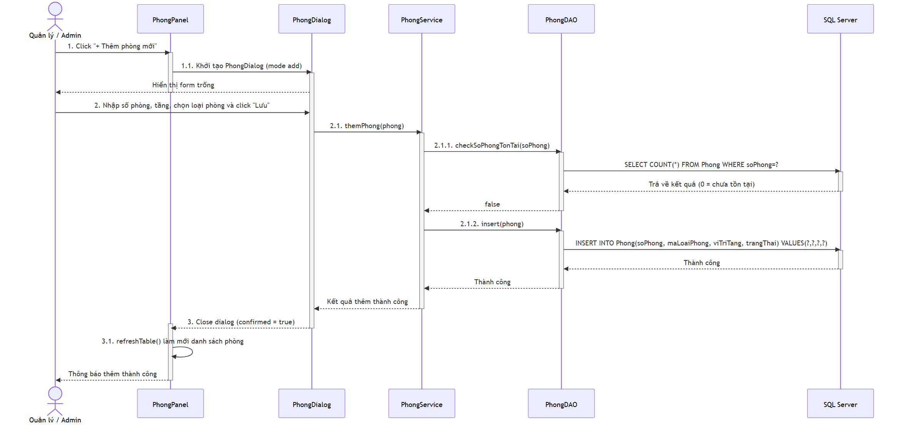

---

### 3.17 Quản lý Bảng giá phòng:

#### 3.17.1 Mô tả UC_008.5

<table border="1">
  <tr>
    <td width="30%"><b>Mục</b></td>
    <td width="70%"><b>Nội dung</b></td>
  </tr>
  <tr>
    <td><b>Tên Use case:</b></td>
    <td>Cập nhật bảng giá phòng</td>
  </tr>
  <tr>
    <td><b>Mã Use case:</b></td>
    <td>UC_008.5</td>
  </tr>
  <tr>
    <td><b>Mô tả:</b></td>
    <td>Cho phép quản lý điều chỉnh các mốc đơn giá giờ đầu, giờ tiếp theo, đơn giá qua đêm, đơn giá ngày của từng loại phòng trong khách sạn.</td>
  </tr>
  <tr>
    <td><b>Tác nhân:</b></td>
    <td>Quản lý, Admin</td>
  </tr>
  <tr>
    <td><b>Điều kiện trước:</b></td>
    <td>Đăng nhập hệ thống bằng tài khoản Quản lý, mở tab "Quản lý bảng giá" tại giao diện quản trị danh mục.</td>
  </tr>
  <tr>
    <td><b>Điều kiện sau:</b></td>
    <td>Bảng giá phòng mới được áp dụng và cập nhật thành công vào cơ sở dữ liệu.</td>
  </tr>
  <tr>
    <td colspan="2" align="center"><b>Luồng sự kiện chính (Basic flows)</b></td>
  </tr>
  <tr>
    <td class="header-split"><b>Người dùng</b></td>
    <td class="header-split"><b>Hệ thống</b></td>
  </tr>
  <tr>
    <td>1. Lựa chọn loại phòng cần cấu hình giá từ bảng trên BangGiaPanel.</td>
    <td></td>
  </tr>
  <tr>
    <td>2. Nhấn nút "Cập nhật bảng giá".</td>
    <td></td>
  </tr>
  <tr>
    <td></td>
    <td>3. Hệ thống hiển thị BangGiaDialog chứa thông số giá hiện tại của loại phòng đã chọn.</td>
  </tr>
  <tr>
    <td>4. Nhập các mức giá mới (Đơn giá giờ đầu, Giá giờ tiếp theo, Giá qua đêm, Giá ngày).</td>
    <td></td>
  </tr>
  <tr>
    <td>5. Nhấn nút "Lưu thay đổi".</td>
    <td></td>
  </tr>
  <tr>
    <td></td>
    <td>6. Hệ thống thực hiện kiểm tra các ô giá trị nhập vào phải là số thực dương lớn hơn hoặc bằng 0.</td>
  </tr>
  <tr>
    <td></td>
    <td>7. Hệ thống gọi BangGiaDAO thực hiện cập nhật bảng giá của loại phòng này trong cơ sở dữ liệu.</td>
  </tr>
  <tr>
    <td></td>
    <td>8. Hệ thống tải lại danh sách trên BangGiaPanel và thông báo cập nhật thành công.</td>
  </tr>
  <tr>
    <td>9. Nhấn nút Đóng để kết thúc.</td>
    <td></td>
  </tr>
  <tr style="background-color: #f2f2f2;">
    <td colspan="2" align="center"><b>Luồng sự kiện phụ (Alternative Flows)</b></td>
  </tr>
  <tr>
    <td></td>
    <td>6.1. Giá trị nhập vào âm hoặc sai định dạng chữ, hệ thống báo lỗi định dạng số và giữ nguyên dialog.</td>
  </tr>
</table>

#### 3.17.2 Biểu đồ

##### Sơ đồ Activity

<details>
<summary><b>Xem mã nguồn PlantUML (nhấp để mở rộng)</b></summary>

```plantuml
@startuml
skinparam DefaultFontName "Segoe UI"
skinparam DefaultFontSize 12
skinparam ActivityMinimalWidth 180
skinparam ActivityPadding 8
skinparam ActivityMargin 8
skinparam backgroundcolor white
skinparam ActivityBackgroundColor white
skinparam ActivityBorderColor #475569
skinparam ActivityStartColor #0F172A
skinparam ActivityEndColor #0F172A
skinparam ActivityDiamondBackgroundColor white
skinparam ActivityDiamondBorderColor #475569
skinparam ArrowColor #475569
skinparam ActivityBorderThickness 1
skinparam ArrowThickness 1
skinparam linetype ortho

|Quản Lý|
start
:Chọn loại phòng, nhấn Cập nhật bảng giá;
|Hệ thống|
:Hiển thị hộp thoại Bảng giá\ncó các mức giá cũ;
while (Các mức giá hợp lệ?) is (Chưa)
  |Quản Lý|
  :Thay đổi mức giá (ngày, giờ, cuối tuần, phụ phí);
  :Nhấn nút Lưu thay đổi;
  |Hệ thống|
  if (Mức giá là số hợp lệ và không âm?) then (Có)
    break
  else (Không)
    :Thông báo lỗi: Đơn giá không hợp lệ!;
  endif
endwhile (Hợp lệ)
:Cập nhật dữ liệu giá mới vào cơ sở dữ liệu;
:Làm mới danh sách giá phòng và báo thành công;
|Quản Lý|
:Đóng hộp thoại và hoàn tất;
stop
@enduml
```

</details>


##### Sơ đồ Sequence

<details>
<summary><b>Xem mã nguồn Mermaid (nhấp để mở rộng)</b></summary>

```mermaid
sequenceDiagram
    actor Manager as Quản lý
    participant UI as BangGiaPanel
    participant Dlg as BangGiaDialog
    participant Service as BangGiaService
    participant BGDAO as BangGiaDAO
    participant DB as SQL Server

    Manager->>UI: 1. Chọn loại phòng cần đổi giá, click "Cập nhật bảng giá"
    activate UI
    UI->>Dlg: 1.1. Khởi tạo BangGiaDialog(loaiPhong)
    activate Dlg
    Dlg-->>Manager: Hiển thị giao diện điền sẵn bảng giá hiện thời
    deactivate UI

    Manager->>Dlg: 2. Nhập các mức giá mới & click "Lưu"
    Dlg->>Dlg: 2.1. validatePrices()
    Dlg->>Service: 2.2. sua(bangGia)
    activate Service
    Service->>BGDAO: 2.2.1. update(bangGia)
    activate BGDAO
    BGDAO->>DB: UPDATE BangGia SET tenBangGia=?, mucUuTien=?, trangThai=? WHERE maBangGia=?
    activate DB
    DB-->>BGDAO: Thành công
    deactivate DB
    BGDAO-->>Service: true
    deactivate BGDAO
    Service-->>Dlg: null (Thành công)
    deactivate Service

    Dlg-->>UI: 3. Close dialog (confirmed = true)
    activate UI
    deactivate Dlg
    UI->>UI: 3.1. refreshTable() tải lại bảng giá mới
    UI-->>Manager: Thông báo "Cập nhật bảng giá thành công!"
    deactivate UI
```

</details>


---

### 3.18 Bàn giao ca và xem lịch sử ca:

#### 3.18.1 Mô tả UC_016

<table border="1">
  <tr>
    <td width="30%"><b>Mục</b></td>
    <td width="70%"><b>Nội dung</b></td>
  </tr>
  <tr>
    <td><b>Tên Use case:</b></td>
    <td>Bàn giao ca & Xem lịch sử ca</td>
  </tr>
  <tr>
    <td><b>Mã Use case:</b></td>
    <td>UC_016</td>
  </tr>
  <tr>
    <td><b>Mô tả:</b></td>
    <td>Cho phép nhân viên lễ tân cuối ca kết toán số tiền mặt thực tế nhận được trong ca, ghi nhận chi phí phát sinh và lập biên bản bàn giao ca cho nhân viên ca sau.</td>
  </tr>
  <tr>
    <td><b>Tác nhân:</b></td>
    <td>Nhân viên lễ tân, Quản lý, Admin</td>
  </tr>
  <tr>
    <td><b>Điều kiện trước:</b></td>
    <td>Nhân viên đang đăng nhập hệ thống và thực hiện yêu cầu bàn giao ca (hoặc hệ thống tự động yêu cầu khi đăng xuất).</td>
  </tr>
  <tr>
    <td><b>Điều kiện sau:</b></td>
    <td>Bản ghi bàn giao ca (bảng GiaoCa) được lưu vào cơ sở dữ liệu, in biên bản giao ca và hệ thống tự động đăng xuất.</td>
  </tr>
  <tr>
    <td colspan="2" align="center"><b>Luồng sự kiện chính (Basic flows)</b></td>
  </tr>
  <tr>
    <td class="header-split"><b>Người dùng</b></td>
    <td class="header-split"><b>Hệ thống</b></td>
  </tr>
  <tr>
    <td>1. Nhấn nút "Bàn giao ca" ở góc phải Giao diện chính.</td>
    <td></td>
  </tr>
  <tr>
    <td></td>
    <td>2. Hệ thống hiển thị hộp thoại bàn giao ca chứa thông tin tiền mặt ban đầu, tổng tiền thu được qua hóa đơn lẻ/đoàn trong ca.</td>
  </tr>
  <tr>
    <td>3. Chọn chức năng "Kiểm đếm tiền mặt" để mở hộp thoại mệnh giá.</td>
    <td></td>
  </tr>
  <tr>
    <td></td>
    <td>4. Hệ thống mở hộp thoại mệnh giá bàn giao, lễ tân nhập số lượng tờ tiền của từng mệnh giá (500k, 200k, 100k...).</td>
  </tr>
  <tr>
    <td>5. Xác nhận và đóng hộp thoại mệnh giá bàn giao để tự động tính tổng tiền mặt kiểm kê thực tế.</td>
    <td></td>
  </tr>
  <tr>
    <td>6. Nhấn chọn "Chi phí phát sinh" để ghi nhận các khoản chi tiêu của ca (ví dụ mua chổi, khăn giấy...).</td>
    <td></td>
  </tr>
  <tr>
    <td></td>
    <td>7. Hệ thống mở hộp thoại chi phí phát sinh để nhập lý do chi và số tiền chi. Hệ thống trừ tiền chi vào số tiền bàn giao.</td>
  </tr>
  <tr>
    <td>8. Chọn nhân viên ca sau nhận bàn giao từ danh sách, nhập ghi chú và nhấn "Xác nhận bàn giao & Đăng xuất".</td>
    <td></td>
  </tr>
  <tr>
    <td></td>
    <td>9. Hệ thống tính toán mức chênh lệch giữa tiền mặt sổ sách và tiền thực tế (thiếu/thừa). Ghi nhận bản ghi vào bảng GiaoCa trong cơ sở dữ liệu.</td>
  </tr>
  <tr>
    <td></td>
    <td>10. Hệ thống đóng Giao diện chính, in biên bản giao ca ra file và thoát ra màn hình Giao diện đăng nhập.</td>
  </tr>
  <tr style="background-color: #f2f2f2;">
    <td colspan="2" align="center"><b>Luồng sự kiện phụ (Alternative Flows)</b></td>
  </tr>
  <tr>
    <td>1a. Lễ tân nhấn "Đăng xuất" trực tiếp mà chưa bàn giao ca. Hệ thống hiện cảnh báo "Bạn chưa bàn giao ca! Vui lòng thực hiện bàn giao ca trước khi rời khỏi hệ thống" và tự động kích hoạt hộp thoại bàn giao ca.</td>
    <td></td>
  </tr>
</table>

#### 3.18.2 Biểu đồ

##### Sơ đồ Activity

<details>
<summary><b>Xem mã nguồn PlantUML (nhấp để mở rộng)</b></summary>

```plantuml
@startuml
skinparam DefaultFontName "Segoe UI"
skinparam DefaultFontSize 12
skinparam ActivityMinimalWidth 180
skinparam ActivityPadding 8
skinparam ActivityMargin 8
skinparam backgroundcolor white
skinparam ActivityBackgroundColor white
skinparam ActivityBorderColor #475569
skinparam ActivityStartColor #0F172A
skinparam ActivityEndColor #0F172A
skinparam ActivityDiamondBackgroundColor white
skinparam ActivityDiamondBorderColor #475569
skinparam ArrowColor #475569
skinparam ActivityBorderThickness 1
skinparam ArrowThickness 1
skinparam linetype ortho

|Lễ Tân|
start
:Nhấn nút Bàn giao ca hoặc Đăng xuất;
|Hệ thống|
if (Chưa có ca làm việc nào đang chạy?) then (Có)
  :Hiển thị hộp thoại Bắt đầu ca mới;
  |Lễ Tân|
  :Nhập số tiền mặt đầu ca và nhấn Xác nhận;
  |Hệ thống|
  :Tạo ca làm việc mới trong DB;
  stop
else (Không)
  :Hiển thị hộp thoại bàn giao ca\ntổng hợp doanh thu trong ca;
endif
|Lễ Tân|
:Nhấn chọn Bảng kiểm tiền mặt;
|Hệ thống|
:Hiển thị hộp thoại mệnh giá bàn giao;
|Lễ Tân|
:Nhập số lượng cho từng mệnh giá tiền;
|Hệ thống|
:Tự động tính tổng tiền thực tế;
|Lễ Tân|
:Nhấn Xác nhận bảng kiểm tiền;
:Khai báo chi phí phát sinh trong ca (nếu có);
:Chọn nhân viên nhận ca sau;
:Nhấn Xác nhận bàn giao ca;
|Hệ thống|
:Tính toán chênh lệch tiền thực tế so với sổ sách;
:Lưu bản ghi GiaoCa vào cơ sở dữ liệu;
:In biên bản bàn giao ca;
:Mở lại Giao diện đăng nhập;
|Lễ Tân|
stop
@enduml
```

</details>


##### Sơ đồ Sequence

<details>
<summary><b>Xem mã nguồn Mermaid (nhấp để mở rộng)</b></summary>

```mermaid
sequenceDiagram
    actor User as Lễ tân hiện tại
    participant MainUI as MainFrame
    participant HODlg as HandoverDialog
    participant DenDlg as DenominationDialog
    participant GCDAO as GiaoCaDAO
    participant DB as SQL Server

    User->>MainUI: 1. Click "Bàn giao ca"
    activate MainUI
    MainUI->>HODlg: 1.1. Khởi tạo HandoverDialog(maNhanVien)
    activate HODlg
    HODlg->>GCDAO: 1.1.1. tinhToanDoanhThuCaHienTai(maNhanVien)
    activate GCDAO
    GCDAO->>DB: SELECT SUM(tongTien) FROM HoaDon WHERE maNhanVien=? AND thoiGianLap > thoiGianMoCa
    activate DB
    DB-->>GCDAO: Doanh thu hóa đơn
    deactivate DB
    GCDAO-->>HODlg: Trả về số tiền tổng kết
    deactivate GCDAO
    HODlg-->>User: Hiển thị các khoản tiền sổ sách

    User->>HODlg: 2. Nhấn "Kiểm tiền mặt"
    HODlg->>DenDlg: 2.1. Khởi tạo DenominationDialog()
    activate DenDlg
    User->>DenDlg: 2.2. Nhập số lượng tờ tiền các mệnh giá & Click "Xác nhận"
    DenDlg-->>HODlg: 2.3. Trả về tổng tiền mặt thực tế kiểm đếm
    deactivate DenDlg

    User->>HODlg: 3. Chọn người nhận ca kế tiếp & nhấn "Bàn giao ca"
    HODlg->>GCDAO: 3.1. insertGiaoCa(giaoCa)
    activate GCDAO
    GCDAO->>DB: INSERT INTO GiaoCa(maNhanVienGiao, maNhanVienNhan, tienBatDau, tienKetThuc, chenhLech...) VALUES(?,?,?,?,?)
    activate DB
    DB-->>GCDAO: Lưu bàn giao ca thành công
    deactivate DB
    GCDAO-->>HODlg: Thành công
    deactivate GCDAO

    HODlg-->>MainUI: 4. Bàn giao hoàn tất, kích hoạt đóng
    deactivate HODlg
    MainUI->>MainUI: 4.1. dispose() đóng MainFrame
    MainUI->>MainUI: 4.2. Khởi tạo new LoginFrame().setVisible(true)
    deactivate MainUI
```

</details>


---

### 3.19 Quản lý Phòng - Sửa phòng:

#### 3.19.1 Mô tả UC_008.2

<table border="1">
  <tr>
    <td width="30%"><b>Mục</b></td>
    <td width="70%"><b>Nội dung</b></td>
  </tr>
  <tr>
    <td><b>Tên Use case:</b></td>
    <td>Sửa thông tin phòng</td>
  </tr>
  <tr>
    <td><b>Mã Use case:</b></td>
    <td>UC_008.2</td>
  </tr>
  <tr>
    <td><b>Mô tả:</b></td>
    <td>Cho phép Quản lý hoặc Admin chỉnh sửa các thông tin thuộc tính của một phòng vật lý (Số tầng, hướng nhìn, loại phòng, trạng thái).</td>
  </tr>
  <tr>
    <td><b>Tác nhân:</b></td>
    <td>Quản lý, Admin</td>
  </tr>
  <tr>
    <td><b>Điều kiện trước:</b></td>
    <td>Người dùng đã đăng nhập hệ thống với vai trò Quản lý hoặc Admin và đang ở giao diện quản lý phòng (PhongPanel).</td>
  </tr>
  <tr>
    <td><b>Điều kiện sau:</b></td>
    <td>Thông tin phòng được cập nhật thành công vào cơ sở dữ liệu và hiển thị trên bảng.</td>
  </tr>
  <tr style="background-color: #f2f2f2;">
    <td colspan="2" align="center"><b>Luồng sự kiện chính (Basic flows)</b></td>
  </tr>
  <tr>
    <td class="header-split"><b>Người dùng</b></td>
    <td class="header-split"><b>Hệ thống</b></td>
  </tr>
  <tr>
    <td>1. Lựa chọn phòng cần sửa trên bảng và nhấn nút "Sửa" hoặc double click dòng phòng.</td>
    <td></td>
  </tr>
  <tr>
    <td></td>
    <td>2. Hệ thống mở hộp thoại hộp thoại phòng và điền sẵn thông tin hiện tại của phòng.</td>
  </tr>
  <tr>
    <td>3. Chỉnh sửa các trường thông tin cần thiết (Tầng, Hướng nhìn, Loại phòng, Trạng thái).</td>
    <td></td>
  </tr>
  <tr>
    <td>4. Nhấn nút "Lưu".</td>
    <td></td>
  </tr>
  <tr>
    <td></td>
    <td>5. Hệ thống thực hiện cập nhật thông tin phòng.</td>
  </tr>
  <tr>
    <td></td>
    <td>6. Hệ thống thực hiện câu lệnh SQL Update qua lưu phòng để lưu thông tin phòng mới vào cơ sở dữ liệu.</td>
  </tr>
  <tr>
    <td></td>
    <td>7. Hệ thống hiển thị thông báo "Cập nhật thành công", đóng hộp thoại phòng và reload lại bảng danh sách phòng.</td>
  </tr>
  <tr style="background-color: #f2f2f2;">
    <td colspan="2" align="center"><b>Luồng sự kiện phụ (Alternative Flows)</b></td>
  </tr>
  <tr>
    <td>4a. Dữ liệu nhập không hợp lệ hoặc rỗng. Hệ thống hiển thị cảnh báo lỗi và giữ nguyên hộp thoại phòng để người dùng sửa lại.</td>
    <td></td>
  </tr>
</table>

#### 3.19.2 Biểu đồ

##### Sơ đồ Activity

<details>
<summary><b>Xem mã nguồn PlantUML (nhấp để mở rộng)</b></summary>

```plantuml
@startuml
skinparam DefaultFontName "Segoe UI"
skinparam DefaultFontSize 12
skinparam ActivityMinimalWidth 180
skinparam ActivityPadding 8
skinparam ActivityMargin 8
skinparam backgroundcolor white
skinparam ActivityBackgroundColor white
skinparam ActivityBorderColor #475569
skinparam ActivityStartColor #0F172A
skinparam ActivityEndColor #0F172A
skinparam ActivityDiamondBackgroundColor white
skinparam ActivityDiamondBorderColor #475569
skinparam ArrowColor #475569
skinparam ActivityBorderThickness 1
skinparam ArrowThickness 1
skinparam linetype ortho

|Quản lý / Admin|
start
:Chọn phòng trên bảng và nhấn nút Sửa;
|Hệ thống|
:Hiển thị hộp thoại thông tin phòng điền sẵn thông tin;
|Quản lý / Admin|
:Sửa đổi số phòng, loại phòng,\nhướng nhìn, tầng hoặc trạng thái;
:Nhấn nút Lưu;
|Hệ thống|
:Gọi cập nhật phòng và lưu vào cơ sở dữ liệu;
:Đóng hộp thoại, báo thành công và tải lại bảng;
|Quản lý / Admin|
stop
@enduml
```

</details>


##### Sơ đồ Sequence

<details>
<summary><b>Xem mã nguồn Mermaid (nhấp để mở rộng)</b></summary>

```mermaid
sequenceDiagram
    actor Admin as Quản lý / Admin
    participant Panel as PhongPanel
    participant Dialog as PhongDialog
    participant Service as PhongService
    participant DAO as PhongDAO
    participant DB as SQL Server

    Admin->>Panel: 1. Click "Sửa" hoặc double click dòng phòng
    activate Panel
    Panel->>Dialog: 1.1. Khởi tạo PhongDialog(phongSelected)
    activate Dialog
    Dialog-->>Admin: Hiển thị giao diện điền sẵn dữ liệu phòng
    Admin->>Dialog: 2. Sửa thông tin & nhấn "Lưu"
    Dialog->>Service: 2.1. suaPhong(p)
    activate Service
    Service->>DAO: 2.1.1. update(p)
    activate DAO
    DAO->>DB: UPDATE Phong SET tang=?, huongNhin=?, maLoaiPhong=?, trangThai=? WHERE maPhong=?
    activate DB
    DB-->>DAO: Kết quả cập nhật
    deactivate DB
    DAO-->>Service: true
    deactivate DAO
    Service-->>Dialog: null (Thành công)
    deactivate Service
    Dialog-->>Admin: Hiển thị thông báo cập nhật thành công
    Dialog->>Panel: 2.2. Kích hoạt reload bảng phòng
    deactivate Dialog
    Panel->>Panel: Tải lại danh sách phòng từ DB
    deactivate Panel
```

</details>


---

### 3.20 Quản lý Phòng - Xóa phòng:

#### 3.20.1 Mô tả UC_008.3

<table border="1">
  <tr>
    <td width="30%"><b>Mục</b></td>
    <td width="70%"><b>Nội dung</b></td>
  </tr>
  <tr>
    <td><b>Tên Use case:</b></td>
    <td>Xóa phòng</td>
  </tr>
  <tr>
    <td><b>Mã Use case:</b></td>
    <td>UC_008.3</td>
  </tr>
  <tr>
    <td><b>Mô tả:</b></td>
    <td>Cho phép Quản lý hoặc Admin xóa một phòng khỏi hệ thống (thực hiện xóa mềm chuyển trạng thái ẩn).</td>
  </tr>
  <tr>
    <td><b>Tác nhân:</b></td>
    <td>Quản lý, Admin</td>
  </tr>
  <tr>
    <td><b>Điều kiện trước:</b></td>
    <td>Người dùng đã đăng nhập hệ thống với vai trò Quản lý hoặc Admin và đang ở giao diện quản lý phòng (PhongPanel).</td>
  </tr>
  <tr>
    <td><b>Điều kiện sau:</b></td>
    <td>Phòng được đánh dấu xóa/ẩn khỏi danh mục hiển thị trong cơ sở dữ liệu.</td>
  </tr>
  <tr style="background-color: #f2f2f2;">
    <td colspan="2" align="center"><b>Luồng sự kiện chính (Basic flows)</b></td>
  </tr>
  <tr>
    <td class="header-split"><b>Người dùng</b></td>
    <td class="header-split"><b>Hệ thống</b></td>
  </tr>
  <tr>
    <td>1. Lựa chọn phòng cần xóa trên bảng và nhấn nút "Xóa".</td>
    <td></td>
  </tr>
  <tr>
    <td></td>
    <td>2. Hệ thống hiển thị cảnh báo xác nhận xóa phòng: "Bạn có chắc chắn muốn xóa phòng này?".</td>
  </tr>
  <tr>
    <td>3. Chọn "Đồng ý" trên popup xác nhận.</td>
    <td></td>
  </tr>
  <tr>
    <td></td>
    <td>4. Hệ thống thực hiện xóa phòng.</td>
  </tr>
  <tr>
    <td></td>
    <td>5. Hệ thống truy vấn thông tin phòng và kiểm tra trạng thái (phải khác Đang ở).</td>
  </tr>
  <tr>
    <td></td>
    <td>6. Hệ thống gọi xóa phòng thực hiện ẩn phòng trong cơ sở dữ liệu.</td>
  </tr>
  <tr>
    <td></td>
    <td>7. Hệ thống báo xóa thành công và làm mới bảng danh sách phòng.</td>
  </tr>
  <tr style="background-color: #f2f2f2;">
    <td colspan="2" align="center"><b>Luồng sự kiện phụ (Alternative Flows)</b></td>
  </tr>
  <tr>
    <td>3a. Chọn "Hủy bỏ" trên popup xác nhận. Hệ thống đóng popup và giữ nguyên giao diện PhongPanel.</td>
    <td></td>
  </tr>
  <tr>
    <td></td>
    <td>5a. Phòng đang ở trạng thái Đang ở (Đang có khách lưu trú). Hệ thống từ chối xóa, hiển thị cảnh báo: "Không thể xóa phòng đang có khách!" và hủy bỏ tác vụ.</td>
  </tr>
</table>

#### 3.20.2 Biểu đồ

##### Sơ đồ Activity

<details>
<summary><b>Xem mã nguồn PlantUML (nhấp để mở rộng)</b></summary>

```plantuml
@startuml
skinparam DefaultFontName "Segoe UI"
skinparam DefaultFontSize 12
skinparam ActivityMinimalWidth 180
skinparam ActivityPadding 8
skinparam ActivityMargin 8
skinparam backgroundcolor white
skinparam ActivityBackgroundColor white
skinparam ActivityBorderColor #475569
skinparam ActivityStartColor #0F172A
skinparam ActivityEndColor #0F172A
skinparam ActivityDiamondBackgroundColor white
skinparam ActivityDiamondBorderColor #475569
skinparam ArrowColor #475569
skinparam ActivityBorderThickness 1
skinparam ArrowThickness 1
skinparam linetype ortho

|Quản lý / Admin|
start
:Chọn phòng trên bảng và nhấn Xóa;
|Hệ thống|
:Hiển thị popup xác nhận;
|Quản lý / Admin|
:Nhấn Đồng ý xác nhận xóa;
|Hệ thống|
if (Phòng đang có khách lưu trú?) then (Có)
  :Báo lỗi: Phòng đang có khách, không thể xóa!;
else (Không)
  :Xóa/ẩn phòng trong cơ sở dữ liệu;
  :Thông báo xóa phòng thành công và tải lại bảng;
endif
|Quản lý / Admin|
stop
@enduml
```

</details>


##### Sơ đồ Sequence

<details>
<summary><b>Xem mã nguồn Mermaid (nhấp để mở rộng)</b></summary>

```mermaid
sequenceDiagram
    actor Admin as Quản lý / Admin
    participant Panel as PhongPanel
    participant Service as PhongService
    participant DAO as PhongDAO
    participant DB as SQL Server

    Admin->>Panel: 1. Chọn phòng & nhấn "Xóa"
    activate Panel
    Panel-->>Admin: Hiển thị popup xác nhận
    Admin->>Panel: 2. Nhấn "Đồng ý"
    Panel->>Service: 2.1. xoaPhong(maPhong)
    activate Service
    Service->>DAO: 2.1.1. getById(maPhong)
    activate DAO
    DAO->>DB: SELECT * FROM Phong WHERE maPhong=?
    activate DB
    DB-->>DAO: Trả về thực thể Phong
    deactivate DB
    DAO-->>Service: Thực thể Phong p
    deactivate DAO

    alt Trạng thái p.getTrangThai() == OCCUPIED
        Service-->>Panel: "Không thể xóa phòng đang có khách!"
        Panel-->>Admin: Hiển thị cảnh báo lỗi
    else Trạng thái hợp lệ
        Service->>DAO: 2.1.2. delete(maPhong)
        activate DAO
        DAO->>DB: UPDATE Phong SET trangThai='DELETED' WHERE maPhong=?
        activate DB
        DB-->>DAO: Kết quả cập nhật
        deactivate DB
        DAO-->>Service: true
        deactivate DAO
        Service-->>Panel: null (Thành công)
        Panel-->>Admin: Hiển thị thông báo xóa thành công
        Panel->>Panel: Tải lại danh sách phòng
    end
    deactivate Service
    deactivate Panel
```

</details>


---

### 3.21 Quản lý Loại phòng:

#### 3.21.1 Mô tả UC_008.4

<table border="1">
  <tr>
    <td width="30%"><b>Mục</b></td>
    <td width="70%"><b>Nội dung</b></td>
  </tr>
  <tr>
    <td><b>Tên Use case:</b></td>
    <td>Quản lý Loại phòng (Thêm/Sửa/Xóa)</td>
  </tr>
  <tr>
    <td><b>Mã Use case:</b></td>
    <td>UC_008.4</td>
  </tr>
  <tr>
    <td><b>Mô tả:</b></td>
    <td>Cho phép Quản lý hoặc Admin cấu hình danh mục các loại phòng của khách sạn (Thêm loại phòng mới, sửa bảng giá cơ bản, sức chứa, hoặc xóa loại phòng không còn kinh doanh).</td>
  </tr>
  <tr>
    <td><b>Tác nhân:</b></td>
    <td>Quản lý, Admin</td>
  </tr>
  <tr>
    <td><b>Điều kiện trước:</b></td>
    <td>Người dùng đã đăng nhập hệ thống với vai trò Quản lý hoặc Admin và đang ở giao diện quản lý loại phòng (LoaiPhongPanel).</td>
  </tr>
  <tr>
    <td><b>Điều kiện sau:</b></td>
    <td>Cập nhật cấu hình loại phòng thành công vào cơ sở dữ liệu và đồng bộ hiển thị lên bảng loại phòng.</td>
  </tr>
  <tr style="background-color: #f2f2f2;">
    <td colspan="2" align="center"><b>Luồng sự kiện chính (Basic flows)</b></td>
  </tr>
  <tr>
    <td class="header-split"><b>Người dùng</b></td>
    <td class="header-split"><b>Hệ thống</b></td>
  </tr>
  <tr>
    <td>1. Lựa chọn chức năng "Thêm mới" (hoặc chọn loại phòng hiện có và click "Sửa").</td>
    <td></td>
  </tr>
  <tr>
    <td></td>
    <td>2. Hệ thống mở hộp thoại Loaihộp thoại phòng điền sẵn thông tin (nếu sửa) hoặc trống (nếu thêm).</td>
  </tr>
  <tr>
    <td>3. Nhập/Sửa thông tin loại phòng (Tên loại phòng, Giá theo ngày, Giá theo giờ, Sức chứa, Tiện nghi đi kèm). Nhấn "Lưu".</td>
    <td></td>
  </tr>
  <tr>
    <td></td>
    <td>4. Hệ thống thực hiện thêm mới hoặc sửa loại phòng.</td>
  </tr>
  <tr>
    <td></td>
    <td>5. Hệ thống xác thực các giá trị nhập (Tên không rỗng, giá trị tiền và sức chứa lớn hơn 0).</td>
  </tr>
  <tr>
    <td></td>
    <td>6. Hệ thống thực hiện INSERT/UPDATE vào bảng LoaiPhong qua LoaiPhongDAO.</td>
  </tr>
  <tr>
    <td></td>
    <td>7. Hệ thống hiển thị thông báo thành công, đóng Loaihộp thoại phòng và reload bảng LoaiPhong.</td>
  </tr>
  <tr style="background-color: #f2f2f2;">
    <td colspan="2" align="center"><b>Luồng sự kiện phụ (Alternative Flows)</b></td>
  </tr>
  <tr>
    <td>1a. Người dùng chọn một loại phòng và nhấn "Xóa".</td>
    <td></td>
  </tr>
  <tr>
    <td></td>
    <td>2a. Hệ thống kiểm tra xem có phòng nào đang thuộc loại phòng này không bằng kiểm tra phòng thuộc loại.</td>
  </tr>
  <tr>
    <td></td>
    <td>3a. Nếu kết quả đếm > 0: Hệ thống hiển thị cảnh báo chặn: "Không thể xóa! Còn X phòng thuộc loại này" và kết thúc.</td>
  </tr>
  <tr>
    <td></td>
    <td>4a. Nếu kết quả đếm = 0: Hệ thống thực hiện xóa loại phòng qua xóa loại phòng và làm mới bảng dữ liệu.</td>
  </tr>
</table>

#### 3.21.2 Biểu đồ

##### Sơ đồ Activity

<details>
<summary><b>Xem mã nguồn PlantUML (nhấp để mở rộng)</b></summary>

```plantuml
@startuml
skinparam DefaultFontName "Segoe UI"
skinparam DefaultFontSize 12
skinparam ActivityMinimalWidth 180
skinparam ActivityPadding 8
skinparam ActivityMargin 8
skinparam backgroundcolor white
skinparam ActivityBackgroundColor white
skinparam ActivityBorderColor #475569
skinparam ActivityStartColor #0F172A
skinparam ActivityEndColor #0F172A
skinparam ActivityDiamondBackgroundColor white
skinparam ActivityDiamondBorderColor #475569
skinparam ArrowColor #475569
skinparam ActivityBorderThickness 1
skinparam ArrowThickness 1
skinparam linetype ortho

|Quản lý / Admin|
start
:Chọn chức năng Thêm/Sửa/Xóa loại phòng;
|Hệ thống|
:Hiển thị hộp thoại thông tin loại phòng;
|Quản lý / Admin|
:Nhập thông tin loại phòng, tiện nghi và nhấn Lưu;
|Hệ thống|
if (Hành động Xóa?) then (Có)
  if (Còn phòng thuộc loại này đang tồn tại?) then (Có)
    :Báo lỗi: Còn phòng thuộc loại này đang hoạt động!;
    |Quản lý / Admin|
    stop
  else (Không)
    :Xóa loại phòng khỏi cơ sở dữ liệu;
  endif
else (Thêm/Sửa)
  :Lưu thông tin loại phòng vào cơ sở dữ liệu;
endif
:Đóng hộp thoại, báo thành công và tải lại bảng;
|Quản lý / Admin|
stop
@enduml
```

</details>


##### Sơ đồ Sequence

<details>
<summary><b>Xem mã nguồn Mermaid (nhấp để mở rộng)</b></summary>

```mermaid
sequenceDiagram
    actor Admin as Quản lý / Admin
    participant Panel as LoaiPhongPanel
    participant Dialog as LoaiPhongDialog
    participant Service as PhongService
    participant LPDAO as LoaiPhongDAO
    participant DB as SQL Server

    Admin->>Panel: 1. Chọn loại phòng & click "Sửa"
    activate Panel
    Panel->>Dialog: 1.1. Khởi tạo LoaiPhongDialog(lpSelected)
    activate Dialog
    Admin->>Dialog: 2. Chỉnh sửa Giá theo ngày, Sức chứa & click "Lưu"
    Dialog->>Service: 2.1. suaLoaiPhong(lp)
    activate Service
    Service->>LPDAO: 2.1.1. update(lp)
    activate LPDAO
    LPDAO->>DB: UPDATE LoaiPhong SET tenLoaiPhong=?, giaTheoNgay=?, sucChua=? WHERE maLoaiPhong=?
    activate DB
    DB-->>LPDAO: Kết quả
    deactivate DB
    LPDAO-->>Service: true
    deactivate LPDAO
    Service-->>Dialog: null (Thành công)
    deactivate Service
    Dialog-->>Admin: Báo thành công & Close Dialog
    Dialog->>Panel: Kích hoạt reload bảng loại phòng
    deactivate Dialog
    Panel->>Panel: Tải lại danh sách
    deactivate Panel
```

</details>


---

### 3.22 Quản lý Dịch vụ - Thêm dịch vụ:

#### 3.22.1 Mô tả UC_009.1

<table border="1">
  <tr>
    <td width="30%"><b>Mục</b></td>
    <td width="70%"><b>Nội dung</b></td>
  </tr>
  <tr>
    <td><b>Tên Use case:</b></td>
    <td>Thêm dịch vụ</td>
  </tr>
  <tr>
    <td><b>Mã Use case:</b></td>
    <td>UC_009.1</td>
  </tr>
  <tr>
    <td><b>Mô tả:</b></td>
    <td>Cho phép Quản lý hoặc Admin khai báo một dịch vụ mới phục vụ cho khách lưu trú vào hệ thống.</td>
  </tr>
  <tr>
    <td><b>Tác nhân:</b></td>
    <td>Quản lý, Admin</td>
  </tr>
  <tr>
    <td><b>Điều kiện trước:</b></td>
    <td>Người dùng đã đăng nhập hệ thống với vai trò Quản lý hoặc Admin và đang ở giao diện danh sách dịch vụ (DichVuPanel).</td>
  </tr>
  <tr>
    <td><b>Điều kiện sau:</b></td>
    <td>Dịch vụ mới được lưu vào cơ sở dữ liệu và sẵn sàng cho thuê/Thực hiện gọi dịch vụ.</td>
  </tr>
  <tr style="background-color: #f2f2f2;">
    <td colspan="2" align="center"><b>Luồng sự kiện chính (Basic flows)</b></td>
  </tr>
  <tr>
    <td class="header-split"><b>Người dùng</b></td>
    <td class="header-split"><b>Hệ thống</b></td>
  </tr>
  <tr>
    <td>1. Nhấn nút "Thêm mới" trên giao diện DichVuPanel.</td>
    <td></td>
  </tr>
  <tr>
    <td></td>
    <td>2. Hệ thống hiển thị hộp thoại trống hộp thoại dịch vụ để nhập thông tin.</td>
  </tr>
  <tr>
    <td>3. Nhập Tên dịch vụ, Đơn giá, Đơn vị tính, Phân loại dịch vụ và nhấn "Lưu".</td>
    <td></td>
  </tr>
  <tr>
    <td></td>
    <td>4. Hệ thống thêm dịch vụ mới.</td>
  </tr>
  <tr>
    <td></td>
    <td>5. Hệ thống kiểm tra hợp lệ dữ liệu (Tên dịch vụ không trống, Đơn giá phải lớn hơn 0).</td>
  </tr>
  <tr>
    <td></td>
    <td>6. Hệ thống tự động phát sinh mã dịch vụ bằng phát sinh mã dịch dịch vụ và gọi lưu dịch dịch vụ để ghi vào cơ sở dữ liệu.</td>
  </tr>
  <tr>
    <td></td>
    <td>7. Hệ thống thông báo thành công, đóng hộp thoại dịch vụ và làm mới bảng danh sách dịch vụ.</td>
  </tr>
  <tr style="background-color: #f2f2f2;">
    <td colspan="2" align="center"><b>Luồng sự kiện phụ (Alternative Flows)</b></td>
  </tr>
  <tr>
    <td>3a. Nhập thông tin thiếu tên hoặc đơn giá <= 0. Hệ thống hiển thị cảnh báo lỗi nhập liệu và giữ nguyên giao diện để sửa đổi.</td>
    <td></td>
  </tr>
</table>

#### 3.22.2 Biểu đồ

##### Sơ đồ Activity

<details>
<summary><b>Xem mã nguồn PlantUML (nhấp để mở rộng)</b></summary>

```plantuml
@startuml
skinparam DefaultFontName "Segoe UI"
skinparam DefaultFontSize 12
skinparam ActivityMinimalWidth 180
skinparam ActivityPadding 8
skinparam ActivityMargin 8
skinparam backgroundcolor white
skinparam ActivityBackgroundColor white
skinparam ActivityBorderColor #475569
skinparam ActivityStartColor #0F172A
skinparam ActivityEndColor #0F172A
skinparam ActivityDiamondBackgroundColor white
skinparam ActivityDiamondBorderColor #475569
skinparam ArrowColor #475569
skinparam ActivityBorderThickness 1
skinparam ArrowThickness 1
skinparam linetype ortho

|Quản lý / Admin|
start
:Nhấn nút Thêm mới dịch vụ;
|Hệ thống|
:Hiển thị hộp thoại thông tin dịch vụ trống;
while (Thông tin dịch vụ hợp lệ?) is (Chưa)
  |Quản lý / Admin|
  :Nhập Tên, Đơn vị, Giá, SL tối thiểu và nhấn Lưu;
  |Hệ thống|
  if (Tên hoặc đơn vị trống / sai định dạng?) then (Có)
    :Báo lỗi định dạng trường nhập liệu;
  else (Không)
    if (Giá trị hoặc số lượng là số âm?) then (Có)
      :Báo lỗi: Giá và số lượng phải lớn hơn hoặc bằng 0;
    else (Không)
      break
    endif
  endif
endwhile (Hợp lệ)
:Sinh mã tự động và lưu dịch vụ vào DB;
:Tải lại bảng dịch vụ và báo thành công;
|Quản lý / Admin|
stop
@enduml
```

</details>


##### Sơ đồ Sequence

<details>
<summary><b>Xem mã nguồn Mermaid (nhấp để mở rộng)</b></summary>

```mermaid
sequenceDiagram
    actor Admin as Quản lý / Admin
    participant Panel as DichVuPanel
    participant Dialog as DichVuDialog
    participant Service as DichVuService
    participant DAO as DichVuDAO
    participant DB as SQL Server

    Admin->>Panel: 1. Click "Thêm mới"
    activate Panel
    Panel->>Dialog: 1.1. Khởi tạo DichVuDialog(null)
    activate Dialog
    Admin->>Dialog: 2. Nhập thông tin & click "Lưu"
    Dialog->>Service: 2.1. them(dv)
    activate Service
    Service->>DAO: 2.1.1. generateMa()
    activate DAO
    DAO-->>Service: Trả về mã dịch vụ tự sinh
    deactivate DAO
    Service->>DAO: 2.1.2. insert(dv)
    activate DAO
    DAO->>DB: INSERT INTO DichVu(maDV, tenDV, donGia, donViTinh, phanLoai, trangThai) VALUES(...)
    activate DB
    DB-->>DAO: Thành công
    deactivate DB
    DAO-->>Service: true
    deactivate DAO
    Service-->>Dialog: null (Thành công)
    deactivate Service
    Dialog-->>Admin: Hiển thị thông báo thêm thành công
    Dialog->>Panel: reloadTable()
    deactivate Dialog
    Panel->>Panel: Load lại bảng dịch vụ
    deactivate Panel
```

</details>


---

### 3.23 Quản lý Dịch vụ - Sửa dịch vụ:

#### 3.23.1 Mô tả UC_009.2

<table border="1">
  <tr>
    <td width="30%"><b>Mục</b></td>
    <td width="70%"><b>Nội dung</b></td>
  </tr>
  <tr>
    <td><b>Tên Use case:</b></td>
    <td>Sửa thông tin dịch vụ</td>
  </tr>
  <tr>
    <td><b>Mã Use case:</b></td>
    <td>UC_009.2</td>
  </tr>
  <tr>
    <td><b>Mô tả:</b></td>
    <td>Cho phép Quản lý hoặc Admin thay đổi thông tin hiện tại của một dịch vụ (Đơn giá, phân loại, trạng thái phục vụ).</td>
  </tr>
  <tr>
    <td><b>Tác nhân:</b></td>
    <td>Quản lý, Admin</td>
  </tr>
  <tr>
    <td><b>Điều kiện trước:</b></td>
    <td>Người dùng đã đăng nhập hệ thống với vai trò Quản lý hoặc Admin và đang ở giao diện DichVuPanel.</td>
  </tr>
  <tr>
    <td><b>Điều kiện sau:</b></td>
    <td>Thông tin mới của dịch vụ được cập nhật vào cơ sở dữ liệu.</td>
  </tr>
  <tr style="background-color: #f2f2f2;">
    <td colspan="2" align="center"><b>Luồng sự kiện chính (Basic flows)</b></td>
  </tr>
  <tr>
    <td class="header-split"><b>Người dùng</b></td>
    <td class="header-split"><b>Hệ thống</b></td>
  </tr>
  <tr>
    <td>1. Lựa chọn dịch vụ cần sửa trên bảng và nhấn nút "Sửa" hoặc double click dòng dịch vụ.</td>
    <td></td>
  </tr>
  <tr>
    <td></td>
    <td>2. Hệ thống mở hộp thoại hộp thoại dịch vụ và điền sẵn thông tin cũ.</td>
  </tr>
  <tr>
    <td>3. Chỉnh sửa Đơn giá, Đơn vị tính hoặc Phân loại, Trạng thái kinh doanh và nhấn "Lưu".</td>
    <td></td>
  </tr>
  <tr>
    <td></td>
    <td>4. Hệ thống cập nhật thông tin dịch vụ.</td>
  </tr>
  <tr>
    <td></td>
    <td>5. Hệ thống kiểm tra dữ liệu và cập nhật dữ liệu vào cơ sở dữ liệu.</td>
  </tr>
  <tr>
    <td></td>
    <td>6. Hệ thống thông báo thành công, đóng hộp thoại dịch vụ và reload lại bảng danh sách dịch vụ.</td>
  </tr>
  <tr style="background-color: #f2f2f2;">
    <td colspan="2" align="center"><b>Luồng sự kiện phụ (Alternative Flows)</b></td>
  </tr>
  <tr>
    <td>3a. Nhập thông tin đơn giá <= 0 hoặc tên rỗng. Hệ thống báo lỗi và giữ nguyên Dialog để sửa lại.</td>
    <td></td>
  </tr>
</table>

#### 3.23.2 Biểu đồ

##### Sơ đồ Activity

<details>
<summary><b>Xem mã nguồn PlantUML (nhấp để mở rộng)</b></summary>

```plantuml
@startuml
skinparam DefaultFontName "Segoe UI"
skinparam DefaultFontSize 12
skinparam ActivityMinimalWidth 180
skinparam ActivityPadding 8
skinparam ActivityMargin 8
skinparam backgroundcolor white
skinparam ActivityBackgroundColor white
skinparam ActivityBorderColor #475569
skinparam ActivityStartColor #0F172A
skinparam ActivityEndColor #0F172A
skinparam ActivityDiamondBackgroundColor white
skinparam ActivityDiamondBorderColor #475569
skinparam ArrowColor #475569
skinparam ActivityBorderThickness 1
skinparam ArrowThickness 1
skinparam linetype ortho

|Quản lý / Admin|
start
:Chọn dịch vụ trên bảng và nhấn Sửa;
|Hệ thống|
:Hiển thị hộp thoại thông tin dịch vụ điền sẵn dữ liệu;
while (Thông tin sửa đổi hợp lệ?) is (Chưa)
  |Quản lý / Admin|
  :Sửa đổi thông tin dịch vụ và nhấn Lưu;
  |Hệ thống|
  if (Tên trống hoặc giá trị âm?) then (Có)
    :Báo lỗi: Giá trị không hợp lệ!;
  else (Không)
    break
  endif
endwhile (Hợp lệ)
:Lưu cập nhật dịch vụ vào cơ sở dữ liệu;
:Đóng hộp thoại, báo thành công và tải lại bảng;
|Quản lý / Admin|
stop
@enduml
```

</details>


##### Sơ đồ Sequence

<details>
<summary><b>Xem mã nguồn Mermaid (nhấp để mở rộng)</b></summary>

```mermaid
sequenceDiagram
    actor Admin as Quản lý / Admin
    participant Panel as DichVuPanel
    participant Dialog as DichVuDialog
    participant Service as DichVuService
    participant DAO as DichVuDAO
    participant DB as SQL Server

    Admin->>Panel: 1. Chọn dịch vụ & click "Sửa"
    activate Panel
    Panel->>Dialog: 1.1. Khởi tạo DichVuDialog(dvSelected)
    activate Dialog
    Admin->>Dialog: 2. Sửa đơn giá dịch vụ & click "Lưu"
    Dialog->>Service: 2.1. sua(dv)
    activate Service
    Service->>DAO: 2.1.1. update(dv)
    activate DAO
    DAO->>DB: UPDATE DichVu SET tenDV=?, donGia=?, donViTinh=?, phanLoai=?, trangThai=? WHERE maDV=?
    activate DB
    DB-->>DAO: Thành công
    deactivate DB
    DAO-->>Service: true
    deactivate DAO
    Service-->>Dialog: null (Thành công)
    deactivate Service
    Dialog-->>Admin: Hiển thị thông báo cập nhật thành công
    Dialog->>Panel: reloadTable()
    deactivate Dialog
    Panel->>Panel: Load lại bảng dịch vụ
    deactivate Panel
```

</details>


---

### 3.24 Quản lý Dịch vụ - Xóa dịch vụ:

#### 3.24.1 Mô tả UC_009.3

<table border="1">
  <tr>
    <td width="30%"><b>Mục</b></td>
    <td width="70%"><b>Nội dung</b></td>
  </tr>
  <tr>
    <td><b>Tên Use case:</b></td>
    <td>Xóa dịch vụ</td>
  </tr>
  <tr>
    <td><b>Mã Use case:</b></td>
    <td>UC_009.3</td>
  </tr>
  <tr>
    <td><b>Mô tả:</b></td>
    <td>Cho phép Quản lý hoặc Admin xóa một dịch vụ ra khỏi danh mục (hoặc chuyển trạng thái ngừng kinh doanh để bảo toàn lịch sử hóa đơn).</td>
  </tr>
  <tr>
    <td><b>Tác nhân:</b></td>
    <td>Quản lý, Admin</td>
  </tr>
  <tr>
    <td><b>Điều kiện trước:</b></td>
    <td>Người dùng đã đăng nhập hệ thống với vai trò Quản lý hoặc Admin và đang ở giao diện DichVuPanel.</td>
  </tr>
  <tr>
    <td><b>Điều kiện sau:</b></td>
    <td>Dịch vụ được ẩn/xóa mềm khỏi danh mục hiển thị trên giao diện phục vụ.</td>
  </tr>
  <tr style="background-color: #f2f2f2;">
    <td colspan="2" align="center"><b>Luồng sự kiện chính (Basic flows)</b></td>
  </tr>
  <tr>
    <td class="header-split"><b>Người dùng</b></td>
    <td class="header-split"><b>Hệ thống</b></td>
  </tr>
  <tr>
    <td>1. Lựa chọn dịch vụ cần xóa trên bảng và nhấn nút "Xóa".</td>
    <td></td>
  </tr>
  <tr>
    <td></td>
    <td>2. Hệ thống hiển thị popup cảnh báo xác nhận xóa dịch vụ.</td>
  </tr>
  <tr>
    <td>3. Chọn "Đồng ý" trên popup xác nhận.</td>
    <td></td>
  </tr>
  <tr>
    <td></td>
    <td>4. Hệ thống xóa dịch vụ.</td>
  </tr>
  <tr>
    <td></td>
    <td>5. Hệ thống ẩn hoặc xóa mềm dịch vụ.</td>
  </tr>
  <tr>
    <td></td>
    <td>6. Hệ thống hiển thị thông báo "Xóa thành công" và reload danh sách dịch vụ.</td>
  </tr>
  <tr style="background-color: #f2f2f2;">
    <td colspan="2" align="center"><b>Luồng sự kiện phụ (Alternative Flows)</b></td>
  </tr>
  <tr>
    <td>3a. Chọn "Hủy bỏ" trên popup xác nhận. Hệ thống tắt popup và giữ nguyên giao diện DichVuPanel.</td>
    <td></td>
  </tr>
</table>

#### 3.24.2 Biểu đồ

##### Sơ đồ Activity

<details>
<summary><b>Xem mã nguồn PlantUML (nhấp để mở rộng)</b></summary>

```plantuml
@startuml
skinparam DefaultFontName "Segoe UI"
skinparam DefaultFontSize 12
skinparam ActivityMinimalWidth 180
skinparam ActivityPadding 8
skinparam ActivityMargin 8
skinparam backgroundcolor white
skinparam ActivityBackgroundColor white
skinparam ActivityBorderColor #475569
skinparam ActivityStartColor #0F172A
skinparam ActivityEndColor #0F172A
skinparam ActivityDiamondBackgroundColor white
skinparam ActivityDiamondBorderColor #475569
skinparam ArrowColor #475569
skinparam ActivityBorderThickness 1
skinparam ArrowThickness 1
skinparam linetype ortho

|Quản lý / Admin|
start
:Chọn dịch vụ trên bảng và nhấn Xóa;
|Hệ thống|
:Hiển thị popup xác nhận;
|Quản lý / Admin|
:Chọn Đồng ý xác nhận xóa;
|Hệ thống|
:Xóa/ẩn dịch vụ trong cơ sở dữ liệu;
:Báo xóa thành công và tải lại bảng;
|Quản lý / Admin|
stop
@enduml
```

</details>


##### Sơ đồ Sequence

<details>
<summary><b>Xem mã nguồn Mermaid (nhấp để mở rộng)</b></summary>

```mermaid
sequenceDiagram
    actor Admin as Quản lý / Admin
    participant Panel as DichVuPanel
    participant Service as DichVuService
    participant DAO as DichVuDAO
    participant DB as SQL Server

    Admin->>Panel: 1. Chọn dịch vụ & click "Xóa"
    activate Panel
    Panel-->>Admin: Hiển thị popup xác nhận xóa
    Admin->>Panel: 2. Nhấn "Đồng ý"
    Panel->>Service: 2.1. xoa(maDichVu)
    activate Service
    Service->>DAO: 2.1.1. delete(maDichVu)
    activate DAO
    DAO->>DB: DELETE FROM DichVu WHERE maDV=?
    activate DB
    DB-->>DAO: Kết quả xóa
    deactivate DB
    DAO-->>Service: true
    deactivate DAO
    Service-->>Panel: null (Thành công)
    deactivate Service
    Panel-->>Admin: Hiển thị thông báo xóa thành công
    Panel->>Panel: Load lại bảng dịch vụ
    deactivate Panel
```

</details>


---

### 3.25 Quản lý Khuyến mãi - Thêm khuyến mãi:

#### 3.25.1 Mô tả UC_006.1

<table border="1">
  <tr>
    <td width="30%"><b>Mục</b></td>
    <td width="70%"><b>Nội dung</b></td>
  </tr>
  <tr>
    <td><b>Tên Use case:</b></td>
    <td>Thêm chương trình khuyến mãi / Voucher</td>
  </tr>
  <tr>
    <td><b>Mã Use case:</b></td>
    <td>UC_006.1</td>
  </tr>
  <tr>
    <td><b>Mô tả:</b></td>
    <td>Cho phép Quản lý hoặc Admin cấu hình thêm mới một mã khuyến mãi hoặc voucher giảm giá vào hệ thống.</td>
  </tr>
  <tr>
    <td><b>Tác nhân:</b></td>
    <td>Quản lý, Admin</td>
  </tr>
  <tr>
    <td><b>Điều kiện trước:</b></td>
    <td>Người dùng đã đăng nhập hệ thống với vai trò Quản lý hoặc Admin và đang ở giao diện quản lý khuyến mãi (KhuyenMaiPanel).</td>
  </tr>
  <tr>
    <td><b>Điều kiện sau:</b></td>
    <td>Chương trình khuyến mãi mới được thêm thành công vào cơ sở dữ liệu và sẵn sàng áp dụng.</td>
  </tr>
  <tr style="background-color: #f2f2f2;">
    <td colspan="2" align="center"><b>Luồng sự kiện chính (Basic flows)</b></td>
  </tr>
  <tr>
    <td class="header-split"><b>Người dùng</b></td>
    <td class="header-split"><b>Hệ thống</b></td>
  </tr>
  <tr>
    <td>1. Nhấn nút "Thêm mới" trên giao diện KhuyenMaiPanel.</td>
    <td></td>
  </tr>
  <tr>
    <td></td>
    <td>2. Hệ thống hiển thị hộp thoại hộp thoại khuyến mãi trống để nhập dữ liệu.</td>
  </tr>
  <tr>
    <td>3. Nhập mã khuyến mãi, tên chương trình, loại giảm giá (PERCENT hoặc MONEY), giá trị giảm, số lượng, điều kiện hóa đơn tối thiểu, ngày bắt đầu, ngày kết thúc và nhấn "Lưu".</td>
    <td></td>
  </tr>
  <tr>
    <td></td>
    <td>4. Hệ thống lưu trữ thông tin khuyến mãi.</td>
  </tr>
  <tr>
    <td></td>
    <td>5. Hệ thống xác thực dữ liệu nhập (mã không được trùng lặp, ngày kết thúc phải sau ngày bắt đầu, giá trị giảm và số lượng lớn hơn 0).</td>
  </tr>
  <tr>
    <td></td>
    <td>6. Hệ thống thực hiện câu lệnh INSERT vào bảng KhuyenMai trong cơ sở dữ liệu.</td>
  </tr>
  <tr>
    <td></td>
    <td>7. Hệ thống thông báo thêm khuyến mãi thành công, đóng hộp thoại khuyến mãi và reload lại bảng danh sách khuyến mãi.</td>
  </tr>
  <tr style="background-color: #f2f2f2;">
    <td colspan="2" align="center"><b>Luồng sự kiện phụ (Alternative Flows)</b></td>
  </tr>
  <tr>
    <td>3a. Người dùng nhập mã khuyến mãi đã tồn tại hoặc nhập sai lôgic ngày tháng. Hệ thống hiển thị cảnh báo lỗi dữ liệu không hợp lệ và giữ nguyên giao diện để sửa lại.</td>
    <td></td>
  </tr>
</table>

#### 3.25.2 Biểu đồ

##### Sơ đồ Activity

<details>
<summary><b>Xem mã nguồn PlantUML (nhấp để mở rộng)</b></summary>

```plantuml
@startuml
skinparam DefaultFontName "Segoe UI"
skinparam DefaultFontSize 12
skinparam ActivityMinimalWidth 180
skinparam ActivityPadding 8
skinparam ActivityMargin 8
skinparam backgroundcolor white
skinparam ActivityBackgroundColor white
skinparam ActivityBorderColor #475569
skinparam ActivityStartColor #0F172A
skinparam ActivityEndColor #0F172A
skinparam ActivityDiamondBackgroundColor white
skinparam ActivityDiamondBorderColor #475569
skinparam ArrowColor #475569
skinparam ActivityBorderThickness 1
skinparam ArrowThickness 1
skinparam linetype ortho

|Quản lý / Admin|
start
:Nhấn nút Thêm mới khuyến mãi;
|Hệ thống|
:Hiển thị hộp thoại thông tin khuyến mãi trống;
while (Thông tin khuyến mãi hợp lệ?) is (Chưa)
  |Quản lý / Admin|
  :Nhập mã, tên, giá trị giảm, ngày bắt đầu, ngày kết thúc;
  :Nhấn nút Lưu;
  |Hệ thống|
  if (Trùng mã hoặc ngày kết thúc đứng trước ngày bắt đầu?) then (Có)
    :Báo lỗi: Trùng mã hoặc ngày không hợp lệ!;
  else (Không)
    break
  endif
endwhile (Hợp lệ)
:Lưu khuyến mãi vào cơ sở dữ liệu;
:Lưu thành công, đóng hộp thoại và tải lại bảng;
|Quản lý / Admin|
stop
@enduml
```

</details>


##### Sơ đồ Sequence

<details>
<summary><b>Xem mã nguồn Mermaid (nhấp để mở rộng)</b></summary>

```mermaid
sequenceDiagram
    actor Admin as Quản lý / Admin
    participant Panel as KhuyenMaiPanel
    participant Dialog as KhuyenMaiDialog
    participant KMDAO as KhuyenMaiDAO
    participant DB as SQL Server

    Admin->>Panel: 1. Nhấn nút "Thêm mới"
    activate Panel
    Panel->>Dialog: 1.1. Khởi tạo KhuyenMaiDialog(null)
    activate Dialog
    Admin->>Dialog: 2. Nhập mã KM, Giá trị giảm & click "Lưu"
    Dialog->>KMDAO: 2.1. getByVoucherCode(maKM)
    activate KMDAO
    KMDAO->>DB: SELECT * FROM KhuyenMai WHERE maKM=?
    activate DB
    DB-->>KMDAO: Trả về kết quả
    deactivate DB
    KMDAO-->>Dialog: null (Mã chưa tồn tại)
    deactivate KMDAO
    Dialog->>KMDAO: 2.2. insert(km)
    activate KMDAO
    KMDAO->>DB: INSERT INTO KhuyenMai(...) VALUES(...)
    activate DB
    DB-->>KMDAO: Kết quả thêm
    deactivate DB
    KMDAO-->>Dialog: true
    deactivate KMDAO
    Dialog-->>Admin: Hiển thị thông báo thêm thành công & Đóng Dialog
    Dialog->>Panel: reloadTable()
    deactivate Dialog
    Panel->>Panel: Tải lại danh sách khuyến mãi
    deactivate Panel
```

</details>


---

### 3.26 Quản lý Khuyến mãi - Sửa khuyến mãi:

#### 3.26.1 Mô tả UC_006.2

<table border="1">
  <tr>
    <td width="30%"><b>Mục</b></td>
    <td width="70%"><b>Nội dung</b></td>
  </tr>
  <tr>
    <td><b>Tên Use case:</b></td>
    <td>Sửa khuyến mãi</td>
  </tr>
  <tr>
    <td><b>Mã Use case:</b></td>
    <td>UC_006.2</td>
  </tr>
  <tr>
    <td><b>Mô tả:</b></td>
    <td>Cho phép Quản lý hoặc Admin chỉnh sửa các cấu hình thông tin của chương trình khuyến mãi hiện hành.</td>
  </tr>
  <tr>
    <td><b>Tác nhân:</b></td>
    <td>Quản lý, Admin</td>
  </tr>
  <tr>
    <td><b>Điều kiện trước:</b></td>
    <td>Người dùng đã đăng nhập hệ thống với vai trò Quản lý hoặc Admin và đang ở giao diện KhuyenMaiPanel.</td>
  </tr>
  <tr>
    <td><b>Điều kiện sau:</b></td>
    <td>Thông tin khuyến mãi sửa đổi được cập nhật thành công vào cơ sở dữ liệu.</td>
  </tr>
  <tr style="background-color: #f2f2f2;">
    <td colspan="2" align="center"><b>Luồng sự kiện chính (Basic flows)</b></td>
  </tr>
  <tr>
    <td class="header-split"><b>Người dùng</b></td>
    <td class="header-split"><b>Hệ thống</b></td>
  </tr>
  <tr>
    <td>1. Lựa chọn khuyến mãi cần chỉnh sửa trên bảng và nhấn nút "Sửa".</td>
    <td></td>
  </tr>
  <tr>
    <td></td>
    <td>2. Hệ thống mở hộp thoại hộp thoại khuyến mãi và điền sẵn thông tin cũ.</td>
  </tr>
  <tr>
    <td>3. Chỉnh sửa các thông tin cần thiết (Tên khuyến mãi, số lượng, thời gian áp dụng, trạng thái) và nhấn "Lưu".</td>
    <td></td>
  </tr>
  <tr>
    <td></td>
    <td>4. Hệ thống cập nhật thông tin khuyến mãi.</td>
  </tr>
  <tr>
    <td></td>
    <td>5. Hệ thống thực hiện câu lệnh SQL Update cập nhật dữ liệu mới vào cơ sở dữ liệu.</td>
  </tr>
  <tr>
    <td></td>
    <td>6. Hệ thống hiển thị thông báo "Cập nhật thành công", đóng Dialog và làm mới danh sách.</td>
  </tr>
  <tr style="background-color: #f2f2f2;">
    <td colspan="2" align="center"><b>Luồng sự kiện phụ (Alternative Flows)</b></td>
  </tr>
  <tr>
    <td>3a. Dữ liệu ngày kết thúc nhỏ hơn ngày bắt đầu. Hệ thống báo lỗi và giữ nguyên Dialog để sửa đổi.</td>
    <td></td>
  </tr>
</table>

#### 3.26.2 Biểu đồ

##### Sơ đồ Activity

<details>
<summary><b>Xem mã nguồn PlantUML (nhấp để mở rộng)</b></summary>

```plantuml
@startuml
skinparam DefaultFontName "Segoe UI"
skinparam DefaultFontSize 12
skinparam ActivityMinimalWidth 180
skinparam ActivityPadding 8
skinparam ActivityMargin 8
skinparam backgroundcolor white
skinparam ActivityBackgroundColor white
skinparam ActivityBorderColor #475569
skinparam ActivityStartColor #0F172A
skinparam ActivityEndColor #0F172A
skinparam ActivityDiamondBackgroundColor white
skinparam ActivityDiamondBorderColor #475569
skinparam ArrowColor #475569
skinparam ActivityBorderThickness 1
skinparam ArrowThickness 1
skinparam linetype ortho

|Quản lý / Admin|
start
:Chọn khuyến mãi trên bảng và nhấn Sửa;
|Hệ thống|
:Hiển thị hộp thoại thông tin khuyến mãi điền sẵn;
|Quản lý / Admin|
:Sửa đổi thông tin và nhấn Lưu;
|Hệ thống|
:Cập nhật thông tin khuyến mãi vào cơ sở dữ liệu;
:Báo thành công và tải lại bảng dữ liệu;
|Quản lý / Admin|
stop
@enduml
```

</details>


##### Sơ đồ Sequence

<details>
<summary><b>Xem mã nguồn Mermaid (nhấp để mở rộng)</b></summary>

```mermaid
sequenceDiagram
    actor Admin as Quản lý / Admin
    participant Panel as KhuyenMaiPanel
    participant Dialog as KhuyenMaiDialog
    participant KMDAO as KhuyenMaiDAO
    participant DB as SQL Server

    Admin->>Panel: 1. Chọn khuyến mãi & click "Sửa"
    activate Panel
    Panel->>Dialog: 1.1. Khởi tạo KhuyenMaiDialog(kmSelected)
    activate Dialog
    Admin->>Dialog: 2. Sửa Tên KM, Hạn dùng & click "Lưu"
    Dialog->>KMDAO: 2.1. update(km)
    activate KMDAO
    KMDAO->>DB: UPDATE KhuyenMai SET tenKM=?, ngayKetThuc=?, trangThai=? WHERE maKM=?
    activate DB
    DB-->>KMDAO: Kết quả cập nhật
    deactivate DB
    KMDAO-->>Dialog: true
    deactivate KMDAO
    Dialog-->>Admin: Báo cập nhật thành công & Đóng Dialog
    Dialog->>Panel: reloadTable()
    deactivate Dialog
    Panel->>Panel: Tải lại danh sách
    deactivate Panel
```

</details>


---

### 3.27 Quản lý Khuyến mãi - Xóa khuyến mãi:

#### 3.27.1 Mô tả UC_006.3

<table border="1">
  <tr>
    <td width="30%"><b>Mục</b></td>
    <td width="70%"><b>Nội dung</b></td>
  </tr>
  <tr>
    <td><b>Tên Use case:</b></td>
    <td>Xóa khuyến mãi</td>
  </tr>
  <tr>
    <td><b>Mã Use case:</b></td>
    <td>UC_006.3</td>
  </tr>
  <tr>
    <td><b>Mô tả:</b></td>
    <td>Cho phép Quản lý hoặc Admin xóa bỏ hoàn toàn một chương trình khuyến mãi/mã voucher khỏi hệ thống.</td>
  </tr>
  <tr>
    <td><b>Tác nhân:</b></td>
    <td>Quản lý, Admin</td>
  </tr>
  <tr>
    <td><b>Điều kiện trước:</b></td>
    <td>Người dùng đã đăng nhập hệ thống với vai trò Quản lý hoặc Admin và đang ở giao diện KhuyenMaiPanel.</td>
  </tr>
  <tr>
    <td><b>Điều kiện sau:</b></td>
    <td>Bản ghi chương trình khuyến mãi bị xóa khỏi cơ sở dữ liệu.</td>
  </tr>
  <tr style="background-color: #f2f2f2;">
    <td colspan="2" align="center"><b>Luồng sự kiện chính (Basic flows)</b></td>
  </tr>
  <tr>
    <td class="header-split"><b>Người dùng</b></td>
    <td class="header-split"><b>Hệ thống</b></td>
  </tr>
  <tr>
    <td>1. Lựa chọn khuyến mãi cần xóa trên bảng và nhấn nút "Xóa".</td>
    <td></td>
  </tr>
  <tr>
    <td></td>
    <td>2. Hệ thống hiển thị popup xác nhận xóa khuyến mãi.</td>
  </tr>
  <tr>
    <td>3. Chọn "Đồng ý" trên popup xác nhận.</td>
    <td></td>
  </tr>
  <tr>
    <td></td>
    <td>4. Hệ thống xóa khuyến mãi khỏi hệ thống.</td>
  </tr>
  <tr>
    <td></td>
    <td>5. Hệ thống thực hiện câu lệnh DELETE từ bảng KhuyenMai trong cơ sở dữ liệu.</td>
  </tr>
  <tr>
    <td></td>
    <td>6. Hệ thống hiển thị thông báo "Xóa thành công" và reload danh sách khuyến mãi.</td>
  </tr>
  <tr style="background-color: #f2f2f2;">
    <td colspan="2" align="center"><b>Luồng sự kiện phụ (Alternative Flows)</b></td>
  </tr>
  <tr>
    <td>3a. Chọn "Hủy bỏ" trên popup xác nhận. Hệ thống đóng popup và giữ nguyên giao diện KhuyenMaiPanel.</td>
    <td></td>
  </tr>
</table>

#### 3.27.2 Biểu đồ

##### Sơ đồ Activity

<details>
<summary><b>Xem mã nguồn PlantUML (nhấp để mở rộng)</b></summary>

```plantuml
@startuml
skinparam DefaultFontName "Segoe UI"
skinparam DefaultFontSize 12
skinparam ActivityMinimalWidth 180
skinparam ActivityPadding 8
skinparam ActivityMargin 8
skinparam backgroundcolor white
skinparam ActivityBackgroundColor white
skinparam ActivityBorderColor #475569
skinparam ActivityStartColor #0F172A
skinparam ActivityEndColor #0F172A
skinparam ActivityDiamondBackgroundColor white
skinparam ActivityDiamondBorderColor #475569
skinparam ArrowColor #475569
skinparam ActivityBorderThickness 1
skinparam ArrowThickness 1
skinparam linetype ortho

|Quản lý / Admin|
start
:Chọn khuyến mãi trên bảng và nhấn Xóa;
|Hệ thống|
:Hiển thị popup xác nhận;
|Quản lý / Admin|
:Chọn Đồng ý xác nhận xóa;
|Hệ thống|
:Xóa khuyến mãi trong cơ sở dữ liệu;
:Báo thành công và tải lại bảng dữ liệu;
|Quản lý / Admin|
stop
@enduml
```

</details>


##### Sơ đồ Sequence

<details>
<summary><b>Xem mã nguồn Mermaid (nhấp để mở rộng)</b></summary>

```mermaid
sequenceDiagram
    actor Admin as Quản lý / Admin
    participant Panel as KhuyenMaiPanel
    participant KMDAO as KhuyenMaiDAO
    participant DB as SQL Server

    Admin->>Panel: 1. Chọn khuyến mãi & click "Xóa"
    activate Panel
    Panel-->>Admin: Hiển thị popup xác nhận xóa
    Admin->>Panel: 2. Nhấn "Đồng ý"
    Panel->>KMDAO: 2.1. delete(maKM)
    activate KMDAO
    KMDAO->>DB: DELETE FROM KhuyenMai WHERE maKM=?
    activate DB
    DB-->>KMDAO: Kết quả
    deactivate DB
    KMDAO-->>Panel: true
    deactivate KMDAO
    Panel-->>Admin: Báo xóa thành công và tải lại danh sách
    deactivate Panel
```

</details>


---

### 3.28 Thay đổi người đại diện thuê phòng:

#### 3.28.1 Mô tả UC_014.5

<table border="1">
  <tr>
    <td width="30%"><b>Mục</b></td>
    <td width="70%"><b>Nội dung</b></td>
  </tr>
  <tr>
    <td><b>Tên Use case:</b></td>
    <td>Thay đổi người đại diện thuê phòng</td>
  </tr>
  <tr>
    <td><b>Mã Use case:</b></td>
    <td>UC_014.5</td>
  </tr>
  <tr>
    <td><b>Mô tả:</b></td>
    <td>Cho phép lễ tân thay đổi khách hàng đại diện đứng tên hóa đơn thuê phòng (áp dụng cho chặng đang lưu trú hoặc cả đơn đặt phòng đoàn).</td>
  </tr>
  <tr>
    <td><b>Tác nhân:</b></td>
    <td>Nhân viên lễ tân, Quản lý</td>
  </tr>
  <tr>
    <td><b>Điều kiện trước:</b></td>
    <td>Phòng đang có khách lưu trú (Đang ở) hoặc đơn đặt phòng đoàn đang hoạt động.</td>
  </tr>
  <tr>
    <td><b>Điều kiện sau:</b></td>
    <td>Thông tin khách hàng đại diện mới được cập nhật vào đơn đặt phòng và các chi tiết lưu trú của phòng chỉ định.</td>
  </tr>
  <tr style="background-color: #f2f2f2;">
    <td colspan="2" align="center"><b>Luồng sự kiện chính (Basic flows)</b></td>
  </tr>
  <tr>
    <td class="header-split"><b>Người dùng</b></td>
    <td class="header-split"><b>Hệ thống</b></td>
  </tr>
  <tr>
    <td>1. Lễ tân chuột phải vào một phòng đang lưu trú trên sơ đồ phòng (giao diện thuê phòng) và chọn "Thay đổi người đại diện".</td>
    <td></td>
  </tr>
  <tr>
    <td></td>
    <td>2. Hệ thống mở hộp thoại hộp thoại đổi người đại diện.</td>
  </tr>
  <tr>
    <td>3. Nhập số điện thoại khách hàng mới cần thay thế và nhấn nút Tìm kiếm.</td>
    <td></td>
  </tr>
  <tr>
    <td></td>
    <td>4. Hệ thống tìm kiếm thông tin khách hàng theo số điện thoại.</td>
  </tr>
  <tr>
    <td></td>
    <td>5. Hệ thống hiển thị thông tin khách hàng tìm được.</td>
  </tr>
  <tr>
    <td>6. Lễ tân xác nhận bằng cách nhấn nút "Xác nhận đổi".</td>
    <td></td>
  </tr>
  <tr>
    <td></td>
    <td>7. Hệ thống thực hiện.</td>
  </tr>
  <tr>
    <td></td>
    <td>8. Hệ thống cập nhật người đại diện mới cho đơn đặt phòng chính (Datlưu phòng) và đồng thời cập nhật tên khách hàng hiện tại trên thực thể Phòng (lưu phòng) & bản ghi lưu trú (ChiTietDatlưu phòng).</td>
  </tr>
  <tr>
    <td></td>
    <td>9. Hệ thống đóng hộp thoại đổi người đại diện, hiển thị thông báo thành công và cập nhật lại tên khách trên sơ đồ phòng.</td>
  </tr>
  <tr style="background-color: #f2f2f2;">
    <td colspan="2" align="center"><b>Luồng sự kiện phụ (Alternative Flows)</b></td>
  </tr>
  <tr>
    <td>3a. Số điện thoại nhập vào chưa tồn tại trong hệ thống. Lễ tân nhấn nút "Thêm khách hàng" trực tiếp trên Dialog để kích hoạt hộp thoại khách hàng thêm mới thông tin khách hàng trước.</td>
    <td></td>
  </tr>
</table>

#### 3.28.2 Biểu đồ

##### Sơ đồ Activity

<details>
<summary><b>Xem mã nguồn PlantUML (nhấp để mở rộng)</b></summary>

```plantuml
@startuml
skinparam DefaultFontName "Segoe UI"
skinparam DefaultFontSize 12
skinparam ActivityMinimalWidth 180
skinparam ActivityPadding 8
skinparam ActivityMargin 8
skinparam backgroundcolor white
skinparam ActivityBackgroundColor white
skinparam ActivityBorderColor #475569
skinparam ActivityStartColor #0F172A
skinparam ActivityEndColor #0F172A
skinparam ActivityDiamondBackgroundColor white
skinparam ActivityDiamondBorderColor #475569
skinparam ArrowColor #475569
skinparam ActivityBorderThickness 1
skinparam ArrowThickness 1
skinparam linetype ortho

|Lễ Tân|
start
:Chuột phải vào phòng đang ở, chọn Đổi đại diện;
|Hệ thống|
:Hiển thị hộp thoại đổi người đại diện;
while (Khách hàng đại diện mới được chọn?) is (Chưa)
  |Lễ Tân|
  :Nhập SĐT khách hàng mới và nhấn Tìm kiếm;
  |Hệ thống|
  if (Khách hàng tồn tại trong hệ thống?) then (Có)
    :Tự động hiển thị Họ tên & CCCD;
    |Lễ Tân|
    if (Xác nhận thông tin khách hàng?) then (Đồng ý)
      break
    else (Chọn lại)
    endif
  else (Chưa có)
    |Lễ Tân|
    :Nhấp nút Thêm khách mới;
    |Hệ thống|
    :Mở hộp thoại thêm khách hàng mới;
    |Lễ Tân|
    :Nhập thông tin khách hàng mới và nhấn Lưu;
    |Hệ thống|
    :Lưu khách hàng mới vào DB và tự động chọn;
  endif
endwhile (Đã tìm thấy)
|Lễ Tân|
:Nhấn nút Xác nhận đổi người đại diện;
|Hệ thống|
:Cập nhật DatPhong, Phong, ChiTietDatPhong trong DB;
:Ghi nhật ký hệ thống;
:Đóng hộp thoại, báo thành công và tải lại sơ đồ;
|Lễ Tân|
stop
@enduml
```

</details>


##### Sơ đồ Sequence

<details>
<summary><b>Xem mã nguồn Mermaid (nhấp để mở rộng)</b></summary>

```mermaid
sequenceDiagram
    actor User as Lễ tân
    participant Panel as ThuePhongPanel
    participant Dialog as ChangeRepresentativeDialog
    participant KHDlg as KhachHangDialog
    participant KHService as KhachHangService
    participant TPService as ThuePhongService
    participant DPDAO as DatPhongDAO
    participant PDAO as PhongDAO
    participant CDAO as ChiTietDatPhongDAO
    participant DB as SQL Server

    User->>Panel: 1. Chuột phải phòng & chọn "Thay đổi người đại diện"
    activate Panel
    Panel->>Dialog: 1.1. Khởi tạo ChangeRepresentativeDialog(maDP, room)
    activate Dialog
    User->>Dialog: 2. Nhập SĐT khách hàng mới & nhấn Tìm kiếm
    Dialog->>KHService: 2.1. getByPhone(sdt)
    activate KHService
    KHService-->>Dialog: trả về KhachHang newKh
    deactivate KHService

    alt SĐT chưa có trong hệ thống
        User->>Dialog: click "Thêm khách"
        Dialog->>KHDlg: Khởi tạo & hiển thị KhachHangDialog()
        activate KHDlg
        User->>KHDlg: Nhập thông tin & lưu khách hàng mới
        KHDlg-->>Dialog: Trả về KhachHang mới tạo
        deactivate KHDlg
    end

    User->>Dialog: 3. Nhấn "Xác nhận đổi"
    Dialog->>TPService: 3.1. updateRepresentative(maDP, newKh, room)
    activate TPService
    TPService->>DPDAO: 3.1.1. getById(maDP)
    activate DPDAO
    DPDAO-->>TPService: DatPhong dp
    deactivate DPDAO
    TPService->>DPDAO: 3.1.2. update(dp) (Cập nhật đại diện đoàn)

    opt Có chỉ định phòng (room != null)
        TPService->>PDAO: 3.1.3. getById(room)
        activate PDAO
        PDAO-->>TPService: Phong p
        deactivate PDAO
        TPService->>PDAO: 3.1.4. update(p) (Cập nhật tên khách hiển thị)

        TPService->>CDAO: 3.1.5. getActiveStayByPhong(room)
        activate CDAO
        CDAO-->>TPService: ChiTietDatPhong ct
        deactivate CDAO
        TPService->>CDAO: 3.1.6. update(ct) (Đồng bộ khách ở)
    end

    TPService-->>Dialog: null (Thành công)
    deactivate TPService
    Dialog-->>User: Thông báo thay đổi thành công
    Dialog->>Panel: refreshView()
    deactivate Dialog
    Panel->>Panel: Vẽ lại sơ đồ phòng với tên khách mới
    deactivate Panel
```

</details>


---

### 3.29 Cập nhật trạng thái dọn dẹp/bảo trì phòng:

#### 3.29.1 Mô tả UC_014.6

<table border="1">
  <tr>
    <td width="30%"><b>Mục</b></td>
    <td width="70%"><b>Nội dung</b></td>
  </tr>
  <tr>
    <td><b>Tên Use case:</b></td>
    <td>Cập nhật trạng thái dọn dẹp / bảo trì phòng</td>
  </tr>
  <tr>
    <td><b>Mã Use case:</b></td>
    <td>UC_014.6</td>
  </tr>
  <tr>
    <td><b>Mô tả:</b></td>
    <td>Cho phép lễ tân hoặc nhân viên buồng phòng cập nhật nhanh trạng thái vật lý của phòng (dọn dẹp, bảo trì hoặc hoàn tất chuyển sang sẵn sàng).</td>
  </tr>
  <tr>
    <td><b>Tác nhân:</b></td>
    <td>Nhân viên lễ tân, Quản lý, Nhân viên dọn phòng</td>
  </tr>
  <tr>
    <td><b>Điều kiện trước:</b></td>
    <td>Phòng không ở trạng thái đang có khách ở (Đang ở).</td>
  </tr>
  <tr>
    <td><b>Điều kiện sau:</b></td>
    <td>Trạng thái phòng trong cơ sở dữ liệu được cập nhật thành công và đổi màu hiển thị trên sơ đồ phòng.</td>
  </tr>
  <tr style="background-color: #f2f2f2;">
    <td colspan="2" align="center"><b>Luồng sự kiện chính (Basic flows)</b></td>
  </tr>
  <tr>
    <td class="header-split"><b>Người dùng</b></td>
    <td class="header-split"><b>Hệ thống</b></td>
  </tr>
  <tr>
    <td>1. Lễ tân chuột phải vào ô phòng tương ứng trên sơ đồ phòng (giao diện thuê phòng).</td>
    <td></td>
  </tr>
  <tr>
    <td></td>
    <td>2. Hệ thống hiển thị context menu chứa các lựa chọn thay đổi trạng thái phù hợp (ví dụ: "Dọn dẹp xong", "Bảo trì phòng", "Bảo trì xong").</td>
  </tr>
  <tr>
    <td>3. Lễ tân lựa chọn trạng thái mới cần chuyển đổi (ví dụ: chọn "Dọn dẹp xong").</td>
    <td></td>
  </tr>
  <tr>
    <td></td>
    <td>4. Hệ thống cập nhật trạng thái phòng thành Trống.</td>
  </tr>
  <tr>
    <td></td>
    <td>5. Hệ thống tải thông tin phòng, cập nhật trạng thái và lưu lại.</td>
  </tr>
  <tr>
    <td></td>
    <td>6. Hệ thống thực hiện vẽ lại ô phòng trên giao diện thuê phòng với màu sắc biểu thị trạng thái mới (màu Xanh lá cây - Sẵn sàng).</td>
  </tr>
  <tr style="background-color: #f2f2f2;">
    <td colspan="2" align="center"><b>Luồng sự kiện phụ (Alternative Flows)</b></td>
  </tr>
  <tr>
    <td>1a. Phòng được chọn đang ở trạng thái Đang ở (Đang có khách lưu trú). Hệ thống vô hiệu hóa các tùy chọn thay đổi dọn dẹp/bảo trì trên context menu để tránh làm gián đoạn phòng ở.</td>
    <td></td>
  </tr>
</table>

#### 3.29.2 Biểu đồ

##### Sơ đồ Activity

<details>
<summary><b>Xem mã nguồn PlantUML (nhấp để mở rộng)</b></summary>

```plantuml
@startuml
skinparam DefaultFontName "Segoe UI"
skinparam DefaultFontSize 12
skinparam ActivityMinimalWidth 180
skinparam ActivityPadding 8
skinparam ActivityMargin 8
skinparam backgroundcolor white
skinparam ActivityBackgroundColor white
skinparam ActivityBorderColor #475569
skinparam ActivityStartColor #0F172A
skinparam ActivityEndColor #0F172A
skinparam ActivityDiamondBackgroundColor white
skinparam ActivityDiamondBorderColor #475569
skinparam ArrowColor #475569
skinparam ActivityBorderThickness 1
skinparam ArrowThickness 1
skinparam linetype ortho

|Lễ Tân / Buồng phòng|
start
:Chuột phải vào phòng trên sơ đồ;
|Hệ thống|
:Hiển thị Context Menu có các trạng thái phù hợp;
|Lễ Tân / Buồng phòng|
:Chọn trạng thái mới cần chuyển đổi (VD: CLEANING -> AVAILABLE);
|Hệ thống|
:Lưu cập nhật thông tin trạng thái phòng vào DB;
:Làm mới ô hiển thị phòng tương ứng trên sơ đồ;
|Lễ Tân / Buồng phòng|
stop
@enduml
```

</details>


##### Sơ đồ Sequence

<details>
<summary><b>Xem mã nguồn Mermaid (nhấp để mở rộng)</b></summary>

```mermaid
sequenceDiagram
    actor User as Lễ tân / Buồng phòng
    participant Panel as ThuePhongPanel
    participant Service as PhongService
    participant DAO as PhongDAO
    participant DB as SQL Server

    User->>Panel: 1. Chuột phải phòng (Ví dụ phòng đang CLEANING)
    activate Panel
    Panel-->>User: Hiện context menu với tùy chọn "Dọn dẹp xong"
    User->>Panel: 2. Click chọn "Dọn dẹp xong"
    Panel->>Service: 2.1. updateTrangThai(maPhong, AVAILABLE)
    activate Service
    Service->>DAO: 2.1.1. getById(maPhong)
    activate DAO
    DAO-->>Service: trả về đối tượng Phong p
    deactivate DAO
    Service->>DAO: 2.1.2. update(p) (Đặt trạng thái mới là AVAILABLE)
    activate DAO
    DAO->>DB: UPDATE Phong SET trangThai='AVAILABLE' WHERE maPhong=?
    activate DB
    DB-->>DAO: Thành công
    deactivate DB
    DAO-->>Service: true
    deactivate DAO
    Service-->>Panel: true
    deactivate Service
    Panel->>Panel: loadRoomGrid() (Làm mới sơ đồ phòng)
    Panel-->>User: Ô phòng đổi sang màu xanh lá cây đại diện trống sẵn sàng
    deactivate Panel
```

</details>


---

### 3.30 Hủy đặt phòng:

#### 3.30.1 Mô tả UC_013.2

<table border="1">
  <tr>
    <td width="30%"><b>Mục</b></td>
    <td width="70%"><b>Nội dung</b></td>
  </tr>
  <tr>
    <td><b>Tên Use case:</b></td>
    <td>Hủy đặt phòng</td>
  </tr>
  <tr>
    <td><b>Mã Use case:</b></td>
    <td>UC_013.2</td>
  </tr>
  <tr>
    <td><b>Mô tả:</b></td>
    <td>Cho phép Lễ tân hoặc Quản lý hủy đơn đặt phòng đã đặt trước đó theo yêu cầu của khách hàng hoặc do quá hạn nhận phòng mà khách không đến nhận phòng.</td>
  </tr>
  <tr>
    <td><b>Tác nhân:</b></td>
    <td>Nhân viên lễ tân, Quản lý, Admin</td>
  </tr>
  <tr>
    <td><b>Điều kiện trước:</b></td>
    <td>Người dùng đã đăng nhập vào hệ thống, phiếu đặt phòng được chọn đang ở trạng thái Chờ nhận phòng (chờ nhận phòng) hoặc Đã cọc (đã cọc).</td>
  </tr>
  <tr>
    <td><b>Điều kiện sau:</b></td>
    <td>Trạng thái phiếu đặt phòng được đổi thành Đã hủy trong cơ sở dữ liệu. Phòng được giải phóng để phục vụ khách khác và ghi nhận phí phạt hủy (nếu có).</td>
  </tr>
  <tr style="background-color: #f2f2f2;">
    <td colspan="2" align="center"><b>Luồng sự kiện chính (Basic flows)</b></td>
  </tr>
  <tr>
    <td class="header-split"><b>Người dùng</b></td>
    <td class="header-split"><b>Hệ thống</b></td>
  </tr>
  <tr>
    <td>1. Lễ tân chọn phiếu đặt phòng cần hủy trên giao diện quản lý đặt phòng (giao diện đặt phòng) và nhấn nút "Hủy đặt phòng".</td>
    <td></td>
  </tr>
  <tr>
    <td></td>
    <td>2. Hệ thống hiển thị hộp thoại Huyhộp thoại đặt phòng hiển thị mã đặt phòng, tên khách hàng và ô nhập lý do hủy kèm số tiền phạt (đã tự động tính toán theo chính sách hủy phòng của khách sạn).</td>
  </tr>
  <tr>
    <td>3. Lễ tân nhập lý do hủy phòng, kiểm tra/điều chỉnh phí phạt hủy và nhấn nút "Xác nhận hủy".</td>
    <td></td>
  </tr>
  <tr>
    <td></td>
    <td>4. Hệ thống thực hiện hủy đặt phòng.</td>
  </tr>
  <tr>
    <td></td>
    <td>5. Hệ thống cập nhật trạng thái đơn đặt phòng thành Đã hủy trong cơ sở dữ liệu.</td>
  </tr>
  <tr>
    <td></td>
    <td>6. Hệ thống thực hiện giải phóng các phòng liên quan, ghi nhận hóa đơn phạt (nếu penalty > 0), hiển thị thông báo "Đã hủy đơn đặt phòng thành công." và đóng dialog.</td>
  </tr>
  <tr>
    <td></td>
    <td>7. Hệ thống làm mới bảng danh sách đặt phòng trên giao diện đặt phòng.</td>
  </tr>
  <tr style="background-color: #f2f2f2;">
    <td colspan="2" align="center"><b>Luồng sự kiện phụ (Alternative Flows)</b></td>
  </tr>
  <tr>
    <td>3a. Lễ tân bỏ trống trường lý do hủy và nhấn xác nhận. Hệ thống hiển thị cảnh báo "Vui lòng nhập lý do hủy đơn!" và không thực hiện hủy.</td>
    <td></td>
  </tr>
  <tr>
    <td>3b. Lễ tân nhập phí phạt có ký tự không hợp lệ. Hệ thống báo lỗi "Số tiền phạt không hợp lệ!" và giữ nguyên giao diện để sửa đổi.</td>
    <td></td>
  </tr>
  <tr>
    <td>3c. Lễ tân click nút "Hủy bỏ" hoặc đóng Dialog. Hệ thống tắt Dialog và giữ nguyên trạng thái đơn đặt phòng.</td>
    <td></td>
  </tr>
</table>

#### 3.30.2 Biểu đồ

##### Sơ đồ Activity

<details>
<summary><b>Xem mã nguồn PlantUML (nhấp để mở rộng)</b></summary>

```plantuml
@startuml
skinparam DefaultFontName "Segoe UI"
skinparam DefaultFontSize 12
skinparam ActivityMinimalWidth 180
skinparam ActivityPadding 8
skinparam ActivityMargin 8
skinparam backgroundcolor white
skinparam ActivityBackgroundColor white
skinparam ActivityBorderColor #475569
skinparam ActivityStartColor #0F172A
skinparam ActivityEndColor #0F172A
skinparam ActivityDiamondBackgroundColor white
skinparam ActivityDiamondBorderColor #475569
skinparam ArrowColor #475569
skinparam ActivityBorderThickness 1
skinparam ArrowThickness 1
skinparam linetype ortho

|Lễ tân / Quản lý|
start
:Chọn đơn đặt phòng cần hủy, chọn Hủy đặt phòng;
|Hệ thống|
:Hiển thị hộp thoại Hủy đặt phòng với phí phạt tính sẵn;
while (Hủy đơn thành công?) is (Chưa)
  |Lễ tân / Quản lý|
  :Có thể tích chọn tự điền để sửa đổi phí phạt;
  :Nhập lý do hủy đơn bắt buộc;
  :Nhấn nút Xác nhận Hủy Đơn;
  |Hệ thống|
  if (Lý do hủy đơn bị bỏ trống?) then (Có)
    :Hiển thị cảnh báo: Vui lòng nhập lý do hủy!;
  else (Không)
    if (Phí phạt nhập vào không hợp lệ?) then (Có)
      :Báo lỗi: Số tiền phạt không hợp lệ!;
    else (Không)
      break
    endif
  endif
endwhile (Hợp lệ)
:Cập nhật trạng thái đơn đặt phòng thành CANCELLED;
:Giải phóng phòng đặt và ghi nhận hóa đơn phạt (nếu có);
:Báo hủy đặt phòng thành công, đóng hộp thoại và tải lại bảng;
|Lễ tân / Quản lý|
stop
@enduml
```

</details>


##### Sơ đồ Sequence

<details>
<summary><b>Xem mã nguồn Mermaid (nhấp để mở rộng)</b></summary>

```mermaid
sequenceDiagram
    actor User as Lễ tân / Quản lý
    participant Panel as DatPhongPanel
    participant Dialog as HuyDatPhongDialog
    participant Service as DatPhongService
    participant DAO as DatPhongDAO
    participant DB as SQL Server

    User->>Panel: 1. Chọn phiếu đặt & click "Hủy đặt phòng"
    activate Panel
    Panel->>Dialog: 1.1. Khởi tạo HuyDatPhongDialog(parent, maDP, tenKH)
    activate Dialog
    Dialog->>Service: 1.1.1. tinhPhiHuyDien(maDP)
    activate Service
    Service-->>Dialog: Trả về số tiền phạt dự kiến (double)
    deactivate Service
    Dialog-->>User: Hiển thị giao diện Dialog nhập lý do & phí phạt
    User->>Dialog: 2. Nhập lý do, phí phạt & nhấn "Xác nhận hủy"
    Dialog->>Service: 2.1. huyDatPhong(maDP, penalty, lyDo)
    activate Service
    Service->>DAO: 2.1.1. updateTrangThai(maDP, CANCELLED)
    activate DAO
    DAO->>DB: UPDATE DatPhong SET trangThai='CANCELLED' WHERE maDP=?
    activate DB
    DB-->>DAO: Thành công
    deactivate DB
    DAO-->>Service: true
    deactivate DAO
    Service-->>Dialog: null (Thành công)
    deactivate Service
    Dialog-->>User: Thông báo "Đã hủy đơn đặt phòng thành công"
    Dialog->>Panel: refreshView()
    deactivate Dialog
    Panel->>Panel: loadData() (Tải lại bảng đặt phòng)
    deactivate Panel
```

</details>


---

### 3.31 Tra cứu Nhật ký hệ thống:

#### 3.31.1 Mô tả UC_003

<table border="1">
  <tr>
    <td width="30%"><b>Mục</b></td>
    <td width="70%"><b>Nội dung</b></td>
  </tr>
  <tr>
    <td><b>Tên Use case:</b></td>
    <td>Tra cứu Nhật ký hệ thống</td>
  </tr>
  <tr>
    <td><b>Mã Use case:</b></td>
    <td>UC_003</td>
  </tr>
  <tr>
    <td><b>Mô tả:</b></td>
    <td>Cho phép Quản lý hoặc Admin tra cứu và xem lịch sử chi tiết các hành động nghiệp vụ (đăng nhập, Nhận phòng, Trả phòng, CRUD danh mục,...) để giám sát và kiểm toán hệ thống.</td>
  </tr>
  <tr>
    <td><b>Tác nhân:</b></td>
    <td>Quản lý, Admin</td>
  </tr>
  <tr>
    <td><b>Điều kiện trước:</b></td>
    <td>Người dùng đã đăng nhập với vai trò Quản lý hoặc Admin và đang ở giao diện Nhật ký hệ thống (giao diện nhật ký).</td>
  </tr>
  <tr>
    <td><b>Điều kiện sau:</b></td>
    <td>Danh sách nhật ký hệ thống hiển thị chính xác theo từ khóa tìm kiếm và bộ lọc hành động đã chọn.</td>
  </tr>
  <tr style="background-color: #f2f2f2;">
    <td colspan="2" align="center"><b>Luồng sự kiện chính (Basic flows)</b></td>
  </tr>
  <tr>
    <td class="header-split"><b>Người dùng</b></td>
    <td class="header-split"><b>Hệ thống</b></td>
  </tr>
  <tr>
    <td>1. Lễ tân/Quản lý truy cập vào tab "Nhật ký hệ thống" từ thanh menu chính.</td>
    <td></td>
  </tr>
  <tr>
    <td></td>
    <td>2. Hệ thống tải danh sách nhật ký mới nhất hiển thị lên bảng.</td>
  </tr>
  <tr>
    <td>3. Nhập từ khóa cần tìm (mã log, tài khoản, đối tượng) hoặc chọn loại hành động từ combobox.</td>
    <td></td>
  </tr>
  <tr>
    <td></td>
    <td>4. Hệ thống áp dụng bộ lọc tìm kiếm nhật ký hệ thống.</td>
  </tr>
  <tr>
    <td></td>
    <td>5. Hệ thống truy vấn cơ sở dữ liệu SQL Server.</td>
  </tr>
  <tr>
    <td></td>
    <td>6. Hệ thống hiển thị danh sách nhật ký phù hợp lên bảng.</td>
  </tr>
  <tr>
    <td>7. Chọn một dòng nhật ký trên bảng và nhấn nút "Xem chi tiết" (hoặc double-click dòng đó).</td>
    <td></td>
  </tr>
  <tr>
    <td></td>
    <td>8. Hệ thống khởi tạo hộp thoại nhật ký(parent, log) hiển thị đầy đủ thông tin chi tiết nhật ký ở dạng chỉ đọc.</td>
  </tr>
  <tr>
    <td>9. Nhấn nút "Đóng" trên dialog xem chi tiết.</td>
    <td></td>
  </tr>
  <tr>
    <td></td>
    <td>10. Hệ thống tắt dialog và quay về giao diện giao diện nhật ký.</td>
  </tr>
  <tr style="background-color: #f2f2f2;">
    <td colspan="2" align="center"><b>Luồng sự kiện phụ (Alternative Flows)</b></td>
  </tr>
  <tr>
    <td>3a. Không tìm thấy bản ghi nào khớp. Hệ thống hiển thị bảng trống và không báo lỗi.</td>
    <td></td>
  </tr>
</table>

#### 3.31.2 Biểu đồ

##### Sơ đồ Activity

<details>
<summary><b>Xem mã nguồn PlantUML (nhấp để mở rộng)</b></summary>

```plantuml
@startuml
skinparam DefaultFontName "Segoe UI"
skinparam DefaultFontSize 12
skinparam ActivityMinimalWidth 180
skinparam ActivityPadding 8
skinparam ActivityMargin 8
skinparam backgroundcolor white
skinparam ActivityBackgroundColor white
skinparam ActivityBorderColor #475569
skinparam ActivityStartColor #0F172A
skinparam ActivityEndColor #0F172A
skinparam ActivityDiamondBackgroundColor white
skinparam ActivityDiamondBorderColor #475569
skinparam ArrowColor #475569
skinparam ActivityBorderThickness 1
skinparam ArrowThickness 1
skinparam linetype ortho

|Quản lý / Admin|
start
:Truy cập giao diện nhật ký hệ thống;
|Hệ thống|
:Lấy danh sách nhật ký từ DB và hiển thị;
|Quản lý / Admin|
:Nhập từ khóa hoặc chọn loại hành động để lọc;
|Hệ thống|
:Tìm kiếm nhật ký và cập nhật lại bảng dữ liệu;
|Quản lý / Admin|
:Chọn một dòng nhật ký, nhấn Xem chi tiết;
|Hệ thống|
:Khởi tạo và hiển thị hộp thoại nhật ký dạng chỉ đọc;
|Quản lý / Admin|
:Nhấn nút Đóng;
|Hệ thống|
:Đóng hộp thoại và quay lại giao diện chính;
|Quản lý / Admin|
stop
@enduml
```

</details>


##### Sơ đồ Sequence

<details>
<summary><b>Xem mã nguồn Mermaid (nhấp để mở rộng)</b></summary>

```mermaid
sequenceDiagram
    actor User as Quản lý / Admin
    participant Panel as LogPanel
    participant Dialog as LogDialog
    participant Service as LogService
    participant DAO as LogDAO
    participant DB as SQL Server

    User->>Panel: 1. Truy cập menu "Nhật ký hệ thống"
    activate Panel
    Panel->>Service: 1.1. getAllLogs()
    activate Service
    Service->>DAO: 1.1.1. getAll()
    activate DAO
    DAO->>DB: SELECT * FROM NhatKyHeThong ORDER BY thoiGian DESC
    activate DB
    DB-->>DAO: Kết quả danh sách
    deactivate DB
    DAO-->>Service: List<NhatKyHeThong>
    deactivate DAO
    Service-->>Panel: List<NhatKyHeThong>
    deactivate Service
    Panel-->>User: Hiển thị bảng nhật ký

    User->>Panel: 2. Nhập từ khóa tìm kiếm & chọn loại hành động
    Panel->>Service: 2.1. searchLogs(keyword, actionType)
    activate Service
    Service->>DAO: 2.1.1. search(keyword, actionType)
    activate DAO
    DAO->>DB: SELECT * FROM NhatKyHeThong WHERE (maLog LIKE ... OR tenDangNhap LIKE ...) AND hanhDong=?
    activate DB
    DB-->>DAO: Kết quả lọc
    deactivate DB
    DAO-->>Service: List<NhatKyHeThong>
    deactivate DAO
    Service-->>Panel: List<NhatKyHeThong>
    deactivate Service
    Panel-->>User: Làm mới bảng hiển thị kết quả

    User->>Panel: 3. Chọn dòng log & nhấn "Xem chi tiết"
    Panel->>Dialog: 3.1. Khởi tạo LogDialog(parent, selectedLog)
    activate Dialog
    Dialog-->>User: Hiển thị giao diện thông tin chi tiết nhật ký (Read-only)
    User->>Dialog: 4. Nhấn "Đóng"
    Dialog-->>User: Tắt Dialog
    deactivate Dialog
    deactivate Panel
```

</details>


---

### 3.32 Tra cứu & Xem chi tiết Hóa đơn:

#### 3.32.1 Mô tả UC_010

<table border="1">
  <tr>
    <td width="30%"><b>Mục</b></td>
    <td width="70%"><b>Nội dung</b></td>
  </tr>
  <tr>
    <td><b>Tên Use case:</b></td>
    <td>Tra cứu & Xem chi tiết Hóa đơn</td>
  </tr>
  <tr>
    <td><b>Mã Use case:</b></td>
    <td>UC_010</td>
  </tr>
  <tr>
    <td><b>Mô tả:</b></td>
    <td>Cho phép Lễ tân hoặc Quản lý tìm kiếm, lọc danh sách các hóa đơn thanh toán trong lịch sử và xem chi tiết doanh thu, danh sách dịch vụ của từng hóa đơn, đồng thời in lại hóa đơn PDF.</td>
  </tr>
  <tr>
    <td><b>Tác nhân:</b></td>
    <td>Nhân viên lễ tân, Quản lý, Admin</td>
  </tr>
  <tr>
    <td><b>Điều kiện trước:</b></td>
    <td>Người dùng đã đăng nhập thành công vào hệ thống và đang ở giao diện quản lý hóa đơn (giao diện hóa đơn).</td>
  </tr>
  <tr>
    <td><b>Điều kiện sau:</b></td>
    <td>Thông tin chi tiết hóa đơn được hiển thị đầy đủ trên dialog; file PDF hóa đơn được kết xuất chính xác khi chọn in.</td>
  </tr>
  <tr style="background-color: #f2f2f2;">
    <td colspan="2" align="center"><b>Luồng sự kiện chính (Basic flows)</b></td>
  </tr>
  <tr>
    <td class="header-split"><b>Người dùng</b></td>
    <td class="header-split"><b>Hệ thống</b></td>
  </tr>
  <tr>
    <td>1. Lễ tân truy cập giao diện danh sách hóa đơn (giao diện hóa đơn).</td>
    <td></td>
  </tr>
  <tr>
    <td></td>
    <td>2. Hệ thống tải ngầm danh sách hóa đơn đã xuất thông qua SwingWorker và hiển thị lên bảng.</td>
  </tr>
  <tr>
    <td>3. Nhập từ khóa tìm kiếm (mã hóa đơn, tên khách, SĐT) hoặc lọc theo khoảng ngày thanh toán.</td>
    <td></td>
  </tr>
  <tr>
    <td></td>
    <td>4. Hệ thống áp dụng bộ lọc để cập nhật bảng hóa đơn và số tiền tổng cộng.</td>
  </tr>
  <tr>
    <td>5. Chọn hóa đơn trên bảng và chọn "Xem chi tiết" (hoặc click đúp dòng hóa đơn).</td>
    <td></td>
  </tr>
  <tr>
    <td></td>
    <td>6. Hệ thống lấy danh sách chi tiết phòng và dịch vụ đã thanh toán.</td>
  </tr>
  <tr>
    <td></td>
    <td>7. Hệ thống khởi tạo và hiển thị giao diện xem hóa đơn đặt phòng với danh sách chi tiết dịch vụ/phòng đã sử dụng.</td>
  </tr>
  <tr>
    <td>8. Nhấn nút "In hóa đơn" trên dialog xem chi tiết.</td>
    <td></td>
  </tr>
  <tr>
    <td></td>
    <td>9. Hệ thống thực hiện xuất file PDF hóa đơn và tự động mở file PDF.</td>
  </tr>
  <tr>
    <td>10. Nhấn "Đóng" trên dialog xem chi tiết.</td>
    <td></td>
  </tr>
  <tr>
    <td></td>
    <td>11. Hệ thống tắt dialog và quay về giao diện giao diện hóa đơn.</td>
  </tr>
  <tr style="background-color: #f2f2f2;">
    <td colspan="2" align="center"><b>Luồng sự kiện phụ (Alternative Flows)</b></td>
  </tr>
  <tr>
    <td>3a. Không tìm thấy hóa đơn phù hợp. Hệ thống hiển thị bảng trống và tổng số tiền thanh toán hiển thị bằng 0 VNĐ.</td>
    <td></td>
  </tr>
</table>

#### 3.32.2 Biểu đồ

##### Sơ đồ Activity

<details>
<summary><b>Xem mã nguồn PlantUML (nhấp để mở rộng)</b></summary>

```plantuml
@startuml
skinparam DefaultFontName "Segoe UI"
skinparam DefaultFontSize 12
skinparam ActivityMinimalWidth 180
skinparam ActivityPadding 8
skinparam ActivityMargin 8
skinparam backgroundcolor white
skinparam ActivityBackgroundColor white
skinparam ActivityBorderColor #475569
skinparam ActivityStartColor #0F172A
skinparam ActivityEndColor #0F172A
skinparam ActivityDiamondBackgroundColor white
skinparam ActivityDiamondBorderColor #475569
skinparam ArrowColor #475569
skinparam ActivityBorderThickness 1
skinparam ArrowThickness 1
skinparam linetype ortho

|Lễ tân / Quản lý|
start
:Truy cập giao diện lịch sử hóa đơn;
|Hệ thống|
:Tải và hiển thị danh sách hóa đơn từ cơ sở dữ liệu;
|Lễ tân / Quản lý|
:Nhập mã HD/tên khách hoặc chọn khoảng ngày lọc;
|Hệ thống|
:Lọc dữ liệu trên bảng và cập nhật tổng doanh thu;
|Lễ tân / Quản lý|
:Chọn hóa đơn và nhấn Xem chi tiết;
|Hệ thống|
:Tải chi tiết hóa đơn và hiển thị giao diện xem;
|Lễ tân / Quản lý|
:Nhấn nút In hóa đơn;
|Hệ thống|
:Xuất hóa đơn thành tệp PDF và tự động mở hiển thị;
|Lễ tân / Quản lý|
:Nhấn Đóng hộp thoại;
|Hệ thống|
:Đóng hộp thoại và quay về danh sách hóa đơn;
|Lễ tân / Quản lý|
stop
@enduml
```

</details>


##### Sơ đồ Sequence

<details>
<summary><b>Xem mã nguồn Mermaid (nhấp để mở rộng)</b></summary>

```mermaid
sequenceDiagram
    actor User as Lễ tân / Quản lý
    participant Panel as HoaDonPanel
    participant Dialog as XemHoaDonDialog
    participant DAO as ChiTietHoaDonDAO
    participant Exporter as PDFExporter
    participant DB as SQL Server

    User->>Panel: 1. Chọn hóa đơn trên bảng & nhấn "Xem chi tiết"
    activate Panel
    Panel->>Dialog: 1.1. Khởi tạo XemHoaDonDialog(parent, hoaDon)
    activate Dialog
    Dialog->>DAO: 1.1.1. getByHoaDon(maHD)
    activate DAO
    DAO->>DB: SELECT * FROM ChiTietHoaDon WHERE maHD=?
    activate DB
    DB-->>DAO: Danh sách chi tiết (List<ChiTietHoaDon>)
    deactivate DB
    DAO-->>Dialog: dsChiTiet
    deactivate DAO
    Dialog-->>User: Hiển thị giao diện xem chi tiết hóa đơn & các dịch vụ đã dùng
    User->>Dialog: 2. Nhấn nút "In hóa đơn"
    Dialog->>Exporter: 2.1. exportHoaDon(dialog, hd, dsChiTiet)
    activate Exporter
    Exporter-->>User: Xuất file PDF, lưu đĩa & mở file PDF lên
    deactivate Exporter
    User->>Dialog: 3. Nhấn nút "Đóng"
    Dialog-->>Panel: Tắt Dialog
    deactivate Dialog
    deactivate Panel
```

</details>


---

### 3.33 Báo cáo & Thống kê doanh thu:

#### 3.33.1 Mô tả UC_011

<table border="1">
  <tr>
    <td width="30%"><b>Mục</b></td>
    <td width="70%"><b>Nội dung</b></td>
  </tr>
  <tr>
    <td><b>Tên Use case:</b></td>
    <td>Báo cáo & Thống kê doanh thu</td>
  </tr>
  <tr>
    <td><b>Mã Use case:</b></td>
    <td>UC_011</td>
  </tr>
  <tr>
    <td><b>Mô tả:</b></td>
    <td>Cho phép Quản lý hoặc Admin xem báo cáo thống kê trực quan về doanh thu theo kỳ, hiệu suất kinh doanh phòng, dịch vụ, phân khúc khách hàng qua biểu đồ cột/donut và xuất báo cáo sang file Excel.</td>
  </tr>
  <tr>
    <td><b>Tác nhân:</b></td>
    <td>Quản lý, Admin</td>
  </tr>
  <tr>
    <td><b>Điều kiện trước:</b></td>
    <td>Người dùng đã đăng nhập với vai trò Quản lý hoặc Admin và đang ở giao diện giao diện thống kê.</td>
  </tr>
  <tr>
    <td><b>Điều kiện sau:</b></td>
    <td>Số liệu KPI và biểu đồ được vẽ lại chính xác theo khoảng thời gian chọn; xuất báo cáo file Excel (.xlsx) chứa đầy đủ dữ liệu thống kê thương hiệu.</td>
  </tr>
  <tr style="background-color: #f2f2f2;">
    <td colspan="2" align="center"><b>Luồng sự kiện chính (Basic flows)</b></td>
  </tr>
  <tr>
    <td class="header-split"><b>Người dùng</b></td>
    <td class="header-split"><b>Hệ thống</b></td>
  </tr>
  <tr>
    <td>1. Quản lý truy cập giao diện "Báo cáo thống kê" (giao diện thống kê).</td>
    <td></td>
  </tr>
  <tr>
    <td></td>
    <td>2. Hệ thống tải số liệu tổng quan KPI hôm nay và vẽ các biểu đồ doanh số mặc định.</td>
  </tr>
  <tr>
    <td>3. Chọn kỳ thống kê (Hôm nay, Tuần này, Tháng này, Quý này, Năm này hoặc Tùy chọn ngày) trên menu lựa chọn kỳ.</td>
    <td></td>
  </tr>
  <tr>
    <td></td>
    <td>4. Hệ thống tải dữ liệu thống kê.</td>
  </tr>
  <tr>
    <td></td>
    <td>5. Hệ thống truy xuất số liệu thống kê phòng, dịch vụ, khách hàng.</td>
  </tr>
  <tr>
    <td></td>
    <td>6. Hệ thống cập nhật các thẻ KPI, vẽ lại biểu đồ ModernBarChart & ModernDonutChart và hiển thị bảng dữ liệu chi tiết.</td>
  </tr>
  <tr>
    <td>7. Nhấn nút "Xuất báo cáo Excel".</td>
    <td></td>
  </tr>
  <tr>
    <td></td>
    <td>8. Hệ thống hiển thị hộp thoại JOptionPane hỏi chọn các sheet báo cáo cần xuất (Tóm tắt, KPI, Hiệu suất phòng, Dịch vụ,...).</td>
  </tr>
  <tr>
    <td>9. Tích chọn các nội dung muốn xuất và nhấn OK.</td>
    <td></td>
  </tr>
  <tr>
    <td></td>
    <td>10. Hệ thống hiển thị hộp thoại cửa sổ chọn đường dẫn lưu để lựa chọn nơi lưu file Excel.</td>
  </tr>
  <tr>
    <td>11. Chọn đường dẫn lưu file báo cáo và nhấn "Save".</td>
    <td></td>
  </tr>
  <tr>
    <td></td>
    <td>12. Hệ thống khởi tạo XSSFWorkbook, áp dụng cell style thương hiệu (navy #1F4E79), đổ dữ liệu vào các sheet, vẽ đồ thị Excel và ghi file xuống ổ đĩa.</td>
  </tr>
  <tr>
    <td></td>
    <td>13. Hệ thống hiển thị thông báo "Xuất báo cáo Excel thành công!".</td>
  </tr>
  <tr style="background-color: #f2f2f2;">
    <td colspan="2" align="center"><b>Luồng sự kiện phụ (Alternative Flows)</b></td>
  </tr>
  <tr>
    <td>9a. Người dùng bỏ chọn tất cả các sheet báo cáo. Hệ thống cảnh báo "Vui lòng chọn ít nhất 1 sheet để xuất!" và giữ nguyên giao diện để chọn lại.</td>
    <td></td>
  </tr>
  <tr>
    <td>11a. Người dùng nhấn Hủy trong dialog chọn file lưu. Hệ thống dừng xuất file và quay về màn hình thống kê.</td>
    <td></td>
  </tr>
</table>

#### 3.33.2 Biểu đồ

##### Sơ đồ Activity

<details>
<summary><b>Xem mã nguồn PlantUML (nhấp để mở rộng)</b></summary>

```plantuml
@startuml
skinparam DefaultFontName "Segoe UI"
skinparam DefaultFontSize 12
skinparam ActivityMinimalWidth 180
skinparam ActivityPadding 8
skinparam ActivityMargin 8
skinparam backgroundcolor white
skinparam ActivityBackgroundColor white
skinparam ActivityBorderColor #475569
skinparam ActivityStartColor #0F172A
skinparam ActivityEndColor #0F172A
skinparam ActivityDiamondBackgroundColor white
skinparam ActivityDiamondBorderColor #475569
skinparam ArrowColor #475569
skinparam ActivityBorderThickness 1
skinparam ArrowThickness 1
skinparam linetype ortho

|Quản lý / Admin|
start
:Truy cập giao diện thống kê báo cáo;
|Hệ thống|
:Tải KPI tổng hợp và vẽ các biểu đồ mặc định;
|Quản lý / Admin|
:Chọn kỳ báo cáo mong muốn (tháng, năm, khoảng ngày);
|Hệ thống|
:Lấy dữ liệu doanh thu, phòng, dịch vụ và vẽ lại biểu đồ;
|Quản lý / Admin|
:Nhấn nút Xuất báo cáo Excel;
|Hệ thống|
:Hiển thị hộp thoại chọn các nội dung sheet cần xuất;
|Quản lý / Admin|
:Tích chọn các sheet nội dung và nhấn OK;
|Hệ thống|
:Hiển thị hộp thoại chọn đường dẫn lưu file Excel;
|Quản lý / Admin|
:Chọn thư mục, đặt tên tệp Excel và nhấn Save;
|Hệ thống|
:Khởi tạo workbook, đổ dữ liệu, vẽ đồ thị và ghi xuống đĩa;
:Hiển thị thông báo Xuất Excel thành công;
|Quản lý / Admin|
stop
@enduml
```

</details>


##### Sơ đồ Sequence

<details>
<summary><b>Xem mã nguồn Mermaid (nhấp để mở rộng)</b></summary>

```mermaid
sequenceDiagram
    actor User as Quản lý / Admin
    participant Panel as ThongKePanel
    participant OptDlg as JOptionPane
    participant FileDlg as JFileChooser
    participant Service as ThongKeService
    participant DAO as ThongKeDAO
    participant POI as XSSFWorkbook
    participant DB as SQL Server

    User->>Panel: 1. Chọn kỳ báo cáo (Ví dụ "Tháng này")
    activate Panel
    Panel->>Service: 1.1. getChiTietPhongStats("THANG_NAY") (và các stats khác)
    activate Service
    Service->>DAO: 1.1.1. getChiTietPhongStats("THANG_NAY")
    activate DAO
    DAO->>DB: SELECT sum(doanhThu) FROM HoaDon... GROUP BY maPhong
    activate DB
    DB-->>DAO: Dữ liệu doanh thu phòng
    deactivate DB
    DAO-->>Service: List<Map<String,Object>>
    deactivate DAO
    Service-->>Panel: stats phòng
    deactivate Service
    Panel->>Panel: Vẽ lại ModernBarChart & ModernDonutChart

    User->>Panel: 2. Nhấn "Xuất báo cáo Excel"
    Panel->>OptDlg: 2.1. showConfirmDialog() (Lọc sheet)
    activate OptDlg
    OptDlg-->>User: Hiển thị danh sách JCheckBox chọn sheet
    User->>OptDlg: 3. Tích chọn sheet & click OK
    OptDlg-->>Panel: confirmed
    deactivate OptDlg

    Panel->>FileDlg: 3.1. showSaveDialog(parent)
    activate FileDlg
    FileDlg-->>User: Giao diện chọn đường dẫn lưu file
    User->>FileDlg: 4. Chọn file "BaoCao.xlsx" & nhấn Save
    FileDlg-->>Panel: file đối tượng
    deactivate FileDlg

    Panel->>POI: 4.1. new XSSFWorkbook()
    activate POI
    Panel->>POI: Đổ dữ liệu thống kê & thiết lập styles navy (#1F4E79)
    Panel->>POI: write(outputStream) (Ghi file xuống ổ đĩa)
    POI-->>Panel: File saved
    deactivate POI
    Panel-->>User: Thông báo "Xuất báo cáo Excel thành công!"
    deactivate Panel
```

</details>


## 4. HƯỚNG DẪN XEM TÀI LIỆU TRỰC QUAN TRÊN VS CODE

Để xem tài liệu này với đầy đủ định dạng bảng biểu HTML và kết xuất sơ đồ UML (sơ đồ hoạt động, sơ đồ trình tự) trực quan ngay trong **VS Code**:

1. **Cài đặt extension hỗ trợ render Mermaid**:
   - Mở VS Code, nhấn `Ctrl + Shift + X` để vào phần Extensions.
   - Tìm kiếm và cài đặt extension: **Markdown Preview Mermaid Support** (của tác giả _Matt Bierner_).

2. **Xem chế độ Markdown Preview**:
   - Mở file này (`DOC_DAC_TA_UML.md`) trong VS Code.
   - Nhấn tổ hợp phím **`Ctrl + K` rồi nhấn tiếp `V`** (hoặc click vào nút biểu tượng kính lúp xem trước ở góc trên bên phải màn hình biên tập).
   - VS Code sẽ mở một tab preview hiển thị đầy đủ bảng đặc tả định dạng HTML đẹp mắt cùng các sơ đồ hoạt động (swimlane) và sơ đồ trình tự chuyển động trực quan, sinh động.
