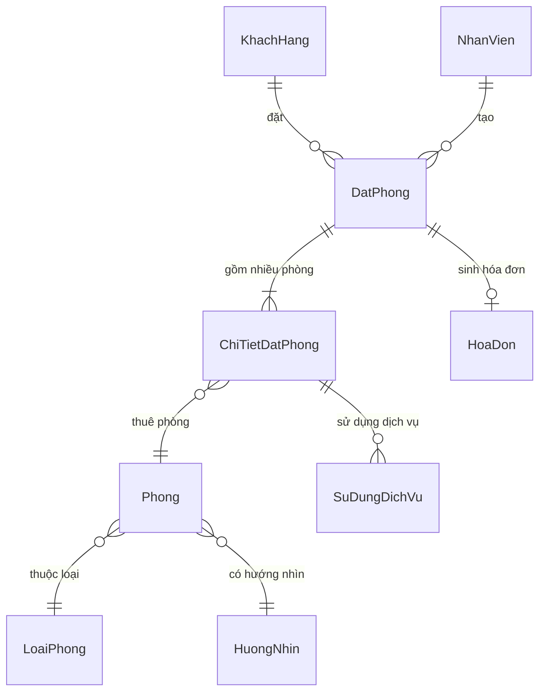
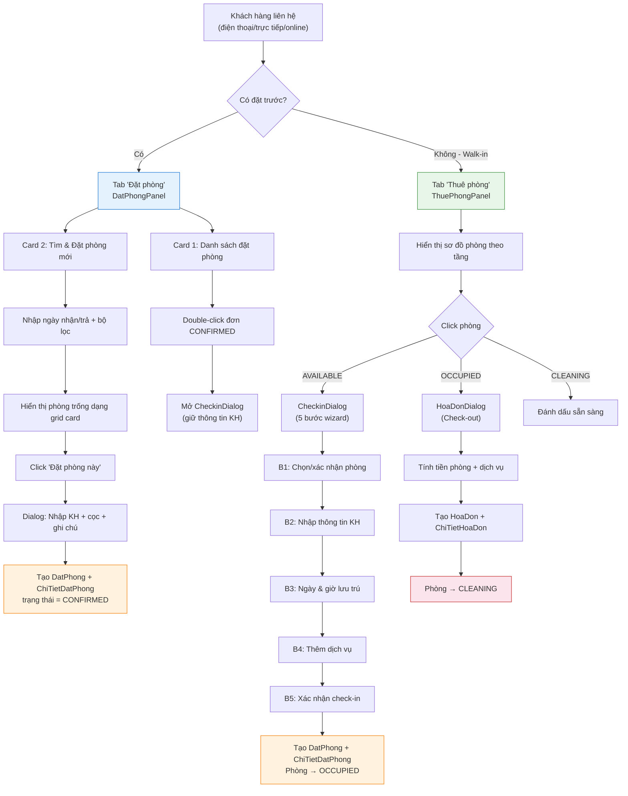
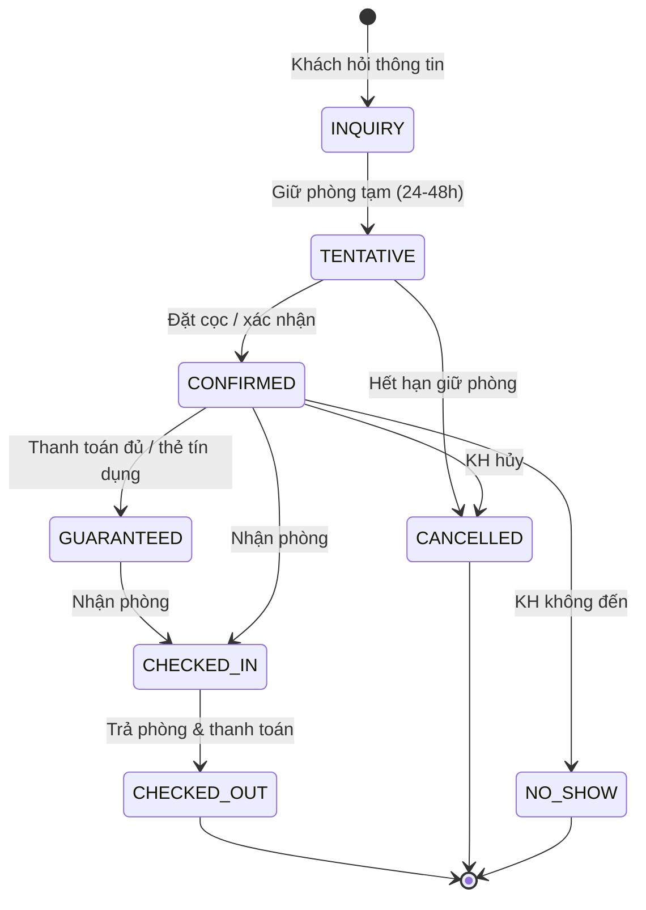
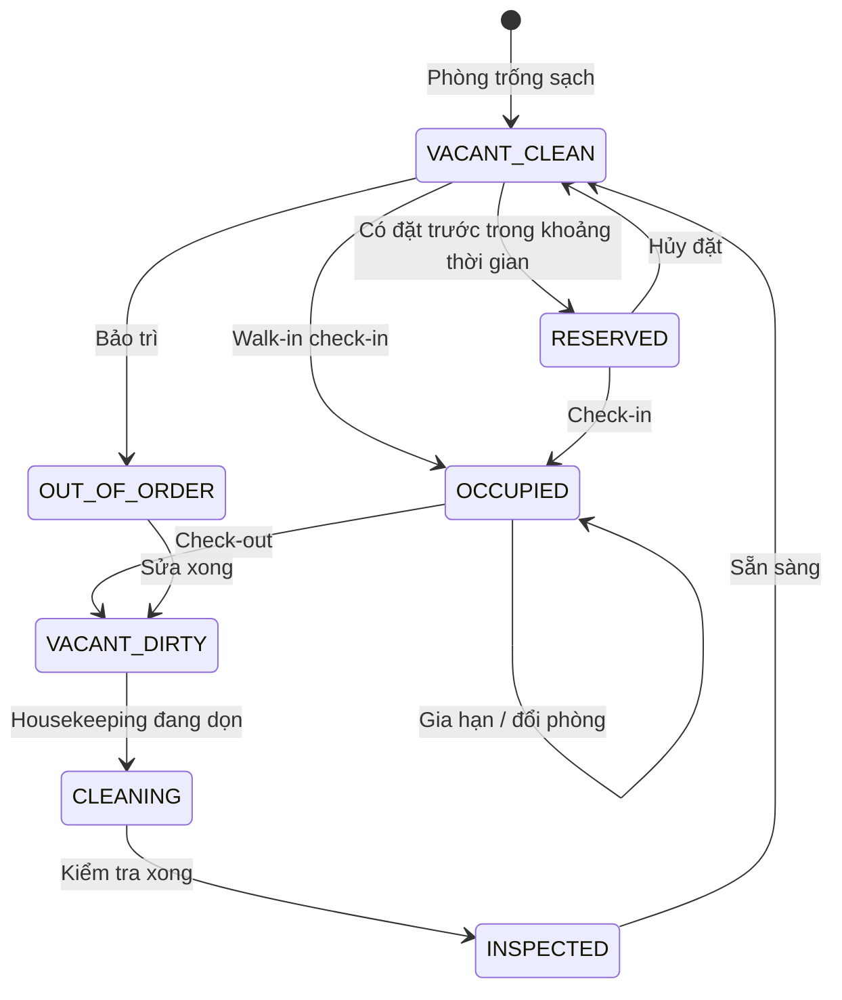
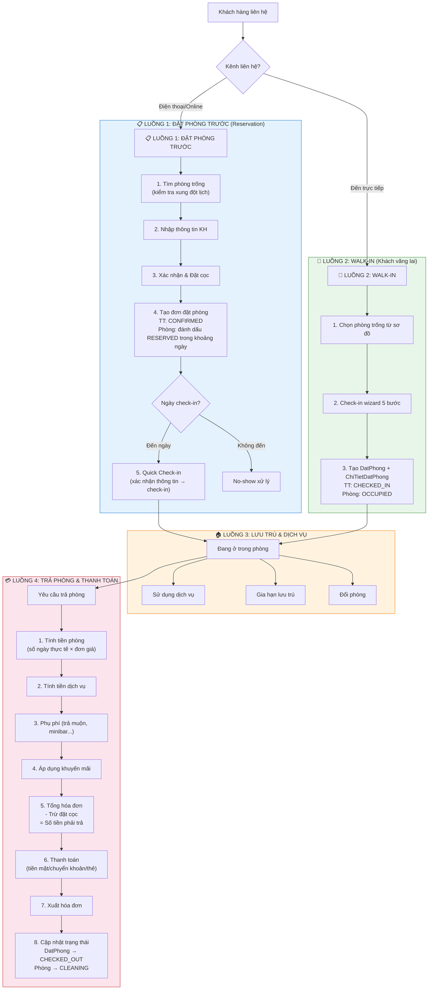

# 🏨 Phân Tích Luồng Đặt Phòng & Thuê Phòng — Hệ Thống Quản Lý Khách Sạn

## 1. Tổng Quan Hệ Thống Hiện Tại

### 1.1 Kiến trúc Entity



### 1.2 Trạng thái hiện có

| Entity | Trạng thái | Giá trị |
|--------|-----------|---------|
| **Phòng** (`TrangThaiPhong`) | 4 trạng thái | `AVAILABLE`, `OCCUPIED`, `MAINTENANCE`, `CLEANING` |
| **Đặt phòng** (`TrangThaiDatPhong`) | 5 trạng thái | `PENDING`, `CONFIRMED`, `CHECKED_IN`, `CHECKED_OUT`, `CANCELLED` |
| **Thanh toán** (`TrangThaiThanhToan`) | 4 trạng thái | `UNPAID`, `PARTIALLY_PAID`, `PAID`, `REFUNDED` |

---

## 2. Luồng Xử Lý Hiện Tại — Phân Tích Chi Tiết

### 2.1 Luồng hiện tại (As-Is)



### 2.2 Những gì đang hoạt động tốt ✅

| # | Feature | Đánh giá |
|---|---------|----------|
| 1 | **5-step Check-in wizard** | Luồng wizard rõ ràng, dễ dùng |
| 2 | **Tìm phòng với bộ lọc đa tiêu chí** | Lọc được tầng, hướng, loại phòng, sức chứa |
| 3 | **Sơ đồ phòng trực quan** | Room grid card + màu sắc trạng thái + WrapLayout |
| 4 | **Tích hợp dịch vụ sử dụng** | Thêm dịch vụ trực tiếp lúc check-in |
| 5 | **Context menu** | Chuột phải → chi tiết, đổi phòng, thêm DV, trả phòng |
| 6 | **Giá động theo hướng nhìn** | `giaThucTe = giaCoSo × heSoHuongNhin` |

### 2.3 Vấn đề & Thiếu sót 🔴

| # | Vấn đề | Mức độ | Mô tả |
|---|--------|--------|-------|
| 1 | **Thiếu trạng thái `RESERVED`** cho phòng | 🔴 Cao | Khi đặt phòng CONFIRMED, phòng vẫn `AVAILABLE` → có thể bị walk-in check-in ngay phòng đã đặt |
| 2 | **Không kiểm tra xung đột đặt phòng** | 🔴 Cao | 2 KH có thể đặt cùng 1 phòng cùng ngày |
| 3 | **Luồng từ Đặt phòng → Check-in chưa liền mạch** | 🟡 Trung bình | Phải double-click dòng table → mở lại CheckinDialog, dữ liệu truyền hạn chế |
| 4 | **Thiếu tính tiền theo giờ** | 🟡 Trung bình | DB có `giaTheoGio` nhưng chưa implement |
| 5 | **Thiếu quản lý No-show** | 🟡 Trung bình | KH đặt rồi không đến, không có cơ chế tự động xử lý |
| 6 | **Thiếu Early check-in / Late check-out** | 🟡 Trung bình | Có phụ phí nhưng chưa hiển thị rõ cho nhân viên |
| 7 | **Entity ThuePhong cũ chưa bị loại bỏ** | 🟢 Thấp | Entity `ThuePhong.java` vẫn tồn tại nhưng service dùng `ChiTietDatPhong` |

---

## 3. Luồng Xử Lý Chuẩn Khách Sạn Thực Tế (PMS)

> Dựa trên các hệ thống PMS phổ biến: Opera PMS (Oracle), Cloudbeds, ezCloud, RoomRaccoon

### 3.1 Vòng đời Reservation (Đặt phòng) theo chuẩn quốc tế



### 3.2 Vòng đời Phòng theo chuẩn PMS



### 3.3 So sánh hiện tại vs chuẩn PMS

| Tính năng | Hệ thống hiện tại | Chuẩn PMS | Gap |
|-----------|-------------------|-----------|-----|
| Đặt phòng trước (Reservation) | ✅ Có | ✅ Có | — |
| Walk-in check-in | ✅ Có | ✅ Có | — |
| Kiểm tra xung đột lịch | ❌ Không | ✅ Có | 🔴 |
| Trạng thái `RESERVED` cho phòng | ❌ Không | ✅ Có | 🔴 |
| Đặt cọc (Deposit) | ✅ Có | ✅ Có | — |
| Tính giờ ở thực tế | ❌ Không | ✅ Có | 🟡 |
| Kéo dài lưu trú (Extend stay) | ❌ Không | ✅ Có | 🟡 |
| No-show handling | ❌ Không | ✅ Có | 🟡 |
| Phụ phí check-in sớm/trả muộn | ⚠️ Có logic, chưa UI | ✅ Có | 🟡 |
| Nhiều phòng cùng 1 đặt phòng | ✅ Có (qua ChiTietDatPhong) | ✅ Có | — |
| Dịch vụ phòng | ✅ Có | ✅ Có | — |
| Hóa đơn chi tiết | ✅ Có | ✅ Có | — |
| Housekeeping workflow | ⚠️ Chỉ có CLEANING | ✅ 3+ bước | 🟡 |
| Khuyến mãi / Giảm giá | ✅ Có (percent/fixed) | ✅ Có | — |
| Bảng giá theo mùa | ✅ Có (BangGia) | ✅ Có | — |
| Lịch phòng (Availability Calendar) | ❌ Không | ✅ Có | 🟡 |

---

## 4. Đề Xuất Luồng Xử Lý Mới (To-Be)

### 4.1 Luồng tổng thể đề xuất



### 4.2 Chi tiết từng luồng

---

#### 📋 LUỒNG 1: ĐẶT PHÒNG TRƯỚC (Reservation Flow)

**Mục đích:** Khách gọi/đặt online, nhân viên tạo đơn đặt phòng trước

| Bước | Tên | Hành động | Thay đổi dữ liệu |
|------|-----|-----------|-------------------|
| 1 | **Tìm phòng trống** | Nhập ngày nhận/trả, số khách, lọc tầng/loại/hướng | Query `findAvailableRooms(from, to)` **có kiểm tra xung đột** |
| 2 | **Chọn phòng** | Click vào card phòng trống | — |
| 3 | **Nhập thông tin KH** | Họ tên, SĐT, CCCD (tìm KH cũ hoặc tạo mới) | Tạo/cập nhật `KhachHang` |
| 4 | **Xác nhận & Đặt cọc** | Chọn mức cọc (0%, 30%, 50%, 100%), ghi chú | — |
| 5 | **Lưu đặt phòng** | Tạo đơn | Tạo `DatPhong` (CONFIRMED) + `ChiTietDatPhong` |
| 6 | **Quick Check-in** | Khi KH đến, double-click đơn → xác nhận nhanh | `DatPhong` → CHECKED_IN, `Phong` → OCCUPIED |

> [!IMPORTANT]
> **Kiểm tra xung đột:** Khi tìm phòng trống, cần loại bỏ các phòng đã có `ChiTietDatPhong` với `DatPhong` ở trạng thái `CONFIRMED` hoặc `CHECKED_IN` mà khoảng thời gian chồng lấn.

**Logic kiểm tra xung đột (cần bổ sung):**
```sql
-- Phòng KHÔNG trống nếu tồn tại ChiTietDatPhong mà:
SELECT DISTINCT p.maPhong
FROM Phong p
WHERE p.maPhong NOT IN (
    SELECT ct.maPhong
    FROM ChiTietDatPhong ct
    JOIN DatPhong dp ON ct.maDatPhong = dp.maDatPhong
    WHERE dp.trangThai IN ('CONFIRMED', 'CHECKED_IN')
      AND dp.ngayNhanDuKien < @ngayTraDuKien  -- bắt đầu trước khi kết thúc mới
      AND dp.ngayTraDuKien  > @ngayNhanDuKien  -- kết thúc sau khi bắt đầu mới
)
AND p.trangThai NOT IN ('MAINTENANCE')
```

---

#### 🚶 LUỒNG 2: WALK-IN (Check-in trực tiếp)

**Mục đích:** Khách đến trực tiếp, chưa đặt trước

| Bước | Tên | Hành động | Thay đổi dữ liệu |
|------|-----|-----------|-------------------|
| 1 | **Chọn phòng** | Click phòng AVAILABLE trên sơ đồ | — |
| 2 | **Nhập thông tin KH** | Quét CCCD, nhập họ tên, SĐT | Tạo/tìm `KhachHang` |
| 3 | **Chọn ngày** | Ngày nhận = NOW, nhập ngày trả dự kiến | — |
| 4 | **Thêm dịch vụ** | (Tùy chọn) chọn dịch vụ ban đầu | — |
| 5 | **Xác nhận** | Review & check-in | Tạo `DatPhong` (CHECKED_IN) + `ChiTietDatPhong`, Phòng → OCCUPIED |

> [!TIP]
> Wizard 5 bước hiện tại đã khá tốt. Cần bổ sung thêm **kiểm tra xung đột** trước khi cho check-in.

---

#### 🏠 LUỒNG 3: LƯU TRÚ & DỊCH VỤ (In-Stay Operations)

**Mục đích:** Quản lý trong thời gian khách ở

| Thao tác | Hiện tại | Đề xuất cải tiến |
|----------|---------|-----------------|
| **Thêm dịch vụ** | ✅ Có (context menu) | Thêm nút trên room card khi OCCUPIED |
| **Đổi phòng** | ✅ Có (context menu) | OK, giữ nguyên |
| **Gia hạn lưu trú** | ❌ Chưa có | 🆕 Cần thêm: cho phép kéo dài ngày trả |
| **Xem lịch sử dịch vụ** | ⚠️ Hạn chế | Cải thiện hiển thị trong HoaDonDialog |

---

#### 💳 LUỒNG 4: TRẢ PHÒNG & THANH TOÁN (Check-out Flow)

**Mục đích:** Kết thúc lưu trú, tạo hóa đơn, thu tiền

| Bước | Tên | Logic |
|------|-----|-------|
| 1 | **Tính tiền phòng** | `soNgay = ceil(hours_between(ngayNhan, ngayTra) / 24)` × `giaThucTeChot` |
| 2 | **Tính tiền dịch vụ** | `Σ (SuDungDichVu.donGiaLuu × soLuong)` |
| 3 | **Phụ phí** | Check-in sớm (<12h: +50k), Check-out muộn (>13h: +50k), minibar... |
| 4 | **Khuyến mãi** | Áp mã giảm giá PERCENT hoặc FIXED |
| 5 | **Trừ đặt cọc** | `cònPhảiTrả = tổng - đặtCọc - khuyếnMãi` |
| 6 | **Thanh toán** | Tiền mặt / Chuyển khoản / QR |
| 7 | **Xuất hóa đơn** | Tạo `HoaDon` + `ChiTietHoaDon` |
| 8 | **Dọn phòng** | `Phong` → `CLEANING`, `DatPhong` → `CHECKED_OUT` |

> [!WARNING]
> **Hiện tại thiếu:** Bước trừ đặt cọc! `HoaDonDialog` chưa trừ `tienDatCoc` từ `DatPhong` trước khi tính tổng thanh toán.

---

## 5. Đề Xuất Cải Tiến Cụ Thể (Ưu Tiên)

### 🔴 Ưu tiên CAO (nên làm ngay)

#### 5.1 Thêm kiểm tra xung đột đặt phòng

**Vấn đề:** `PhongDAO.findAvailableRooms()` hiện tại chỉ check trạng thái phòng, không check lịch đặt trước.

**Giải pháp:** Sửa query SQL trong `PhongDAO.findAvailableRooms()`:

```java
// PhongDAO.java - cải tiến
public List<Phong> findAvailableRooms(LocalDateTime from, LocalDateTime to, int capacity) {
    String sql = """
        SELECT p.*, lp.*, hn.*
        FROM Phong p
        JOIN LoaiPhong lp ON p.maLoaiPhong = lp.maLoaiPhong
        LEFT JOIN HuongNhin hn ON p.maHuongNhin = hn.maHuongNhin
        WHERE p.trangThai NOT IN ('MAINTENANCE')
          AND lp.soNguoiToiDa >= ?
          AND p.maPhong NOT IN (
              SELECT ct.maPhong
              FROM ChiTietDatPhong ct
              JOIN DatPhong dp ON ct.maDatPhong = dp.maDatPhong
              WHERE dp.trangThai IN ('CONFIRMED', 'CHECKED_IN')
                AND dp.ngayNhanDuKien < ?
                AND dp.ngayTraDuKien  > ?
          )
        ORDER BY p.tang, p.maPhong
    """;
    // params: capacity, to, from
}
```

#### 5.2 Trừ đặt cọc khi checkout

**Vấn đề:** `ThuePhongService.checkOut()` không trừ `tienDatCoc` khi tính `tongThanhToan`.

**Giải pháp:**
```java
// Trong ThuePhongService.checkOut():
double datCoc = 0;
if (ct.getDatPhong() != null) {
    datCoc = ct.getDatPhong().getTienDatCoc();
}
double tongThanhToan = tongTienPhong + tongTienDV - tienGiam - datCoc;
hd.setTongThanhToan(Math.max(0, tongThanhToan));
```

### 🟡 Ưu tiên TRUNG BÌNH

#### 5.3 Thêm trạng thái `RESERVED` cho phòng (tùy chọn)

Có 2 cách tiếp cận:

| Cách | Mô tả | Ưu | Nhược |
|------|-------|---|-------|
| **A: Thêm enum** | Thêm `RESERVED` vào `TrangThaiPhong` | Rõ ràng trên sơ đồ | Phức tạp quản lý (1 phòng có thể reserved nhiều khoảng) |
| **B: Kiểm tra runtime** | Giữ 4 enum, nhưng khi hiển thị sơ đồ, check `ChiTietDatPhong` để đánh dấu | Đơn giản hơn | Cần query thêm |

> [!TIP]
> **Khuyến nghị: Cách B** — không cần đổi database hay enum, chỉ cần thêm logic hiển thị trên UI. Room card sẽ hiện badge "Đã đặt" nếu phòng có reservation trong ngày.

#### 5.4 Gia hạn lưu trú (Extend Stay)

Thêm option trong context menu phòng OCCUPIED:
- Cho phép thay đổi `ngayTraDuKien` của `DatPhong`
- Tính lại `tongTienTamTinh`

#### 5.5 No-show handling

- Scheduled task (hoặc khi mở tab đặt phòng): kiểm tra các đơn `CONFIRMED` mà `ngayNhanDuKien` đã qua
- Hiển thị cảnh báo cho nhân viên
- Option: hủy tự động hoặc thủ công

### 🟢 Ưu tiên THẤP (cải thiện UX)

#### 5.6 Hiển thị badge "Đã đặt" trên room card

Trên sơ đồ phòng (`ThuePhongPanel`), nếu phòng AVAILABLE nhưng có reservation trong ngày → hiện badge nhỏ "📅 Đã đặt hôm nay".

#### 5.7 Lịch phòng (Availability Calendar)

Thêm view dạng lịch (timeline/gantt) hiển thị các phòng theo ngày, cho phép kéo thả để đặt phòng.

---

## 6. Tóm Tắt Hành Động

| # | Hành động | File cần sửa | Độ khó | Ưu tiên |
|---|-----------|-------------|--------|---------|
| 1 | Kiểm tra xung đột đặt phòng | `PhongDAO.java`, `DatPhongService.java` | ⭐⭐ | 🔴 |
| 2 | Trừ đặt cọc khi checkout | `ThuePhongService.java`, `HoaDonDialog.java` | ⭐ | 🔴 |
| 3 | Badge "Đã đặt" trên room card | `ThuePhongPanel.java`, `PhongDAO.java` | ⭐⭐ | 🟡 |
| 4 | Gia hạn lưu trú | `ThuePhongPanel.java` (context menu), `DatPhongService.java` | ⭐⭐ | 🟡 |
| 5 | No-show cảnh báo | `DatPhongPanel.java`, `DatPhongService.java` | ⭐⭐ | 🟡 |
| 6 | Lịch phòng timeline | New panel | ⭐⭐⭐⭐ | 🟢 |
| 7 | Xóa entity `ThuePhong.java` cũ | `ThuePhong.java`, `ThuePhongDAO.java` | ⭐ | 🟢 |

---

> [!NOTE]
> **Nhận xét chung:** Hệ thống hiện tại đã có nền tảng tốt — model `DatPhong → ChiTietDatPhong` đúng pattern nhiều-phòng-1-đặt-phòng, Entity liên kết rõ ràng, UI wizard 5 bước chuyên nghiệp. Các cải tiến chính cần tập trung vào **kiểm tra xung đột** và **tích hợp đặt cọc vào checkout** — 2 tính năng quan trọng nhất của bất kỳ PMS nào.

Bạn muốn tôi bắt tay vào implement cải tiến nào trước?
